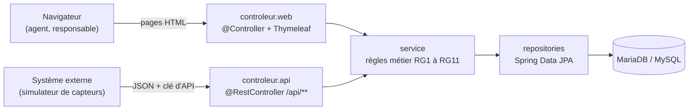
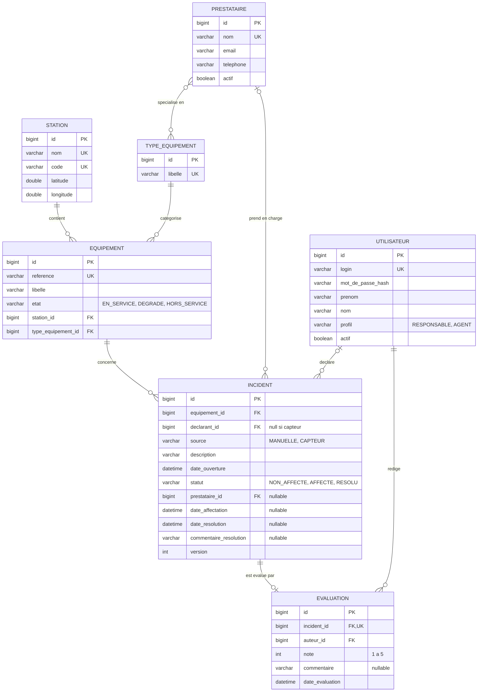

# Journal Downlyzer (ALTN72, 2026-27)

> Supervision d'équipements et suivi d'incidents sur un réseau de transport.

**Groupe :** Ibrahim GHELLAB (seul)

---

## README

### Prérequis
- Java 21
- Maven 3.9+ (ou le wrapper `./mvnw` fourni)
- MariaDB : on a développé et testé avec MariaDB 10.4 (celle de XAMPP), mais une version 10.6 ou plus est conseillée (voir Limites connues). La version en ligne tourne sur MySQL 8.
- Spring Boot 4.1.1, la même pile que le TP fil rouge

### Initialiser la base de données
1. Créer la base, son schéma et les données de démonstration (en `root`) :
   ```bash
   mariadb -u root -p < db/create.sql
   ```
   Le script supprime puis recrée toutes les tables. On peut donc le relancer autant de fois qu'on veut, il remet toujours la base dans son état de démonstration. On peut aussi l'importer depuis phpMyAdmin (onglet Importer).

2. Créer un compte pour l'application, limité aux données de cette base :
   ```sql
   CREATE USER 'downlyzer_app'@'localhost' IDENTIFIED BY 'un_mot_de_passe';
   GRANT SELECT, INSERT, UPDATE, DELETE ON downlyzer.* TO 'downlyzer_app'@'localhost';
   ```
   L'application n'a aucun droit global et ne peut pas modifier la structure des tables : c'est le script, lancé en `root`, qui les crée.

Les dates des incidents sont calculées par rapport au moment où on lance le script (`NOW() - INTERVAL 47 HOUR`, etc.). Il faut donc **relancer le script juste avant une démonstration**, sinon les cas limites (47 h, 48 h, 72 h) ne tombent plus juste.

### Configuration
Aucun secret n'est dans le dépôt. Les variables d'environnement sont à définir avant de lancer l'application (dans IntelliJ : *Run → Edit Configurations → Modify options → Environment variables*, sans cocher « Store as project file ») :

| Variable | Rôle | Obligatoire |
|---|---|---|
| `DB_USERNAME` | utilisateur MariaDB (ex. `downlyzer_app`) | oui |
| `DB_PASSWORD` | mot de passe de cet utilisateur | oui |
| `DB_URL` | URL JDBC ; par défaut `jdbc:mariadb://localhost:3306/downlyzer` | non |
| `DOWNLYZER_API_KEY` | clé demandée aux systèmes externes sur l'API REST (en-tête `X-API-KEY`) ; une longue valeur aléatoire, par exemple avec `openssl rand -hex 24` | pour utiliser l'API |

Sans `DB_USERNAME` ou `DB_PASSWORD`, l'application refuse de démarrer (`Could not resolve placeholder`). Sans `DOWNLYZER_API_KEY`, elle démarre, mais l'API refuse toutes les requêtes (401) et un avertissement le dit au démarrage.

### Lancer l'application
```bash
mvn spring-boot:run
```
Puis ouvrir http://localhost:8080. La documentation de l'API est sur http://localhost:8080/swagger-ui.html (bouton « Authorize » pour mettre la clé d'API avant d'essayer une requête).

### Essayer l'API et le simulateur de capteurs (piste 8)
- `requetes.http`, à la racine : toutes les requêtes de l'API (succès et erreurs), à lancer depuis IntelliJ. La clé est lue dans un fichier `http-client.private.env.json` qui n'est pas dans le dépôt (son contenu est expliqué en haut de `requetes.http`).
- Le simulateur envoie des pannes à intervalles réguliers, comme des capteurs posés sur les équipements :
  ```bash
  java simulateur/SimulateurCapteurs.java 5
  ```
  (5 signalements ; la variable `DOWNLYZER_API_KEY` doit être définie dans le terminal). Les incidents créés apparaissent tout de suite dans le tableau de bord. Pour viser la version en ligne, on ajoute l'adresse : `java simulateur/SimulateurCapteurs.java 5 https://downlyzer.onrender.com`.

### Lancer les tests
```bash
mvn verify
```
Les tests unitaires et les tests des pages n'ont besoin ni de base ni de variables d'environnement. Seul `DownlyzerApplicationTests` (qui vérifie que toute l'application démarre) se connecte à la base : il faut que MariaDB soit lancée et que `DB_USERNAME` et `DB_PASSWORD` soient définies, comme pour lancer l'application.

Tous les tests, `DownlyzerApplicationTests` compris, sont aussi lancés par GitHub Actions, sur MariaDB et sur MySQL, à chaque push sur `master` et sur chaque pull request (onglet *Actions* du dépôt, fichier `.github/workflows/tests.yml`).

### Comptes de test

| Profil | Login | Mot de passe |
|---|---|---|
| Responsable d'exploitation | `claire.martin` | `Supervision2026!` |
| Agent de station | `karim.dupont` | `Terrain2026!` |

Les mots de passe sont stockés hachés en BCrypt dans la base.

### Données de démonstration
- 6 stations, 5 types d'équipement, 16 équipements, 5 prestataires.
- Des incidents non affectés pour tous les cas limites de RG3 : 2 h, 47 h, 47 h 59 (vert) ; 48 h pile, 60 h, 71 h 59 (orange) ; 72 h pile, 5 jours (rouge).
- 3 incidents affectés, dont un ouvert depuis 80 h (il ne doit pas être rouge, RG4).
- 10 incidents résolus sur les 4 dernières semaines, dont deux résolus sans prestataire (non évaluables) et deux résolus pas encore évalués (pour montrer F10), plus un incident résolu vieux de 45 jours.
- `ESC-003` est un équipement fragile (3 incidents sur 30 jours) avec un incident en cours : le badge se voit sur sa fiche et au tableau de bord. `DIS-001` a 2 incidents récents et 1 vieux de 45 jours : il n'est pas fragile.
- Plusieurs incidents déclarés par un capteur (`source = CAPTEUR`, sans déclarant).
- L'état des équipements colle à leurs incidents : un équipement qui a un incident en cours est hors service ou dégradé.
- Toutes les données sont inventées : noms de stations et de prestataires fictifs, adresses e-mail en `.example` (un domaine réservé à la documentation, qui ne peut appartenir à personne), coordonnées prises dans Paris pour la carte (piste 4).

### Application déployée
- URL : **https://downlyzer.onrender.com** (documentation de l'API : https://downlyzer.onrender.com/swagger-ui.html)
- Comptes : les mêmes que plus haut (Comptes de test).
- Hébergement : l'application sur Render (construite à partir du `Dockerfile`), la base sur Aiven (MySQL 8).
- L'offre gratuite de Render met l'application en veille après 15 minutes sans visite : **le premier chargement peut prendre une minute environ**, ensuite c'est immédiat.
- Pour charger ou remettre à zéro les données de démonstration sur la base en ligne, depuis la racine du projet (PowerShell) :
  ```powershell
  $env:DB_ADMIN_URL = "jdbc:mariadb://<hôte>:<port>/?sslMode=verify-full&serverSslCert=db/aiven-ca.pem"
  $env:DB_ADMIN_USERNAME = "avnadmin"
  $env:DB_ADMIN_PASSWORD = "<mot de passe avnadmin, console Aiven>"
  $env:DB_PASSWORD = "<mot de passe choisi pour downlyzer_app>"
  java -cp "$HOME\.m2\repository\org\mariadb\jdbc\mariadb-java-client\3.5.10\mariadb-java-client-3.5.10.jar" db/ChargementBase.java
  ```
  Le programme lance `db/create.sql` dans le fuseau de Paris (heure d'hiver), le même que celui de l'application. Sans ça, `NOW()` serait en UTC et tous les incidents seraient décalés d'une heure. Il crée ensuite le compte `downlyzer_app`, ou change son mot de passe s'il existe déjà. Le jar du pilote est celui que Maven a téléchargé pour l'application (`./mvnw package` le télécharge s'il manque).

### Limites connues
- Le script de données utilise `NOW()` de la base et l'application l'heure de la JVM : les deux doivent être dans le **même fuseau horaire**, sinon les seuils sont décalés (un incident de 47 h pourrait passer orange).
- MariaDB 10.4 (celle de XAMPP) n'est plus officiellement prise en charge par Hibernate 7, qui affiche un avertissement au démarrage (minimum 10.6). L'application marche quand même. En ligne, sur MySQL 8.4, on a le même genre d'avertissement (`HHH000511`), parce qu'Hibernate garde le dialecte MariaDB qu'il déduit du pilote (voir CHOIX TECHNIQUES, Déploiement).
- Bootstrap, Leaflet et le fond de carte OpenStreetMap sont chargés depuis Internet. Sans connexion, les pages marchent mais sans mise en forme, et l'onglet Carte reste vide (l'onglet Liste donne les mêmes infos).
- L'état « Dégradé » d'un équipement n'est jamais mis automatiquement (voir CHOIX TECHNIQUES, F7-F8) : il n'existe que dans les données de démonstration.
- Les équipements d'une station (F2) ne sont pas triés : la base les renvoie dans l'ordre qu'elle veut.

---

## ARCHITECTURE

- Dépôt : https://github.com/ibrahimghellab/Downlyzer

### Architecture applicative



Les deux types de contrôleurs appellent le même service : la logique métier n'est écrite qu'une fois.

Organisation des packages (`fr.efrei.downlyzer`) :

| Package | Contenu |
|---|---|
| `modele` | énumérations communes (`StatutIncident`, `EtatEquipement`, `Profil`, `SourceIncident`, `NiveauAttention`) |
| `modele.<entité>` (`station`, `equipement`, `incident`…) | une entité JPA et son repository Spring Data |
| `exception` | exceptions métier (`ExceptionMetier` et ses sous-classes) |
| `service` | règles de gestion (`IncidentService`, `EvaluationService`, `TableauDeBordService`, `StationService`, `EquipementService`, `PolitiqueUrgence`, `PolitiqueFragilite`) et les objets qu'ils renvoient aux pages (`SituationStation`, `LigneTableauDeBord`, `IndicateursTableauDeBord`) |
| `securite` | configuration Spring Security et chargement de l'utilisateur connecté |
| `configuration` | beans techniques (l'horloge `Clock`, la documentation de l'API) |
| `controleur.web` | pages Thymeleaf, gestionnaire d'erreurs des pages, contrôleur d'erreur |
| `controleur.web.formulaire` | objets qui reçoivent les saisies des formulaires |
| `controleur.api` | API REST (`IncidentApiControleur`) et son gestionnaire d'erreurs JSON |
| `controleur.api.dto` | objets échangés avec les systèmes externes (`IncidentDto`, `DeclarationCapteurDto`, `ResolutionDto`) |

- **`controleur.web`** : les pages de l'application, pour les deux profils. Après une modification, on redirige (Post/Redirect/Get) ; en cas d'erreur, on affiche une page lisible avec le bon code HTTP.
- **`controleur.api`** : l'API REST pour l'extérieur (F12 et piste 8). Elle n'expose qu'une partie de la logique métier, renvoie du JSON (des DTO, jamais les entités) et des codes HTTP adaptés (200, 201, 204, 400, 404, 409).
- **Chaque repository est à côté de son entité** (`modele.incident.Incident` et `modele.incident.IncidentRepository`) au lieu d'un package `repository` commun : on trouve au même endroit une donnée et la façon d'y accéder. Les couches restent séparées pareil : un contrôleur n'utilise jamais un repository, il passe toujours par un service.

| Endpoint | Usage | Codes |
|---|---|---|
| `GET /api/incidents` | consulter les incidents, du plus récent au plus ancien ; `?statut=RESOLU` pour filtrer | 200, 400 (statut inconnu), 401 |
| `GET /api/incidents/{id}` | consulter un incident | 200, 400 (identifiant non numérique), 401, 404 |
| `POST /api/incidents` | un capteur déclare une panne, en donnant la référence de l'équipement | 201 + `Location`, 400, 401, 404 (référence inconnue), 409 (incident déjà en cours) |
| `PATCH /api/incidents/{id}/resolution` | signaler le retour en service (corps et commentaire facultatifs) | 204, 401, 404, 409 (déjà résolu) |

Toutes les erreurs de l'API sont renvoyées en JSON au format `ProblemDetail` (RFC 9457) : `status`, `title`, `detail`, et pour un 409 de déclaration, `incidentExistant`.

### Pages de l'application

| URL | Fonctionnalité | Profil |
|---|---|---|
| `GET /connexion` | F1 : connexion (le `POST` est géré par Spring Security) | tous |
| `GET /` | accueil : envoie le responsable sur `/tableau-de-bord` et l'agent sur `/stations` | connecté |
| `GET /tableau-de-bord` | F11 : incidents en cours, filtres (`stationId`, `typeEquipementId`, `niveau`, `ordre`) et indicateurs | responsable |
| `GET /stations` | liste des stations triée par nom (onglet « Liste ») ; le niveau d'attention n'est montré qu'au responsable | connecté |
| `GET /stations?vue=carte` | piste 4 : carte des stations et de leur situation (onglet « Carte ») | responsable |
| `GET /stations/{id}` | F2 : équipements de la station | connecté |
| `GET /equipements/{id}` | F3 : fiche de l'équipement et ses incidents | connecté |
| `GET /equipements/{id}/incidents/nouveau`, `POST /equipements/{id}/incidents` | F4 : déclarer un incident sur cet équipement | connecté |
| `GET /incidents/{id}` | F5 : détail d'un incident | connecté |
| `GET`, `POST /incidents/{id}/description` | F6 : modifier la description | selon l'état de l'incident (voir droits) |
| `POST /incidents/{id}/affectation` | F7 : affecter ou réaffecter un prestataire | responsable |
| `POST /incidents/{id}/resolution` | F8 : déclarer l'incident résolu | responsable |
| `GET /historique` | F9 : historique des incidents résolus | connecté (lecture seule) |
| `POST /incidents/{id}/evaluation` | F10 : évaluer l'intervention du prestataire | responsable |
| `POST /deconnexion` | F1 : déconnexion | connecté |

La déclaration d'un incident est rangée sous l'équipement (`/equipements/{id}/incidents`) parce qu'on déclare toujours un incident depuis un équipement précis (F4). Une fois créé, l'incident a sa propre adresse (`/incidents/{id}`), qui ne dépend plus de l'équipement.

### Modèle de données



Choix de modélisation (le sujet laisse le groupe enrichir le modèle minimal du §4) :
- **L'indicateur vert / orange / rouge n'est pas stocké** : on le calcule à partir de l'heure courante, comme la durée d'ouverture et la note moyenne d'un prestataire.
- **Le statut est stocké** (enum) pour que les requêtes restent lisibles. Sa cohérence est protégée à deux endroits : on ne le change que par des méthodes métier (`affecter()`, `resoudre()`), et une contrainte `CHECK` en base refuse toute combinaison qui n'a pas de sens (RG2).
- **`source` et `declarant_id` nullable** : un capteur peut déclarer un incident par l'API (piste 8), et ce n'est pas un utilisateur humain. Une contrainte `CHECK` oblige quand même à avoir un déclarant quand l'incident est saisi à la main.
- **`date_affectation`** : pour afficher depuis quand un incident est pris en charge et mesurer les délais.
- **`commentaire_resolution`** (facultatif) : garde une trace de ce qui a été fait, utile dans l'historique (F9) et pour évaluer le prestataire (F10).
- **`version`** : verrouillage optimiste (`@Version`) contre deux modifications en même temps d'un même incident.
- **`prestataire_specialite`** : relie les prestataires aux types d'équipement sur lesquels ils interviennent. Elle sert dès F7 (on ne propose que les prestataires spécialisés).
- **`type_equipement` est une table** et pas un texte libre dans `equipement` : chaque type est écrit une seule fois, sans faute de frappe possible, et on peut le relier aux spécialités des prestataires et s'en servir comme filtre.
- **L'état d'un équipement a trois valeurs** (`EN_SERVICE`, `DEGRADE`, `HORS_SERVICE`) : « dégradé » distingue un équipement qui marche en partie (deux portiques sur cinq bloqués) d'un équipement à l'arrêt.
- **Station : un `code` court** (`GCE`, `HDV`…) en plus du nom, unique, pour un affichage compact dans les listes, et des **coordonnées** pour la carte (piste 4).
- **Prestataire : e-mail et téléphone séparés** (le sujet demande « de quoi le contacter ») et un booléen **`actif`** : un prestataire avec qui on ne travaille plus n'est plus proposé, sans perdre son historique.
- **Utilisateur : un `nom`** en plus du prénom (affiché pour le déclarant d'un incident) et un booléen **`actif`** : un compte désactivé ne peut plus se connecter, mais on garde la trace de ses déclarations.
- **Évaluation : un `auteur`**, pour savoir quel responsable a noté l'intervention.

Choix techniques du script `db/create.sql` :
- **Énumérations en `VARCHAR` + `CHECK`** au lieu du type `ENUM` natif : c'est du SQL standard, qui marche avec d'autres bases (§7.1), et les valeurs restent lisibles dans phpMyAdmin. On avait mis `@JdbcTypeCode(SqlTypes.VARCHAR)` sur les champs enum par précaution ; en essayant sans, on a vu qu'Hibernate acceptait déjà ces colonnes, donc on l'a enlevé.
- **Identifiants `BIGINT AUTO_INCREMENT`**, en `Long` côté Java avec `GenerationType.IDENTITY` : c'est la base qui donne les identifiants.
- **Moteur InnoDB et encodage `utf8mb4`** : InnoDB est le seul moteur de MariaDB qui gère les transactions et les clés étrangères, et `utf8mb4` accepte tous les caractères (accents, apostrophes typographiques).
- **Contraintes nommées** (`uk_equipement_reference`, `ck_incident_statut`…) : quand la base renvoie une erreur, on voit tout de suite quelle règle a été violée.
- **Index sur `incident.statut` et `incident.date_resolution`** : le tableau de bord filtre sur le statut, l'historique trie sur la date de résolution.
- **`DROP TABLE IF EXISTS` puis `CREATE TABLE`** : le script remet la base dans un état connu à chaque fois (§7.6).

Contraintes en base :

| Contrainte | Règle |
|---|---|
| `UNIQUE (equipement.reference)` | RG9 |
| `UNIQUE (evaluation.incident_id)`, `CHECK (note BETWEEN 1 AND 5)` | RG8 |
| `CHECK (date_resolution >= date_ouverture)` | RG5 |
| `NOT NULL` sur `equipement_id`, `date_ouverture`, `statut` | RG1 |
| `CHECK` de cohérence statut / prestataire / dates | RG2 |
| `UNIQUE (utilisateur.login)` | F1 |

Ces contraintes ne remplacent pas les vérifications du service : elles évitent juste qu'une erreur de programmation laisse la base dans un état incohérent.

---

## TESTS

- **Stratégie** : les règles métier sont testées par des tests unitaires des services, sans base de données. Les repositories sont simulés avec Mockito et l'horloge est figée (`Clock.fixed`), pour que les durées ne dépendent pas du moment où on lance les tests.
  - Les simulations sont créées avec `mock(...)` dans un `@BeforeEach`, et le service est construit à la main avec `new IncidentService(...)`. Le test ne démarre pas Spring, il tourne en une fraction de seconde, et on voit dans le test exactement de quoi le service dépend.
  - Les entités utilisées dans les tests sont de vrais objets (`Incident.declarerManuellement(...)`, `affecter(...)`) et pas des simulations : les règles d'`Incident` (RG1, RG2, RG5) sont donc testées en même temps que celles du service.
- **Les pages sont testées avec `@WebMvcTest` et MockMvc**, et pas avec `@SpringBootTest` :
  - `@WebMvcTest` ne démarre que la couche web (les contrôleurs choisis, les `@ControllerAdvice` et la configuration de sécurité, importée avec `@Import(SecuriteConfiguration.class)`), sans serveur ni base. Un `@SpringBootTest` démarrerait toute l'application et aurait besoin de MariaDB : les tests seraient plus lents et planteraient sur une machine sans base.
  - Le service est remplacé par une simulation (`@MockitoBean`), parce que ses règles sont déjà couvertes par ses propres tests. On ne vérifie que ce qui dépend du contrôleur : code HTTP, page affichée, redirection, validation du formulaire, droits d'accès et CSRF.
  - L'utilisateur connecté est simulé avec `spring-security-test` (`user(new UtilisateurConnecte(...))`), ce qui évite de passer par le formulaire de connexion dans chaque test ; `csrf()` ajoute le jeton que Spring Security demande sur les formulaires.
  - On vérifie le contenu de la page avec quelques textes attendus (`containsString`), pour être sûr que le template s'affiche vraiment sans erreur.
- **Noms des tests** : chaque méthode est nommée comme une phrase qui dit le comportement attendu (`unAgentNePeutPlusModifierLaDescriptionDUnIncidentAffecte`), comme dans la fiche *Nommage* : quand un test échoue, on sait direct quelle règle est cassée.
- Commande : `mvn verify` (voir README pour `DownlyzerApplicationTests`, qui a besoin de la base).
- **Intégration continue avec GitHub Actions** (un outil cité par la piste 7 du lot alpha, qui ne fait pas partie de nos deux pistes) : à chaque push sur `master` et sur chaque pull request, GitHub lance `./mvnw -B verify` sur une machine neuve, avec MariaDB puis avec MySQL. Un oubli (fichier pas commité, test cassé, truc qui ne marche que sur notre poste) se voit tout de suite, et la croix rouge ou la coche verte reste attachée à chaque commit dans l'historique.
  - **Une vraie base dans le job** (conteneur `services`) au lieu de sauter `DownlyzerApplicationTests` : c'est le seul test qui démarre toute l'application, et avec `ddl-auto=validate` il vérifie que les entités correspondent exactement au schéma de `db/create.sql`. C'est justement l'erreur qu'un commit peut introduire sans qu'aucun test unitaire ne la voie.
  - **La base est créée par le même `db/create.sql` et le même compte `downlyzer_app`** (mêmes droits) qu'en local : la CI teste la procédure du README, pas une configuration à part. Le script est envoyé au client du conteneur (`mariadb` ou `mysql`, avec `docker exec`), pour ne pas dépendre du client installé sur la machine de GitHub.
  - **Deux jobs en parallèle, un sur MariaDB 11.4 et un sur MySQL 8.4** (`matrix`) : MariaDB comme en local, MySQL comme la base en ligne (voir CHOIX TECHNIQUES, Déploiement). Le même script, le même compte et les mêmes tests doivent passer sur les deux, et on ne pouvait pas le vérifier sur notre poste. On a pris MariaDB 11.4 et MySQL 8.4 parce que ce sont les versions maintenues à long terme, au-dessus du minimum d'Hibernate 7. Avec `fail-fast: false`, si un job échoue, l'autre va quand même jusqu'au bout : on sait si le problème vient d'une seule base ou des deux. Côté MySQL, l'URL ajoute `sslMode=trust` parce que MySQL 8 n'envoie le mot de passe que sur une connexion chiffrée. Vérifier le certificat n'aurait pas de sens pour un conteneur créé juste pour le job.
  - **Mots de passe écrits en clair dans le fichier du workflow** : la base n'existe que le temps du job, sur une machine jetable, et personne d'autre ne peut la joindre. Ce ne sont pas des secrets ; les vrais (base en ligne, clé d'API) ne sont jamais dans le dépôt. `DOWNLYZER_API_KEY` n'est pas définie : l'application démarre quand même, l'API refuse juste tout (c'est testé à part avec MockMvc).
  - **`cache: maven`** dans `setup-java` : les dépendances sont gardées d'un job à l'autre tant que `pom.xml` ne change pas, ça évite de tout retélécharger à chaque push.
  - **Droit d'exécution ajouté à `mvnw` dans Git** (`git update-index --chmod=+x`) : le fichier avait été ajouté depuis Windows sans ce droit, et `./mvnw` ne se lançait pas sous Linux.
- Couvert :
  - service des incidents (`IncidentServiceTest`, 22 tests) : déclaration par un capteur (source `CAPTEUR`, sans déclarant, équipement hors service), référence inconnue, pas de doublon quand l'équipement a déjà un incident en cours, liste de l'API avec ou sans statut ;
    - F4 : un incident déclaré démarre non affecté, à l'heure de l'horloge, et l'équipement passe hors service ;
    - F5-F6 : droits de modification de la description (agent ou responsable, incident non affecté, affecté ou résolu), incident inexistant, durée d'ouverture (incident en cours ou résolu) ;
    - F7 : affectation d'un prestataire spécialisé, réaffectation (l'ancien prestataire n'est plus proposé), refus d'un prestataire non proposé, refus d'affecter un incident résolu (RG5), seul le responsable peut affecter et résoudre ;
    - F8 : date de résolution et commentaire enregistrés, équipement remis en service s'il n'a plus d'incident en cours, ou laissé hors service sinon, commentaire vide enregistré comme absent, refus de résoudre deux fois ;
    - F9 : l'historique demande les incidents résolus triés par date de résolution décroissante.
  - tableau de bord (`TableauDeBordServiceTest`, 14 tests) : regroupement en une colonne par niveau dans l'ordre d'urgence en gardant le tri choisi, colonne vide présente ; tri par défaut du plus urgent au moins urgent (et du plus ancien au plus récent à niveau égal), un incident pris en charge passe après les incidents en attente même s'il est plus ancien (RG4), tri par station puis par urgence, tri du plus récent au plus ancien, filtre par niveau, filtres par station et par type transmis à la requête, absence de filtre, indicateurs (incidents en cours, en attente, rouges, pris en charge, équipements hors service, délai moyen converti en durée), délai moyen absent quand rien n'a été résolu, répartition par niveau (nombres et pourcentages dans l'ordre d'urgence), répartition sans division par zéro quand il n'y a aucun incident.
  - politique d'urgence (`PolitiqueUrgenceTest`, 5 tests) : exactement les cas du §7.8, c'est-à-dire 2 h, 47 h et 47 h 59 min 59 s vert ; 48 h pile et 71 h 59 min 59 s orange ; 72 h pile et 5 jours rouge ; un incident affecté depuis 1 h ou ouvert depuis 80 h est « pris en charge » (RG4) ; un incident résolu n'a pas de niveau (RG6). Les tests construisent la vraie classe avec `new`, sans Spring ni simulation : elle ne dépend que de l'incident et de l'heure.
  - situation des stations (`StationServiceTest`, 4 tests) : une station prend le niveau de son incident le plus urgent, un incident en attente passe avant un incident pris en charge, une station dont tous les incidents sont affectés est « prise en charge », une station sans incident n'a pas de niveau.
  - service des évaluations (`EvaluationServiceTest`, 8 tests) : évaluation enregistrée avec l'auteur connecté et la date de l'horloge, refus pour un incident non résolu ou résolu sans prestataire, une seule évaluation par incident, note de 1 à 5 (0 et 6 refusés, 1 et 5 acceptés), commentaire vide enregistré comme absent, seul le responsable peut évaluer, notes moyennes rangées par prestataire (RG8, F10).
  - API (`IncidentApiControleurTest`, 16 tests) : 401 en JSON sans clé ou avec une fausse clé, 403 pour un utilisateur des pages, liste des incidents en JSON sans champ interne, filtre par statut, statut inconnu (400), incident inexistant (404 en JSON), identifiant non numérique (400), panne signalée par un capteur (201 et `Location`), déclaration invalide (400 avec chaque champ), corps qui n'est pas du JSON (400), référence inconnue (404), panne déjà signalée (409 avec l'incident existant), retour en service avec ou sans corps (204), incident déjà résolu (409).
  - pages (`IncidentControleurTest`, 27 tests) :
    - accès refusé sans connexion, détail d'un incident (F5) avec ou sans lien de modification, enregistrement d'une description valide, formulaire réaffiché si la description est trop courte, refus d'un envoi sans jeton CSRF ;
    - F7-F8 : formulaires visibles pour le responsable et absents pour l'agent, affectation et résolution qui ramènent au détail avec un message, affectation sans prestataire réaffichée avec l'erreur, prestataire non proposé (400), agent qui essaie d'affecter ou de résoudre (403) ;
    - F9-F10 : historique affiché avec ses incidents et le badge « À évaluer », formulaire d'évaluation visible pour le responsable, évaluation enregistrée avec un message, note invalide réaffichée avec l'erreur, agent qui essaie d'évaluer (403), seconde évaluation (409) ;
    - tableau de bord (`TableauDeBordControleurTest`, 12 tests) : par défaut, les incidents sont rangés en colonnes sous la phrase de situation, sans tableau ; une colonne de plus de 6 incidents renvoie vers la liste filtrée sur son niveau ; la vue en liste affiche le tableau et les badges de niveau ; en vue par niveau, le filtre par niveau n'est pas appliqué ; la barre de répartition n'affiche que les niveaux présents, avec leur infobulle, et la légende les donne tous ; le responsable voit les incidents en cours, leur niveau, leur durée et les indicateurs ; un agent reçoit un 403 ; les filtres choisis sont transmis au service ; un filtre invalide dans l'URL est ignoré au lieu de faire une erreur ; après la connexion, le responsable arrive sur le tableau de bord et l'agent sur les stations ;
    - stations (`StationControleurTest`, 5 tests) : le responsable voit la situation de chaque station et l'onglet Carte ; l'agent voit les stations et leur nombre d'incidents, sans niveau d'attention ni onglet Carte ; l'onglet carte charge Leaflet et transmet la position et le niveau de chaque station ; un agent qui demande la carte reçoit un 403 ; une valeur d'onglet inconnue affiche la liste ;
    - pages d'erreur : 404 (incident inexistant, identifiant non numérique, URL inconnue), 403, 409, et erreur imprévue affichée sans détail technique.
  - équipement fragile : voir la section Évolution séance finale (`PolitiqueFragiliteTest`, 10 tests ; `EquipementServiceTest`, 3 tests ; `EquipementControleurTest`, 2 tests ; et les tests ajoutés aux classes ci-dessus).
- Pas couvert :
  - les équipements d'une station et le reste de la fiche équipement (F2-F3) : ce sont de simples lectures, sans règle ;
  - le JavaScript de la carte (placement des points, couleurs, bulles) : vérifié à la main dans le navigateur ;
  - la connexion réelle (`UtilisateurDetailsService` et le contrôle du mot de passe BCrypt) : vérifiée à la main avec les deux comptes de test ;
  - les résultats des repositories, des requêtes JPQL et de la requête SQL native : la CI démarre bien l'application sur une vraie base, mais aucun test ne vérifie ce que renvoient les requêtes (il faudrait des `@DataJpaTest` avec des données de test). La requête native a été vérifiée à la main dans MariaDB. RG6 (un incident résolu n'apparaît plus parmi les incidents en cours) repose sur la requête `trouverEnCours`, testée seulement dans l'application. L'ordre de l'historique (RG7) ne tient qu'au choix de la requête (`findByStatutOrderByDateResolutionDesc`), et la moyenne des notes (`AVG`) n'a été vérifiée qu'à la main dans l'application ;
  - l'atomicité réelle des opérations `@Transactional` (RG10) : les tests unitaires utilisent des simulations, ils vérifient les règles mais pas l'annulation en base en cas d'erreur.

---

## CHOIX TECHNIQUES

### Profils et droits

Deux profils :
- **Responsable d'exploitation** : il gère le réseau. Il décide des affectations, valide les résolutions, évalue les prestataires et supervise la situation.
- **Agent de station** : il est sur le terrain. Il consulte les équipements et signale les pannes.

| N° | Fonctionnalité | Responsable d'exploitation | Agent de station |
|---|---|---|---|
| Accueil | Liste des stations | Accès complet, avec le niveau d'attention de chaque station | Lecture seule : nombre d'incidents en cours, sans niveau d'attention |
| F2-F3 | Consulter équipements et fiches | Accès complet | Accès complet |
| F4 | Déclarer un incident | Accès complet | Accès complet |
| F5-F6 | Consulter / modifier un incident | Accès complet | Consultation ; modification de la description tant que l'incident n'est pas affecté |
| F7 | Affecter ou réaffecter un prestataire | Accès complet | Interdit |
| F8 | Déclarer un incident résolu | Accès complet | Interdit |
| F9 | Consulter l'historique | Accès complet | Lecture seule |
| F10 | Évaluer un prestataire | Accès complet | Interdit |
| F11 | Tableau de bord | Accès complet | Interdit |
| Alpha 2 | Barre de répartition (dans le tableau de bord) | Accès complet | Interdit |
| Alpha 4 | Carte des stations (onglet de la page Stations) | Accès complet | Interdit |

Pourquoi :
- La résolution est réservée au responsable, parce que c'est elle qui ouvre l'évaluation du prestataire (RG8) : elle revient à celui qui gère les prestataires.
- **Les niveaux d'attention (vert, orange, rouge, pris en charge) ne sont montrés qu'au responsable**, sur la liste des stations comme sur la carte et le tableau de bord. Ils disent depuis combien de temps un incident attend un prestataire : c'est un outil de pilotage, et seul le responsable peut agir dessus en affectant quelqu'un. Les montrer à l'agent sur la page Stations lui aurait donné par une autre porte l'info du tableau de bord, qui lui est interdit (F11).
- **L'agent voit par contre le nombre d'incidents en cours de chaque station** : en arrivant dans une station, il sait si des pannes y sont déjà signalées, ce qui évite les déclarations en double. Au début, on avait ouvert la carte et les niveaux aux deux profils ; on est revenus dessus pour que le tableau des droits reste cohérent.
- La règle « peut superviser » est écrite une seule fois, dans `Profil.peutSuperviser()`, et la page Stations s'en sert (affichage de la colonne et de l'onglet). En plus, Spring Security bloque la route de la carte.
- L'agent peut préciser sa description tant que personne n'a pris l'incident en charge. Après, le prestataire travaille sur une description qui ne bouge plus.
- **F6 : on ne peut modifier que la description** (le responsable jusqu'à la résolution, l'agent tant que l'incident n'est pas affecté). Le reste a chaque fois une raison de ne pas l'être :
  - le statut, le prestataire et les dates d'affectation et de résolution ne changent que par F7 et F8, qui garantissent RG2 et RG5 : les laisser modifier librement permettrait de contourner ces règles ;
  - la date d'ouverture sert au calcul de l'indicateur vert / orange / rouge (RG3) et des délais : la modifier permettrait de fausser la supervision ;
  - la source et le déclarant sont des faits (qui a signalé la panne et comment), pas des infos à corriger ;
  - l'équipement n'est pas modifiable : on a pensé à permettre de corriger un mauvais équipement, mais un incident déjà affecté changerait alors de nature sous les yeux du prestataire. Mieux vaut résoudre l'incident faux et en déclarer un nouveau ;
  - un incident n'a pas de titre : le sujet ne prévoit qu'une description, et un titre aurait demandé un champ de plus dans la base, les formulaires et les règles de F6, pour un gain surtout visuel ;
  - un incident résolu n'est plus modifiable : il fait partie de l'historique (F9) et a pu être évalué (F10).
- **Le droit de modifier est vérifié dès l'affichage du formulaire**, et pas seulement à l'envoi : si on tape l'adresse à la main (`/incidents/9/description` pour un incident affecté), on a tout de suite le refus, au lieu d'un formulaire qui serait rejeté à l'envoi. Le lien « Modifier la description » n'est affiché que si on a le droit, mais c'est juste du confort : c'est le service qui applique la règle.
- Les systèmes externes (capteurs) ne sont pas un profil de l'application : ils n'ont accès qu'à `/api/**`, avec une clé d'API.
- On n'a pas fait de profil « administrateur » pour créer les comptes : le sujet impose deux profils et aucune fonctionnalité ne demande de gérer les utilisateurs. Les comptes sont créés par le script SQL.
- Toutes les restrictions sont appliquées côté serveur (RG11), à deux niveaux :
  - **par Spring Security pour les routes réservées à un profil** (`POST /incidents/*/affectation`, `/incidents/*/resolution` et `/incidents/*/evaluation`, `/tableau-de-bord` et `/stations?vue=carte` demandent le rôle `RESPONSABLE`) : un agent qui forge la requête prend un 403 avant même d'arriver au contrôleur ;
  - **dans le service pour les règles qui dépendent de l'état de l'incident** (un agent ne modifie plus un incident affecté) : Spring Security ne connaît que l'URL, pas l'incident.

### Deux types de contrôleurs
Les pages et l'API REST sont dans deux packages séparés (`controleur.web` et `controleur.api`), parce que :
- elles ne servent pas les mêmes clients (un humain dans un navigateur / un programme) ;
- elles ne répondent pas pareil (vue et redirection / JSON et codes HTTP) ;
- elles ne sont pas sécurisées pareil (formulaire de connexion et session / clé d'API sans session, réponse 401 en JSON) ;
- chacune a son propre gestionnaire d'exceptions, ciblé par package.

Une création depuis un formulaire renvoie une redirection (302, Post/Redirect/Get) et pas un 201 : un navigateur ne suit pas l'en-tête `Location` d'un 201, et un rafraîchissement de la page renverrait le formulaire. Le 201 est réservé à l'API.

Les changements d'état passent par des POST vers des URL d'action (`/incidents/{id}/affectation`, `/incidents/{id}/resolution`) plutôt que par des PUT/DELETE simulés avec un champ caché : chaque action métier a sa propre adresse, et on n'a plus besoin du `HiddenHttpMethodFilter` du TP.

### Configuration et accès à la base
- **Aucun secret dans le dépôt** (§7.7) : les identifiants de connexion sont lus dans des variables d'environnement (`${DB_USERNAME}`, `${DB_PASSWORD}`). Seule l'URL a une valeur par défaut, parce qu'elle n'est pas secrète. Les variables sont dans la configuration de lancement d'IntelliJ, sans « Store as project file », et `.idea/` est ignoré par Git : elles ne peuvent pas finir dans le dépôt par ce chemin non plus.
- **Un compte dédié avec le minimum de droits** : l'application se connecte avec `downlyzer_app`, qui n'a que `SELECT`, `INSERT`, `UPDATE` et `DELETE` sur `downlyzer`. Une faille dans l'application ne permettrait ni de supprimer des tables, ni de lire les autres bases du serveur. En local, le compte n'accepte que les connexions de la machine (`'downlyzer_app'@'localhost'`), puisque l'application tourne au même endroit que la base. En ligne, il est créé pour `'%'` (voir Déploiement).
- **`spring.jpa.hibernate.ddl-auto=validate`** : seul `db/create.sql` crée le schéma. Au démarrage, Hibernate vérifie que les entités correspondent aux tables sans jamais toucher à la base ; une erreur de mapping bloque le démarrage au lieu de passer inaperçue.
- **`spring.web.error.include-message` enlevé** : c'était pratique pendant le TP, mais ce réglage pourrait afficher à l'écran le message d'une exception technique. Les messages pour l'utilisateur passent par le gestionnaire d'erreurs.
- **`spring.jpa.open-in-view` laissé par défaut (actif)** : la connexion à la base reste ouverte pendant l'affichage de la page, donc les templates peuvent lire une relation pas encore chargée (les spécialités d'un prestataire, par exemple). Spring met un avertissement au démarrage à ce sujet. Le désactiver obligerait chaque service à charger lui-même tout ce dont la vue a besoin ; avec nos relations en `EAGER` (voir plus bas), on n'y gagnerait pas grand-chose.
- **Fichiers `.properties` en UTF-8** : ils étaient enregistrés en ISO-8859-1, ce qui cassait les accents et faisait planter la compilation Maven (`MalformedInputException`).
- **Libellés des énumérations dans `messages.properties`** (`etat.HORS_SERVICE=Hors service`) et pas dans les énumérations : le texte affiché, c'est de la présentation, l'énumération reste une simple donnée, et tous les textes de l'interface sont au même endroit. Les templates les lisent avec `#{etat.__${equipement.etat}__}`.
- **Horloge injectée** : on a mis un bean `Clock` (`Clock.systemDefaultZone()`) dans `HorlogeConfiguration`, et les services l'utilisent au lieu d'appeler `LocalDateTime.now()`. Comme ça, dans les tests on peut figer l'heure (§7.8). Le fuseau est celui de la machine, comme pour `NOW()` dans le script SQL (voir Limites connues).

### Modèle de données en Java
- **Les entités simples** (`Station`, `TypeEquipement`, `Equipement`, `Prestataire`, `Utilisateur`, `Evaluation`) suivent le modèle JavaBean du TP : annotations JPA explicites (`@Table`, et `@Column` avec `nullable`, `length` et `unique` recopiés du script SQL, pour lire la structure de la table directement dans la classe), getters et setters. Une exception : **pas de `setId()`**, parce que c'est la base qui donne l'identifiant ; le changer pourrait faire écraser une autre ligne.
- **`Incident` n'a pas de setters pour son état.** C'est la seule entité dont l'état suit des règles de gestion. On le crée avec `declarerManuellement(...)` ou `declarerParCapteur(...)`, qui garantissent RG1 (équipement et date d'ouverture obligatoires, statut `NON_AFFECTE`, aucun prestataire). Ensuite, il ne change que par `affecter()`, `resoudre()` et `modifierDescription()`, qui vérifient RG2 et RG5 et lèvent une `TransitionInterditeException` si le changement est interdit. Ces règles sont donc écrites une seule fois, peu importe par où on arrive (pages, API, capteurs), et le statut, le prestataire et les dates changent toujours ensemble.
  - **Deux méthodes de création avec un nom plutôt qu'un constructeur public** : chaque cas a ses règles (une saisie à la main demande un déclarant, un capteur n'en a pas), et le nom dit ce qu'on fait (`declarerParCapteur(...)` se lit mieux que `new Incident(equipement, null, CAPTEUR, ...)`). Le constructeur complet est privé.
  - **Constructeur sans argument `protected`** : JPA en a besoin pour recréer un incident lu en base, mais le reste de l'application ne peut pas créer un incident vide. Il ne peut pas être `private`, parce qu'Hibernate crée des sous-classes des entités.
  - `Objects.requireNonNull` refuse un incident sans équipement ou sans date d'ouverture dès sa création, avec un message clair.
  - **La durée d'ouverture est calculée par `Incident.dureeOuverture(maintenant)`**, jamais stockée : jusqu'à maintenant pour un incident en cours, jusqu'à la résolution sinon. Les petites questions sur l'état (`estResolu()`, `estAffecte()`, `estEvaluable()`) sont aussi posées à l'incident, à côté des données qu'elles utilisent.
- **Les règles qui dépendent du profil connecté restent dans le service** : `Incident` interdit de modifier la description une fois résolu, mais la règle « l'agent ne la modifie que tant que l'incident n'est pas affecté » est vérifiée par le service, qui connaît l'utilisateur.
- **On a écarté un setter qui contiendrait une règle** : son nom ferait croire qu'il range juste une valeur alors qu'il refuserait ou changerait d'autres champs, et l'ordre d'appel des setters deviendrait une règle cachée.
- **L'heure courante est passée en paramètre** aux méthodes d'`Incident` : c'est le service qui la donne, à partir de l'horloge injectée, ce qui rend les règles testables.
- **Les énumérations sont stockées en texte** (`@Enumerated(EnumType.STRING)`) : ajouter une valeur à une énumération ne décale pas les données déjà enregistrées.
- **Relations à sens unique** : `Equipement` connaît sa `Station`, mais `Station` n'a pas de liste d'équipements ; on récupère les listes par des requêtes du repository. Ça évite les chargements inutiles et les boucles quand on convertit en JSON.
- **Relations « vers un » chargées tout de suite (`EAGER`, la valeur par défaut de `@ManyToOne`)** : charger un incident charge aussi son équipement, sa station, son prestataire et son déclarant. Les templates peuvent donc lire `incident.equipement.station.nom` sans risque de `LazyInitializationException`, et le code reste simple. En contrepartie, des requêtes en plus sont lancées pour chaque relation, même quand la page n'en a pas besoin ; avec le volume de l'application (quelques dizaines d'incidents), ça ne se voit pas. Avec beaucoup plus de données, il faudrait passer en `LAZY` avec des requêtes `JOIN FETCH`.
- **Les spécialités d'un prestataire (`@ManyToMany`) restent en chargement paresseux** (valeur par défaut) : elles ne servent qu'à F7, et on les lit en base par une requête JPQL au lieu de parcourir la collection.
- **Requêtes des repositories** : une requête déduite du nom de la méthode quand la recherche est simple (un ou deux critères et un tri : `findByLogin`, `findByEquipementIdOrderByDateOuvertureDesc`, `existsByEquipementIdAndIdNotAndStatutNot`), du JPQL dès qu'il faut une jointure ou que le nom deviendrait illisible (`PrestataireRepository.trouverActifsSpecialisesEn`, qui passe par la table des spécialités). On n'ajoute une méthode que quand un service en a besoin, pour ne pas garder de requête inutile.

### Authentification (F1)
- **Spring Security avec un formulaire de connexion** : la vérification du mot de passe, la session, la protection de chaque page et la déconnexion sont confiées à une bibliothèque qui a fait ses preuves, au lieu de tout refaire avec `HttpSession`.
- **Notre propre page de connexion** (`/connexion`, `connexion.html`) au lieu de celle générée par Spring Security : elle est en français, avec la mise en forme de l'application. Les champs gardent les noms attendus par défaut (`username`, `password`), ce qui évite une configuration de plus.
- **Message d'erreur volontairement vague** (« Identifiant ou mot de passe incorrect ») : dire que le login n'existe pas permettrait de deviner quels comptes existent.
- **Mots de passe hachés en BCrypt** (coût 10, la valeur par défaut de `BCryptPasswordEncoder`) : un sel différent par compte et un calcul exprès lent, comme le recommande l'OWASP (annexe C du sujet).
- **`UtilisateurConnecte`** est l'objet gardé en session : il implémente `UserDetails` et contient le login, l'empreinte, le profil, le prénom (pour l'en-tête) et l'état actif. Il copie ces valeurs au lieu de garder l'entité `Utilisateur`, qui serait détachée de la base pendant toute la session. Le profil devient un rôle préfixé `ROLE_` (la convention de Spring Security, qui permet d'écrire `hasRole("RESPONSABLE")`), et un compte inactif ne peut pas se connecter (`isEnabled()`).
- **Après la connexion**, l'utilisateur revient sur la page qu'il avait demandée ; sinon il arrive sur `/`, qui dépend de son profil : **le responsable commence par le tableau de bord** (c'est lui qui doit avoir « une vision claire de la situation », §1), l'agent par la liste des stations. Le logo Downlyzer de l'en-tête ramène à cette même page.
- **La déconnexion est un `POST` vers `/deconnexion`** (un bouton dans un formulaire) et pas un simple lien : Spring Security demande le jeton CSRF, pour qu'un lien piégé sur un autre site ne puisse pas déconnecter l'utilisateur. Elle ramène sur `/connexion?logout`, qui affiche « Vous êtes déconnecté ».
- **`/error` et `/favicon.ico` sont en accès libre** : sinon, une ressource introuvable demandée par la page de connexion (l'icône de l'onglet) était bloquée, Spring Security la retenait comme « page demandée », et l'utilisateur y était renvoyé juste après s'être connecté (`/error?continue`).
- **L'en-tête « Bonjour [Prénom] ([profil]) | Déconnectez-vous » est un fragment Thymeleaf** (`fragments/entete.html`) inclus dans chaque page : le texte n'est écrit qu'une fois. L'utilisateur connecté est donné à toutes les pages par `UtilisateurConnecteModele`, un `@ControllerAdvice` avec une méthode `@ModelAttribute`, au lieu de l'ajouter dans chaque méthode de chaque contrôleur.

### Formulaires et saisie (F4, F6, F7, F8)
- **Un objet formulaire par saisie** (`DescriptionIncidentFormulaire`, `AffectationFormulaire`, `ResolutionFormulaire`) au lieu de l'entité, comme le `@ModelAttribute Programmeur` du TP : Spring remplit tous les champs dont le nom est dans la requête, et un utilisateur pourrait ajouter `statut=RESOLU` ou `dateOuverture=...` avec les outils du navigateur. Le formulaire ne contient que ce que l'utilisateur a le droit de saisir ; le reste (équipement, date, statut, déclarant) est fixé par le serveur. Et de toute façon, `Incident` n'a pas de setters que Spring pourrait appeler.
- **`DescriptionIncidentFormulaire` sert à F4 et à F6** : la déclaration et la modification portent sur la même donnée, avec la même règle de validation, écrite une fois.
- **Description : obligatoire, de 10 à 1 000 caractères.** 1 000, c'est la taille de la colonne en base (une description plus longue serait refusée par MariaDB avec une erreur incompréhensible) ; 10 évite les déclarations qui ne servent à rien (« panne », « ok »), comme dans l'exemple de la fiche *Gestion des exceptions*.
- **Validation à deux niveaux** : dans le navigateur (`required`, `minlength`, `maxlength`) pour un retour immédiat, et sur le serveur (`@Valid` et `BindingResult`), qui est la vraie protection, puisque la validation du navigateur se contourne facilement. En cas d'erreur, le formulaire revient avec le texte saisi et le message sous le champ.
- **Le déclarant est l'utilisateur connecté** (`@AuthenticationPrincipal`), jamais une donnée du formulaire : on ne peut pas déclarer un incident au nom de quelqu'un d'autre.
- **Un message de confirmation après chaque action** (« L'incident a bien été déclaré. »), passé par `RedirectAttributes.addFlashAttribute` : il survit à la redirection et ne s'affiche qu'une fois.
- **Les dates sont affichées au format `dd/MM/yyyy HH:mm`** (`#temporals.format`) et les durées en jours, heures et minutes.

### Affectation et résolution (F7, F8)
- **F7 : on ne propose que les prestataires actifs et spécialisés dans le type de l'équipement** (requête JPQL sur `prestataire_specialite`). Proposer un prestataire d'écrans pour un ascenseur n'aurait pas de sens, et la table des spécialités existait déjà. L'ordre alphabétique rend la liste facile à parcourir.
- **La réaffectation passe par le même formulaire** que l'affectation (le bouton devient « Réaffecter ») ; le prestataire déjà sur l'incident n'est plus proposé, et réaffecter au même prestataire est refusé. La date d'affectation devient celle de la dernière affectation.
- **Un prestataire qui n'est pas dans la liste proposée est refusé par le service** (`DonneeInvalideException`, 400), même si la requête est forgée : la vérification réutilise exactement la liste proposée, donc la règle n'est écrite qu'une fois.
- **F8 : la date et l'heure de résolution sont celles de l'horloge** au moment du clic, elles ne sont pas saisies : elles ne peuvent donc pas être avant l'ouverture (RG5) ni antidatées.
- **Le commentaire de résolution est facultatif** (1 000 caractères max) : le sujet ne demande que la date. Un commentaire vide est enregistré comme absent (`NULL`) et pas comme une chaîne vide.
- **Un incident peut être résolu sans avoir été affecté** (fausse alerte, redémarrage sur place) : il n'est alors pas évaluable (RG8), et la page de détail le dit.
- **Les formulaires d'affectation et de résolution sont sur la page de détail de l'incident** et pas sur des pages à part : le responsable voit l'incident et agit sans changer de page. Ils ne sont affichés qu'au responsable et tant que l'incident n'est pas résolu (`IncidentService.peutAffecterEtResoudre`).
- **L'état de l'équipement suit ses incidents** :
  - déclarer un incident met l'équipement **hors service** ;
  - résoudre un incident le remet **en service**, seulement s'il n'a plus d'autre incident en cours (`existsByEquipementIdAndIdNotAndStatutNot`).
  - Sans ça, la fiche d'un équipement pouvait afficher « En service » avec une panne ouverte. Limite : l'application ne sait pas si une panne n'est que partielle, donc l'état « dégradé » n'est jamais mis automatiquement.
- **Pas de table d'historique des affectations** : la réaffectation remplace le prestataire de l'incident. Une table `affectation` (prestataire, date de début, date de fin) garderait la trace des réaffectations, mais aucune fonctionnalité du socle ne s'en sert.

### Historique et évaluation (F9, F10)
- **L'historique est une page à part** (`/historique`), accessible depuis l'en-tête, et pas un filtre sur une autre liste : on le consulte souvent, et il est commun aux deux profils. Il est trié par date de résolution décroissante (RG7) par une requête dérivée (`findByStatutOrderByDateResolutionDesc`) : c'est la base qui trie, pas Java.
- **Colonnes de l'historique** : date de résolution, incident (lien vers son détail), équipement (lien vers sa fiche), station, prestataire et note. Un incident évaluable pas encore évalué a un badge « À évaluer », pour que le responsable retrouve vite ce qui reste à faire. Un incident résolu sans prestataire affiche « Aucun » comme prestataire et « Non évaluable » comme note.
- **Pas de filtre ni de pagination** dans l'historique : le sujet ne les demande pas, et il y a peu de données. Ce sera à revoir si l'historique grossit.
- **Les évaluations de l'historique sont chargées en une seule requête** (`findAll`, rangées dans une `Map` par numéro d'incident), au lieu d'une requête par ligne du tableau.
- **Le formulaire d'évaluation est sur la page de détail de l'incident**, dans la carte « Évaluation du prestataire », comme l'affectation et la résolution : le responsable voit ce qu'il évalue (description, prestataire, durée, commentaire de résolution). Il n'apparaît qu'au responsable, pour un incident résolu par un prestataire et pas encore évalué (`EvaluationService.peutEvaluer`).
- **On choisit la note en cliquant sur des étoiles** (1 à 5), le geste habituel pour noter un service, plutôt qu'une liste déroulante ou un champ libre : on voit les cinq valeurs d'un coup, et on ne peut pas en saisir une autre depuis la page. Ce sont de vrais boutons radio dessinés en étoiles, juste en CSS (sans JavaScript) : le formulaire marche au clavier, et chaque étoile a un texte caché « 3 sur 5 » pour les lecteurs d'écran. Les boutons sont écrits de 5 à 1 et affichés à l'envers, pour que la règle CSS « bouton coché ~ étoiles suivantes » colore l'étoile choisie et toutes celles à sa gauche.
- **Une note enregistrée s'affiche en étoiles pleines et vides** (fragment `etoiles` de `fragments/affichage.html`, utilisé sur le détail d'un incident et dans l'historique), avec sa valeur en texte au survol et pour les lecteurs d'écran. Dans la liste de choix d'un prestataire, une balise `<option>` ne peut contenir que du texte : la moyenne y est écrite « ★ 4,0 / 5 ».
- **La note est vérifiée trois fois** : par le formulaire (`@NotNull`, `@Min(1)`, `@Max(5)`) pour réafficher un message sous le champ, par `EvaluationService` (constantes `NOTE_MINIMALE` et `NOTE_MAXIMALE`) parce que RG8 est une règle métier qui doit tenir peu importe par où on arrive, et par la contrainte `CHECK` de la base en dernier recours.
- **Le commentaire est facultatif** (1 000 caractères max, comme la colonne) et un commentaire vide est enregistré comme absent, comme pour la résolution.
- **L'auteur est le responsable connecté et la date est celle de l'horloge** : ni l'un ni l'autre ne sont saisis.
- **Une évaluation n'est plus modifiable** une fois enregistrée : RG8 n'en autorise qu'une par incident, et la changer modifierait après coup la note moyenne déjà utilisée pour choisir des prestataires.
- **Où on voit la note d'un prestataire** (F10) : sur le détail de chaque incident évalué, dans l'historique, et surtout **dans la liste de choix du prestataire au moment d'affecter un incident** (« Ascenso Maintenance : ★ 4,0 / 5 (2 évaluation(s)) ») : c'est là que la note sert à décider. Un prestataire jamais évalué est indiqué « pas encore noté ».
- **La note moyenne est calculée par la base** (requête JPQL avec `AVG` et `GROUP BY`), jamais stockée : elle est toujours à jour. La requête construit directement un `record` `NoteMoyennePrestataire` (`SELECT new ...`) au lieu d'un tableau d'objets, pour que le code qui l'utilise reste lisible et typé.

### Situation des stations et carte (RG3-RG4, piste 4)
- **`PolitiqueUrgence` est le seul endroit où sont les seuils** (`SEUIL_ORANGE` = 48 h, `SEUIL_ROUGE` = 72 h, des constantes nommées, §7.3). Elle reçoit l'incident et l'heure et renvoie un `NiveauAttention` (`ROUGE`, `ORANGE`, `VERT`, `PRIS_EN_CHARGE`) : le niveau est toujours calculé, jamais enregistré. Elle est annotée `@Component` et pas `@Service` : ce n'est pas un cas d'usage appelé par un contrôleur, c'est une règle que les services utilisent (la carte et le tableau de bord).
- **On compare des `Duration`**, pas un nombre d'heures arrondi : 47 h 59 min 59 s reste vert, 48 h pile devient orange, exactement comme le dit RG3.
- **Un incident résolu lève une `IllegalArgumentException`** et pas une exception métier : il n'apparaît jamais parmi les incidents en cours (RG6), donc demander son niveau est une erreur de programmation, pas une situation que l'utilisateur peut provoquer.
- **Une station prend le niveau de son incident en cours le plus urgent.** L'ordre d'urgence est l'ordre de déclaration de `NiveauAttention` (rouge, orange, vert, puis pris en charge) : un incident qui attend encore un prestataire, même vert, demande une action, alors qu'un incident pris en charge est déjà traité. Une station sans incident en cours affiche « Aucun incident ».
- **Les incidents en cours sont lus en une seule requête** (`findByStatutNot(RESOLU)`) puis regroupés par station en Java, au lieu d'une requête par station.
- **La route de la carte est protégée par une règle Spring Security sur le paramètre `vue`** (`requestMatchers` avec une condition sur la requête), et pas par un test dans le contrôleur : toutes les restrictions de route par profil restent au même endroit, dans `SecuriteConfiguration`.
- **`SituationStation` est un `record`** (identifiant, nom, code, coordonnées, niveau, nombre d'incidents en cours) et pas l'entité `Station` : c'est exactement ce que la liste et la carte affichent, sans relation JPA.
- **La liste et la carte sont deux onglets de la même page** (`/stations` et `/stations?vue=carte`) et pas deux pages : ce sont deux façons de regarder les mêmes stations. L'agent, qui n'a pas la carte, ne voit pas d'onglets, juste la liste. L'onglet est choisi par un paramètre d'URL et pas en JavaScript : chaque onglet a son adresse (on peut la mettre en favori ou la partager), le bouton « précédent » du navigateur marche, on n'a pas besoin du JavaScript de Bootstrap, et la carte n'est créée que quand son onglet est affiché (Leaflet calcule mal sa taille dans un onglet caché). Une valeur inconnue affiche la liste.
- **Leaflet 1.9.4 avec le fond de carte OpenStreetMap**, chargés depuis un CDN : une bibliothèque libre et légère, sans clé d'API ni compte à créer. L'attribution d'OpenStreetMap, obligatoire d'après sa licence, est affichée sur la carte. Limite : comme Bootstrap, la carte a besoin d'Internet.
- **Le JavaScript lit les stations dans la liste HTML affichée sous la carte** (attributs `data-latitude`, `data-niveau`…), qui sert aussi de légende et de version texte de la carte. Le même contenu sert donc à l'affichage et à la carte, et on ne dépend pas de la conversion d'objets Java en JavaScript par Thymeleaf. Le contenu des bulles est construit élément par élément (`textContent`) : le nom d'une station n'est jamais interprété comme du HTML.
- **Un point de couleur par station** (`circleMarker`) plutôt qu'une épingle : la couleur est l'info principale. Survoler un point affiche le nom de la station ; cliquer ouvre une bulle avec sa situation, son nombre d'incidents en cours et un lien vers ses équipements (F2), d'où on arrive à la fiche d'un équipement puis au détail d'un incident.
- **Les couleurs des niveaux sont définies une seule fois**, en variables CSS dans `style.css` (`--niveau-ROUGE`…) : les badges s'en servent, et le JavaScript de la carte les lit avec `getComputedStyle`. Pour changer une couleur, on ne touche qu'une ligne.
- **Les libellés des niveaux rappellent leur seuil** (« Rouge (72 h et plus) »), pour que l'utilisateur comprenne la couleur sans aller voir une légende.

### Tableau de bord (F11)
- **Une page à part, `/tableau-de-bord`, réservée au responsable** (voir Profils et droits). C'est sa page d'accueil après la connexion.
- **On n'affiche que les incidents en cours** (RG6), avec une requête JPQL (`trouverEnCours`) qui enlève les incidents résolus. Chaque ligne donne le niveau d'attention calculé au moment de l'affichage par `PolitiqueUrgence`, la durée d'ouverture, la station et l'équipement (liens vers leurs pages), la description (lien vers le détail de l'incident, pour y aller en un clic) et le prestataire, ou « En attente ».
- **Un incident pris en charge se distingue visuellement** (RG4) de trois façons : son badge bleu « Pris en charge » au lieu d'une couleur d'urgence, son texte plus clair, et sa place après les incidents en attente dans le tri par défaut. Chaque ligne a aussi, à gauche, une bordure de la couleur de son niveau, pour repérer les urgences d'un coup d'œil.
- **Trois filtres et trois tris** (le sujet en demande au moins deux) :
  - **station** et **type d'équipement**, pour se concentrer sur une partie du réseau ou sur un métier (les ascenseurs, par exemple) ;
  - **niveau d'attention**, pour ne voir que les incidents rouges, ou que ceux qui sont pris en charge ;
  - **tri par urgence** (par défaut : du rouge au pris en charge, et à niveau égal, le plus ancien d'abord, puisque c'est lui qui va changer de couleur en premier), **par station**, ou **du plus récent au plus ancien**.
- **Les filtres passent dans l'URL** (formulaire en `GET`) et pas en session : une vue filtrée a une adresse qu'on peut mettre en favori, et le bouton « précédent » du navigateur revient au filtre d'avant. Un bouton « Réinitialiser » ramène au tableau complet.
- **Les filtres station et type sont appliqués par la base** (paramètres facultatifs de la requête JPQL : `:stationId IS NULL OR ...`), alors que **le filtre par niveau est appliqué en Java** : le niveau dépend de l'heure et n'est pas stocké (§5.5), donc la base ne peut pas filtrer dessus.
- **Une valeur de filtre invalide dans l'URL est ignorée** (`?niveau=VIOLET` affiche le tableau sans ce filtre) au lieu de donner une page d'erreur : les filtres sont une aide à la lecture, une valeur fausse ne mérite pas de bloquer la page.
- **Les indicateurs sont calculés sur tout le réseau, sans tenir compte des filtres** : ils résument la situation générale et changeraient de sens si on filtrait. Ce sont : le nombre d'incidents en cours, ceux en attente d'affectation, ceux en rouge, ceux pris en charge, le nombre d'équipements hors service, et le délai moyen de résolution sur les 30 derniers jours (assez long pour avoir des résolutions, assez court pour rester actuel). Quand rien n'a été résolu sur la période, le délai affiche « Aucun incident résolu ».
- **Les lignes et les indicateurs sont des `record`** (`LigneTableauDeBord`, `IndicateursTableauDeBord`, `PartNiveau`) : ils regroupent ce qui est calculé pour l'affichage, sans être stockés.
- **On a comparé trois maquettes très différentes avant de choisir** : une console dense avec barre latérale, un tableau de tri en colonnes par niveau d'urgence, et un plan de ligne schématique du réseau. On a écarté le plan de ligne : il ne tient pas avec un vrai réseau (plusieurs lignes, correspondances, des dizaines de stations) et il faudrait stocker l'ordre des stations sur chaque ligne ; la carte Leaflet de la page Stations joue déjà ce rôle avec de vraies coordonnées.
- **On range les incidents en quatre colonnes, une par niveau** (rouge, orange, vert, pris en charge), dans l'ordre d'urgence : le responsable voit d'un coup d'œil où sont les urgences et combien il y en a, et un incident pris en charge est forcément séparé des autres (RG4). Les colonnes sont le premier critère de rangement ; la station, le type d'équipement et le tri restent disponibles en filtres (§5.5).
- **Une phrase résume d'abord la situation** (« 7 incidents attendent un prestataire depuis 72 h ou plus », ou « Tous les incidents en cours sont pris en charge »), avant les chiffres : elle dit ce qui demande une action. Elle change selon le niveau le plus urgent présent, et les accords (1 incident attend / 7 incidents attendent) sont gérés.
- **Chaque colonne affiche 6 fiches au plus** (constante `FICHES_PAR_COLONNE`) ; au-delà, un lien « Voir les N incidents » ouvre la vue en liste filtrée sur ce niveau. Sans cette limite, une colonne de 40 incidents rouges rendrait la page interminable.
- **Une seconde vue, « Liste », reprend le tableau complet** avec la barre de répartition : plus pratique quand il y a beaucoup d'incidents ou pour trier finement. On passe de l'une à l'autre avec deux boutons collés qui gardent les filtres en cours ; la vue est un paramètre d'URL (`vue=COLONNES` ou `vue=LISTE`), comme les filtres. En vue par niveau, le filtre par niveau n'est ni proposé ni appliqué : chaque niveau a déjà sa colonne.
- **Une fiche d'incident est un lien vers son détail** et donne l'équipement, la station, la description sur deux lignes max, et la durée (« En attente depuis 6 j 17 h », ou « Ouvert depuis » et le nom du prestataire pour un incident pris en charge). Un liseré à gauche a la couleur du niveau.
- **Une barre de répartition des incidents en cours par niveau**, dans la vue en liste, pour « identifier immédiatement la situation » (§5.5) : rouge, orange, vert puis pris en charge, chaque part proportionnelle à son nombre d'incidents. C'est la part d'un tout, d'où une **barre empilée horizontale** plutôt qu'un camembert : on compare beaucoup mieux des longueurs alignées que des angles. Elle est faite en HTML et CSS, sans bibliothèque de graphiques : une seule barre ne vaut pas une dépendance de plus.
  - Les parts sont dans l'ordre d'urgence (le même que le tri du tableau), séparées par un espace de 2 px et arrondies aux bouts ; une part vide n'est pas dessinée, mais la **légende**, toujours là, donne les quatre niveaux avec leur nombre, zéro compris.
  - Le nombre est écrit dans chaque part ; au survol ou au focus clavier, une infobulle donne le niveau, le nombre et le pourcentage. Chaque part est un lien qui applique le filtre de ce niveau.
  - La barre a un équivalent texte : chaque part a une description pour les lecteurs d'écran (`aria-label`), et la légende contient les mêmes chiffres.
- **Les valeurs des indicateurs restent dans la couleur du texte** ; la couleur d'un niveau est portée par une pastille à côté du libellé. Un chiffre en orange ou en vert clair devient dur à lire, et la couleur ne doit jamais être le seul moyen de comprendre une info.
- **On a vérifié la palette des niveaux avec un outil de contrôle des couleurs** (séparation pour les trois formes de daltonisme, écart entre couleurs voisines, contraste) au lieu de le faire à l'œil : les quatre couleurs, dans l'ordre de la barre, restent distinguables pour un daltonien (écart minimal ΔE 9,9 entre vert et orange, pour un seuil de 8) et pour une vision normale (ΔE 16,9 entre orange et rouge, seuil 15). Seul le contraste de l'orange sur fond blanc est trop faible (2,6:1) : **le texte posé sur l'orange (badges, barre) est en couleur foncée et pas en blanc**, et chaque couleur est toujours accompagnée de son libellé.
- **La colonne « Ouvert depuis » utilise des chiffres de même largeur** (`tabular-nums`) pour que les durées s'alignent d'une ligne à l'autre ; les grands chiffres des indicateurs gardent des chiffres normaux, plus lisibles en gros.
- **Pas de mode sombre** : l'application suit le thème clair de Bootstrap partout ; un mode sombre demanderait de choisir et vérifier une deuxième série de couleurs pour toute l'interface.

### API REST (F12) et capteurs (piste 8)
- **`ResponseEntity` dans chaque méthode de l'API, comme dans la partie REST du TP fil rouge** : `ok(...)` (200), `created(adresse).body(...)` (201, avec l'en-tête `Location` construit par `ServletUriComponentsBuilder`) et `noContent()` (204). On lit donc directement le code de succès dans la méthode. Les erreurs, elles, ne sont pas décidées dans le contrôleur : ce sont les exceptions métier du service, traduites en JSON par `GestionnaireExceptionsApi` (voir Exceptions), ce qui évite de répéter les mêmes `notFound()` dans chaque méthode.
- **L'API renvoie des DTO (`record`), jamais les entités** : pas de relation JPA à convertir ni de risque de boucle, et aucun champ interne exposé (version, données du déclarant). Le statut et la source sont envoyés en texte (`NON_AFFECTE`, `CAPTEUR`).
- **Un capteur désigne l'équipement par sa référence** (`ASC-004`), unique d'après RG9, et pas par son identifiant en base, qu'il ne connaît pas.
- **Un seul incident en cours par équipement** (un point métier qu'on a tranché) : un capteur qui répète son signal ne crée pas de doublon ; il reçoit un **409** qui donne l'identifiant de l'incident déjà ouvert (`incidentExistant`), pour pouvoir le suivre. Un doublon fausserait le tableau de bord, et renvoyer juste l'incident existant avec un 200 aurait caché au capteur que son signalement n'a rien créé.
- **Une déclaration par un capteur suit les mêmes règles qu'une déclaration à la main** : `Incident.declarerParCapteur` (RG1, pas de déclarant), même validation de la description (10 à 1 000 caractères), et l'équipement passe hors service, dans une transaction.
- **Le retour en service est un `PATCH`** sur `/api/incidents/{id}/resolution` : seule une partie de l'incident change (son statut, sa date et son commentaire de résolution), et l'adresse nomme l'action, comme les URL d'action des pages. Le corps est facultatif.
- **Une clé d'API dans l'en-tête `X-API-KEY`** au lieu d'un compte utilisateur : un capteur ne remplit pas de formulaire de connexion. La clé est lue dans la variable d'environnement `DOWNLYZER_API_KEY`, jamais écrite dans le code (§7.7).
  - Le filtre `CleApiFiltre` compare la clé reçue en **temps constant** (`MessageDigest.isEqual`) : on ne peut pas deviner la clé caractère par caractère en mesurant le temps de réponse. Sans clé configurée, aucune n'est acceptée.
  - **Une deuxième chaîne Spring Security, juste pour `/api/**`**, sans session, sans formulaire et sans protection CSRF (aucun navigateur n'y envoie de cookie de session) : une requête sans clé valide reçoit un **401 en JSON**, au lieu d'être redirigée vers la page de connexion. Un utilisateur connecté aux pages n'a pas accès à l'API pour autant (**403**) : ce n'est pas un système externe.
- **Swagger (springdoc 3.1.1)** génère la documentation en lisant directement les contrôleurs, sans annotation de documentation dans le code (`@Operation`, `@ApiResponse`…), pour rester au plus près du code du TP. On a juste déclaré la clé d'API (`DocumentationApiConfiguration`), pour que le bouton « Authorize » de Swagger permette d'essayer les requêtes. La documentation ne couvre que `/api/**` (`springdoc.paths-to-match`), et ses pages sont accessibles sans compte, puisque les appels qu'elles font demandent de toute façon la clé.
  - Les codes d'erreur (400, 404, 409) apparaissent dans Swagger grâce au `@ResponseStatus` mis sur chaque méthode de `GestionnaireExceptionsApi`, comme dans le gestionnaire des pages : springdoc lit cette annotation de Spring.
  - **Limite** : sans annotation de documentation, springdoc ne sait pas lire le code d'un `ResponseEntity` ; Swagger affiche donc « 200 » comme réponse réussie du `POST` (201 en vrai) et du `PATCH` (204). Les vrais codes sont dans le tableau des requêtes de la partie ARCHITECTURE et vérifiés par les tests. On a préféré cette limite à des annotations `@ApiResponse` sur chaque méthode, qu'on n'a pas vues en cours et qui doubleraient le code.
- **Une adresse inconnue sous `/api` reçoit une erreur en JSON** : `ErreurControleur` renvoie un `ProblemDetail` à un client qui demande du JSON, et la page `erreur.html` à un navigateur.
- **Un simulateur de capteurs** (`simulateur/SimulateurCapteurs.java`) joue le système externe : un programme Java à part, en dehors de l'application, qu'on lance avec `java` sans le compiler avant. Il envoie à intervalles réguliers des pannes sur des équipements tirés au hasard, avec le client HTTP de Java (`HttpClient`), et affiche le code reçu (201, ou 409 quand l'équipement a déjà un incident en cours).
- **`requetes.http`** remplace celui du TP : il contient une requête par cas de l'API (succès et erreurs), à lancer depuis IntelliJ ; la clé est lue dans un fichier local ignoré par Git.

### Exceptions
- Des exceptions métier à nous, non vérifiées (`RuntimeException`, qui n'obligent pas chaque méthode à les déclarer), qui héritent d'une classe mère abstraite `ExceptionMetier` (fiche *Gestion des exceptions*), avec des messages en français qui disent l'objet concerné et la raison :
  - `RessourceIntrouvableException` (abstraite) et ses filles `StationIntrouvableException`, `EquipementIntrouvableException`, `IncidentIntrouvableException`, `PrestataireIntrouvableException`, `UtilisateurIntrouvableException` ;
  - `TransitionInterditeException` : l'état de l'incident interdit l'opération (par exemple, modifier un incident résolu) ;
  - `ActionNonAutoriseeException` : l'opération est possible, mais pas pour le profil connecté, dans l'état actuel de l'incident (par exemple, un agent qui modifie un incident affecté) ;
  - `DonneeInvalideException` : une donnée envoyée est refusée par une règle métier que la validation du formulaire ne peut pas vérifier toute seule (par exemple, un prestataire qui n'intervient pas sur ce type d'équipement).
- **Traduction en réponses HTTP : `@ControllerAdvice` plutôt que `ResponseStatusException`** (§7.4). Avec `ResponseStatusException`, comme dans le TP, chaque contrôleur choisit lui-même le code HTTP et répète le même `orElseThrow(...)` ; or le service ne doit rien savoir de HTTP. Ici, le service lève une exception métier, et un seul gestionnaire par package de contrôleurs la traduit. Pour les pages, `GestionnaireExceptionsWeb` (limité à `controleur.web`) affiche `erreur.html` avec le message métier : **404** pour une ressource introuvable, **403** pour une action non autorisée, **409** pour une transition interdite ou une modification en même temps, **400** pour une donnée invalide.
  - Les contrôleurs n'ont ni `try/catch` ni test d'existence : ils appellent le service, et chaque exception est traduite à un seul endroit.
  - Gérer les classes mères (`RessourceIntrouvableException`) évite d'écrire un gestionnaire par entité : une nouvelle exception « introuvable » est prise en charge sans rien ajouter.
  - Un identifiant non numérique dans l'URL (`/incidents/abc`) est traité comme une ressource introuvable (**404**) et pas comme une requête invalide (400) : pour l'utilisateur, cette page n'existe pas.
  - Une modification en même temps (`ObjectOptimisticLockingFailureException`, levée par `@Version`) donne un **409** avec un message qui dit de recharger la page, au lieu d'une erreur technique.
  - Une contrainte `UNIQUE` violée (`DataIntegrityViolationException`, par exemple deux responsables qui évaluent le même incident au même instant, après que le service a vérifié des deux côtés qu'il n'y avait pas encore d'évaluation) donne aussi un **409**, au lieu d'une erreur 500.
  - Côté pages, on n'utilise pas `ResponseEntity` : une page renvoie le nom d'une vue, et le code HTTP est fixé par `@ResponseStatus` sur le gestionnaire. `ResponseEntity` n'est utilisé que dans l'API (voir API REST).
- Les erreurs qui n'arrivent jamais jusqu'à un de nos contrôleurs (URL inconnue, accès refusé par Spring Security, exception imprévue) sont reprises par `ErreurControleur`, qui remplace la page « Whitelabel » de Spring Boot et affiche la même page `erreur.html`, avec un message général en français : on ne montre jamais le détail technique d'une exception à l'utilisateur. Il est dans `controleur.web` pour que l'en-tête affiche toujours l'utilisateur connecté.
  - Pour un client qui demande du JSON (un système externe), le même contrôleur renvoie un `ProblemDetail` au lieu de la page.
- **L'API a son propre gestionnaire, `GestionnaireExceptionsApi`** (`@RestControllerAdvice` limité à `controleur.api`), qui traduit les mêmes exceptions métier en JSON (`ProblemDetail`, RFC 9457) : **404** pour une ressource introuvable, **409** pour une transition interdite, une modification en même temps ou un incident déjà en cours, **400** pour des données invalides (avec chaque champ en cause et son message), un corps qui n'est pas du JSON, ou un paramètre mal formé. Contrairement aux pages, un identifiant non numérique donne ici un **400** : c'est la requête du programme qui est fausse, pas une page qui n'existerait pas.

### Interface
- **Une identité à nous plutôt que le look Bootstrap par défaut** : une console de supervision sobre, où la couleur sert seulement à l'information. La première version (barre noire, cartes avec ombres, gros chiffres isolés, bleu standard) ressemblait à n'importe quel modèle, donc on l'a reprise sur toute l'application :
  - un **symbole** (une double flèche vers le bas, pour *down*, dans un carré bleu) à côté du nom, dans l'en-tête et sur la page de connexion, dessiné en SVG dans un fragment pour n'être écrit qu'une fois ;
  - la police **Inter** (Google Fonts), lisible en petit et pour les chiffres ; sans connexion, c'est la police du système qui prend le relais ;
  - un **bleu de marque** (`#1f4fd1`) plus profond que celui de Bootstrap, appliqué en redéfinissant les variables CSS de Bootstrap au lieu de réécrire ses composants ;
  - une **barre d'en-tête blanche** avec un trait fin, où l'entrée de la page affichée est soulignée (le fragment d'en-tête reçoit la section en paramètre) ;
  - des **bordures fines au lieu des ombres**, des tableaux aux en-têtes discrets et aux lignes compactes, des liens de la couleur du texte qui se colorent au survol, et les longues descriptions tenues sur une ligne avec le texte complet au survol ;
  - des **badges à fond légèrement teinté, avec un point de couleur et un texte foncé**, au lieu de pastilles pleines : plus discrets, et toujours lisibles peu importe la couleur. Le bleu veut dire « pris en charge » partout (statut « Affecté » comme niveau d'attention).
- Le texte imposé par F1, « Bonjour [Prénom] ([profil]) | Déconnectez-vous », est gardé mot pour mot en haut à droite.
- **Bootstrap 5.3.3**, chargé depuis un CDN comme dans le TP : une mise en page cohérente sur toutes les pages (barre d'en-tête, cartes, tableaux, formulaires, alertes) sans écrire de CSS. Le défaut, c'est qu'il faut Internet pour que les pages soient mises en forme. Une WebJar (Bootstrap en dépendance Maven) réglerait ça, au prix d'une dépendance de plus.
- Les deux feuilles de style sont déclarées une seule fois, dans le fragment `styles` de `fragments/entete.html`, inclus dans chaque page.
- `static/css/style.css` ne contient que ce qui est propre à Downlyzer, notamment la couleur des badges d'état et de statut. La classe d'un badge reprend le nom de la constante stockée en base (`etat-HORS_SERVICE`, `statut-NON_AFFECTE`…) : c'est la feuille de style qui choisit la couleur, sans condition dans les templates.
- Les erreurs de saisie s'affichent sous le champ concerné, entouré en rouge (`th:errorclass="is-invalid"`).
- **Pas de tiret long dans l'interface** : un trait seul dans une case ne dit rien. Une case vide affiche un mot (« Aucun » pour un prestataire, « En cours » pour une date de résolution, « Aucun commentaire », « Non évaluable »), et les titres d'onglet sont écrits « Stations - Downlyzer ».
- **Templates rangés par dossier** (`stations/`, `equipements/`, `incidents/`, `fragments/`) : le nom renvoyé par un contrôleur (`"incidents/detail"`) dit où chercher la vue, et plusieurs pages de détail peuvent exister sans conflit de nom.
- **Navigation par liens** : stations → équipements d'une station → fiche équipement → détail d'un incident, avec un lien de retour en haut de chaque page. La barre d'en-tête a deux liens permanents, « Stations » et « Historique », les deux points d'entrée communs aux deux profils.
- La liste des stations affiche le code et le nom, triée par nom (`findAllByOrderByNomAsc`).

### Organisation du projet
- **Nom du projet : Downlyzer**, contraction de *down* (en panne) et *analyzer* : court, facile à retenir, et il dit ce que fait l'application (§12).
- **Le dépôt est un fork du dépôt du TP fil rouge** : la pile technique (Java 21, Spring Boot 4.1.1, Maven) est la même que celle du TP, comme le demande le §7.1. Le remote `upstream` pointe vers le dépôt de l'enseignant ; on a supprimé le code du TP (`Programmeur`) au fur et à mesure de la mise en place du projet.
- **Package `fr.efrei.downlyzer`** et classe `DownlyzerApplication` à la place de `altn72.tpfilrouge` : nom de domaine inversé de l'école suivi du nom du projet, comme le veulent les conventions Java et la fiche *Nommage*.
- **Identifiants en français**, tirés du vocabulaire du domaine (`Incident`, `Prestataire`, `declarerIncident`, `peutModifierDescription`), dans une seule langue (§7.3). Les termes imposés par Java ou Spring (`Repository`, `get`/`set`) restent en anglais.
- **Commentaires courts**, une ligne en général, qui disent pourquoi le code est comme ça et pas ce qu'il fait : le code et les noms suffisent pour le quoi.
- **Pas de `System.out.println` dans l'application** (annexe B). Il n'y en a que dans `simulateur/SimulateurCapteurs.java` et `db/ChargementBase.java`, deux petits programmes à part, hors de `src/`, qu'on lance à la main dans un terminal : là, afficher le résultat est leur rôle, ce n'est pas du débogage oublié.
- **Messages de commit qui commencent par la fonctionnalité** (`F4 : déclaration d'un incident`) : on lit l'historique fonctionnalité par fonctionnalité (§7.10).
- `target/` et `.idea/` sont ignorés par Git : ils sont produits par Maven et par l'IDE, et `.idea/` peut contenir les variables d'environnement (donc le mot de passe de la base).

### Déploiement (§7.9)
- **Render pour l'application et Aiven pour la base**, deux offres gratuites :
  - on a d'abord essayé Railway, qui héberge les deux ensemble, mais son offre gratuite n'est qu'une période d'essai, déjà terminée sur notre compte ;
  - Vercel ne fait tourner que des fonctions courtes (Node, Python, Go) et ne lance ni Java ni Docker : une application Spring Boot avec une session de connexion n'y a pas sa place ;
  - Supabase et la base gratuite de Render sont en PostgreSQL : il aurait fallu changer de pilote, réécrire `db/create.sql` et la requête native (`TIMESTAMPDIFF` n'existe pas en PostgreSQL) ;
  - Render lance directement le `Dockerfile` du dépôt et redéploie à chaque push sur `master`, et Aiven donne gratuitement un MySQL 8 sans carte bancaire.
- **MySQL 8 en ligne, MariaDB en local** : aucune offre gratuite ne propose MariaDB, et MySQL 8 accepte le même SQL pour tout ce que fait le projet (types, `CHECK` appliqués depuis la 8.0.16, `NOW() - INTERVAL`, `TIMESTAMPDIFF`). `db/create.sql` passe sans rien changer ; Aiven demande une clé primaire sur chaque table, et c'était déjà le cas. On garde le pilote `mariadb-java-client`, qui sait se connecter à MySQL. Hibernate déduit son dialecte du pilote et prend donc le dialecte MariaDB même sur MySQL, d'où l'avertissement `HHH000511` au démarrage. **On garde ce fonctionnement, et c'est un choix testé** : on a essayé de forcer `MySQLDialect` avec une variable, et la validation du schéma ne trouvait plus les tables (`missing table [equipement]`). La CI sur MySQL l'a montré tout de suite, et Render a refusé de déployer cette version en gardant la précédente en ligne. On a donc enlevé ce réglage. Le dialecte MariaDB marche sur MySQL pour ce que fait le projet : la CI lance tous les tests sur les deux bases (voir TESTS).
- **Connexion chiffrée et vérifiée** : Aiven refuse les connexions sans TLS. L'URL utilise `sslMode=verify-full` avec le certificat de l'autorité d'Aiven, copié dans l'image : la connexion est chiffrée, et le pilote vérifie qu'il parle bien au serveur d'Aiven et pas à un intermédiaire. Ce certificat est public (il sert à vérifier, pas à se connecter), donc on peut le mettre dans le dépôt. Avec `sslMode=trust`, ce serait chiffré mais sans rien vérifier.
- **`db/ChargementBase.java` pour charger la base en ligne** : le client `mysql` de XAMPP (MariaDB 10.4) ne sait pas s'authentifier sur MySQL 8 (il lui manque le module `sha256_password`). Plutôt que d'installer un logiciel de plus, ce petit programme lance `db/create.sql` avec le pilote JDBC de l'application, comme le simulateur de capteurs : un seul fichier lancé par `java`. Les mots de passe sont lus dans des variables d'environnement, jamais en argument (ils resteraient dans l'historique du terminal). Le script est découpé sur les `;` de fin de ligne, et chaque instruction est lancée à part, ce qui donne une erreur précise si l'une échoue. Le mot de passe de `downlyzer_app` ne doit contenir que des lettres et des chiffres, parce que `CREATE USER` n'accepte pas de paramètre `?` : le programme refuse tout autre caractère, donc pas d'injection possible.
- **`Dockerfile` en deux étapes** : une image Maven construit le jar, puis une image avec juste le JRE 21 le lance. L'image finale ne contient ni Maven, ni le code source, ni le dossier `.m2`. On copie le `pom.xml` avant le code pour que Docker garde les dépendances en cache tant qu'il ne change pas. `.dockerignore` enlève `target/`, `.idea/`, `.git/` et le fichier de clé du client HTTP.
- **Tests sautés dans l'image (`-DskipTests`)** : `DownlyzerApplicationTests` a besoin d'une base, qui n'existe pas pendant la construction. C'est la CI GitHub Actions qui les lance, avec une base (voir TESTS).
- **`-XX:MaxRAMPercentage=75`** : l'offre gratuite de Render donne 512 Mo, et par défaut Java ne garde qu'un quart de la mémoire du conteneur pour ses objets (128 Mo), trop juste pour Spring Boot et Hibernate. Les 25 % qui restent suffisent au reste de la JVM.
- **`server.port=${PORT:8080}`** : l'hébergeur choisit le port et le donne dans la variable `PORT` ; en local, rien ne change.
- **`server.forward-headers-strategy=framework`** : Render reçoit les requêtes en HTTPS et les passe à l'application en HTTP. Avec ce réglage, Spring lit les en-têtes `X-Forwarded-*` du proxy : l'en-tête `Location` d'un 201 et les redirections (après la connexion, par exemple) restent en `https://`.
- **Mot de passe retiré des logs** (`logging.level.org.hibernate.orm.connections.pooling=WARN`) : au démarrage, Hibernate 7 affiche l'URL de connexion, et le pilote MariaDB y ajoute l'utilisateur et le mot de passe. Au premier déploiement, le mot de passe de `downlyzer_app` s'est donc retrouvé en clair dans les logs de Render. On a masqué ce message, qui n'est qu'informatif, et changé le mot de passe (`db/ChargementBase.java` le met à jour) : l'ancien, resté dans l'historique des logs, ne sert plus à rien.
- **`TZ=Europe/Paris` dans l'image** : les serveurs sont en UTC. L'horloge de l'application (`Clock.systemDefaultZone()`) et le `NOW()` du script de données doivent être dans le même fuseau (voir Limites connues), d'où aussi le `SET time_zone` au chargement du script.
- **Les mêmes variables d'environnement qu'en local** (`DB_URL`, `DB_USERNAME`, `DB_PASSWORD`, `DOWNLYZER_API_KEY`), saisies dans l'onglet *Environment* de Render : aucun secret dans le dépôt, et pas de code propre au déploiement. La clé d'API en ligne n'est pas la même qu'en local.
- **Le compte `downlyzer_app` aussi en ligne**, avec les mêmes droits (`SELECT`, `INSERT`, `UPDATE`, `DELETE`), au lieu du compte administrateur `avnadmin` donné par Aiven. Il est créé pour `'%'` et pas `'localhost'`, parce que l'application et la base ne sont pas sur la même machine ; il est protégé par un long mot de passe et par le TLS obligatoire.
- **Limite** : l'application s'endort après 15 minutes sans visite (premier chargement d'une minute environ), et Aiven peut éteindre une base gratuite qui reste longtemps sans servir. Ça suffit pour une démonstration et la correction, pas pour une vraie exploitation.

### SOLID
- **S, responsabilité unique (appliqué)** :
  - **`EvaluationService` est séparé d'`IncidentService`** : l'évaluation des prestataires (RG8, notes moyennes) a ses propres règles, ses propres données, et changerait pour d'autres raisons (barème, notes par critère) que le cycle de vie d'un incident. Du coup, `IncidentService` n'a plus besoin du repository des évaluations, et chaque classe de test ne prépare que ce dont son service a besoin.
  - **`Incident` protège son propre état** (`affecter()`, `resoudre()`, `modifierDescription()`), les services organisent un cas d'usage (charger, vérifier les droits, enregistrer) et les contrôleurs ne font que traduire HTTP en appels de service : chaque couche a une seule raison de changer.
  - **`PolitiqueUrgence` ne fait qu'une chose** : dire quel est le niveau d'attention d'un incident. Changer un seuil (72 h → 96 h) ne touche que cette classe ; la carte et le tableau de bord suivent sans rien modifier.
  - **`TableauDeBordService` est séparé d'`IncidentService`** : il ne modifie rien, il présente juste les incidents en cours (filtres, tris, indicateurs), et il évoluera pour d'autres raisons (nouveaux indicateurs, nouveaux filtres) que les règles du cycle de vie.
  - **Les contrôleurs sont découpés par écran** (`StationControleur`, `EquipementControleur`, `IncidentControleur`, `HistoriqueControleur`, `TableauDeBordControleur`), et la traduction des exceptions en pages d'erreur est à part, dans `GestionnaireExceptionsWeb`.
- **O, ouvert / fermé (appliqué là où ça sert)** :
  - **Les exceptions** : les gestionnaires traitent `RessourceIntrouvableException`, pas chaque fille. Une nouvelle exception « introuvable » est prise en charge sans modifier `GestionnaireExceptionsWeb` ni `GestionnaireExceptionsApi`.
  - **Les tris du tableau de bord** : ils sont rangés dans la `Map` `ORDRES` de `TableauDeBordService`. Un nouveau tri, c'est une entrée de plus, sans toucher à `listerIncidentsEnCours`.
  - **Écarté pour `PolitiqueUrgence`** : ses `if` seraient à modifier pour ajouter un niveau. Une classe par niveau (une stratégie) ferait beaucoup de code pour trois seuils qui ne changent presque jamais, et les lire à la suite est plus clair.
- **L, substitution de Liskov (respecté, sans rien de spécial à faire)** : il y a très peu d'héritage dans le projet. Là où il y en a, c'est sans surprise : chaque fille de `ExceptionMetier` peut remplacer sa mère, et les gestionnaires n'ont jamais besoin de savoir laquelle ils ont reçue. `UtilisateurConnecte` respecte le contrat de `UserDetails` (un compte inactif répond `false` à `isEnabled()`). Les entités n'héritent pas entre elles.
- **I, ségrégation des interfaces (écarté)** : on n'a écrit aucune grosse interface. Les seules interfaces à nous sont les repositories, qui héritent de `JpaRepository` : ils exposent plus de méthodes que ce que chaque service utilise, mais c'est le fonctionnement de Spring Data, comme dans le TP. Les découper ajouterait du code sans rien apporter à ce projet.
- **D, inversion des dépendances (en partie)** :
  - **Appliqué** : les services dépendent des interfaces des repositories et de `Clock`, pas d'une implémentation, et tout est injecté par le constructeur. C'est ce qui permet de simuler les repositories et de figer l'heure dans les tests.
  - **Écarté pour les services** : les contrôleurs dépendent directement de classes comme `IncidentService`, sans interface. Chaque service n'a qu'une seule implémentation, Mockito sait simuler une classe, et une interface par service doublerait les fichiers sans rien changer.

### Requête SQL native
- **Où** : `IncidentRepository.calculerDelaiMoyenDeResolutionEnMinutes`, utilisée par l'indicateur « Délai moyen de résolution (30 derniers jours) » du tableau de bord (F11) :
  ```sql
  SELECT AVG(TIMESTAMPDIFF(MINUTE, date_ouverture, date_resolution))
  FROM incident
  WHERE statut = 'RESOLU' AND date_resolution >= :depuis
  ```
- **Pourquoi en SQL natif** : la base calcule elle-même la durée entre deux dates et sa moyenne, sur toutes les lignes, sans charger les incidents en mémoire. En JPQL, il n'y a pas de fonction portable pour la différence entre deux dates : il aurait fallu charger tous les incidents résolus et faire la moyenne en Java.
- **Analyse critique** :
  - **Pas portable** : `TIMESTAMPDIFF` est une fonction de MariaDB et MySQL (elle marche donc aussi sur la base en ligne). Avec PostgreSQL, il faudrait écrire `EXTRACT(EPOCH FROM date_resolution - date_ouverture) / 60` : changer de base (§7.1 l'autorise) obligerait à réécrire cette requête, alors qu'Hibernate traduirait tout seul les requêtes JPQL et dérivées.
  - **Liée au schéma et pas au modèle** : elle utilise les noms de table et de colonnes (`incident`, `date_resolution`) et la valeur texte `'RESOLU'`, et pas l'entité `Incident` ni l'énumération `StatutIncident`. Renommer un champ ou une valeur d'énumération ne donnerait aucune erreur de compilation : la requête planterait seulement à l'exécution.
  - **Pas vérifiée au démarrage** : Hibernate valide la syntaxe des requêtes JPQL au lancement de l'application, mais pas celle d'une requête native, que la base ne contrôle qu'au premier appel.
  - **Résultat pas typé** : la base renvoie un nombre décimal, que Spring Data convertit en `Double`, puis le service le transforme en `Duration`. Elle renvoie `NULL` quand aucun incident n'a été résolu sur la période, et le service doit le gérer lui-même.
  - **Ce qui limite les risques** : la requête est courte, rangée dans le repository derrière une méthode au nom clair, et la date de début est passée en paramètre (`:depuis`) au lieu d'être collée dans le texte, donc pas d'injection SQL possible. On l'a testée à la main sur les données de démonstration.
  - **Conclusion** : utile ici pour un calcul d'agrégation sur des dates, mais à garder pour ce genre de cas ; tout le reste du projet passe par des requêtes dérivées ou JPQL, qui ne dépendent pas de la base.

### @Transactional
- **`IncidentService.declarerIncident` (F4)** : l'incident est enregistré et l'équipement passe hors service. Ça fait deux écritures sur deux tables : la transaction garantit qu'elles réussissent ensemble ou pas du tout (RG10). Sans elle, une erreur entre les deux laisserait un incident ouvert sur un équipement affiché « En service ».
- **`IncidentService.modifierDescription` (F6)** : l'incident est chargé, vérifié puis modifié dans une seule transaction. Hibernate enregistre la modification tout seul à la fin de la transaction, sans appeler `save()`. Le verrouillage optimiste (`@Version`) est vérifié au même moment : si quelqu'un a modifié l'incident entre son chargement et l'enregistrement, l'enregistrement est refusé (409) au lieu d'écraser son travail. Le formulaire ne transporte pas la version : une modification faite pendant que l'utilisateur remplit le formulaire n'est donc pas détectée.
- **`IncidentService.affecterPrestataire` (F7)** : la vérification (le prestataire fait partie de la liste proposée, l'incident n'est pas résolu) et la modification se font dans la même transaction, avec le même verrouillage optimiste : deux responsables qui affectent le même incident en même temps ne peuvent pas s'écraser sans le savoir.
- **`IncidentService.resoudreIncident` (F8)** : l'incident passe résolu et, s'il n'a plus d'autre incident en cours, l'équipement repasse en service. Deux tables modifiées, donc une seule transaction (RG10).
- **`IncidentService.declarerParCapteur` (piste 8)** : comme pour F4, l'incident est créé et l'équipement passe hors service dans la même transaction, après avoir vérifié que l'équipement n'a pas déjà un incident en cours.
- **`EvaluationService.evaluerIntervention` (F10) n'est pas annoté** : il n'écrit qu'une seule ligne (l'évaluation), et `save()` tourne déjà dans sa propre transaction. Le risque de deux évaluations en même temps du même incident n'est pas réglé par une transaction (les deux vérifications passeraient quand même), mais par la contrainte `UNIQUE (incident_id)`, traduite en 409.
- Les méthodes de lecture (`trouverIncident`, `listerStations`, `listerIncidentsEnCours`, `calculerIndicateurs`…) ne sont pas annotées : chaque appel au repository tourne déjà dans sa propre transaction en lecture, et il n'y a rien à rendre atomique.
- L'annotation utilisée est celle de Spring (`org.springframework.transaction.annotation.Transactional`), gérée directement par Spring, et pas celle de Jakarta.

---

## LOT ALPHA

Fonctionnalités retenues : pistes **8** (source de données externe) et **4** (cartographie). La piste **2** (graphiques) était prévue comme deuxième fonctionnalité ; la carte, faite en premier, a pris sa place, et la barre de répartition du tableau de bord en reprend une partie (voir plus bas).

On a choisi ces pistes parce qu'elles se renforcent : les incidents envoyés par les capteurs (8) alimentent les graphiques (2) et la carte (4). On avait aussi pensé aux pistes 5 (journal métier) et 7 (qualité) ; de la piste 7, on a finalement repris l'intégration continue avec GitHub Actions (voir TESTS), sans en faire une de nos deux pistes. On a écarté la piste 6, parce qu'elle ferait appeler par nos propres pages l'API réservée aux systèmes externes, avec un deuxième mode d'authentification à gérer.

### Fonctionnalité transverse 1 : source de données externe (piste 8)
- **Besoin** : des capteurs posés sur les équipements déclarent les pannes tout seuls, sans intervention humaine.
- **Périmètre prévu** : un endpoint `POST /api/incidents` protégé par une clé d'API ; l'équipement est désigné par sa référence (le capteur ne connaît pas l'identifiant technique) ; un client de test simule plusieurs capteurs qui envoient des pannes.
- **Choix et essais** (détail dans CHOIX TECHNIQUES, API REST et capteurs) :
  - la même API sert à F12 (consulter les incidents, changer leur état) et à la piste 8 (déclarer une panne) : un capteur est un système externe comme un autre ;
  - une clé d'API dans un en-tête plutôt qu'un compte technique en HTTP Basic : rien à créer dans la table des utilisateurs, et l'API reste séparée des profils de l'application ;
  - un 409 avec l'incident existant quand l'équipement a déjà un incident en cours, pour qu'un capteur qui répète son signal ne crée pas de doublon ;
  - le simulateur est un programme Java à part plutôt qu'un script `curl` : il marche pareil sous Windows, macOS et Linux, et montre ce que ferait un vrai système externe.
- **Ce qui marche** : déclaration d'une panne par référence (201 et `Location`), refus d'un doublon (409), d'une référence inconnue (404) et de données invalides (400) ; consultation et résolution par l'API ; 401 en JSON sans clé, 403 pour un utilisateur des pages ; documentation Swagger avec saisie de la clé ; simulateur qui remplit le tableau de bord en direct, en local comme en ligne. Tout est couvert par les tests de `IncidentApiControleurTest` et `IncidentServiceTest`.
- **Difficultés** :
  - la sécurité des pages redirigeait toute requête pas authentifiée vers la page de connexion, celles de l'API comprises : il a fallu une deuxième chaîne Spring Security, juste pour `/api/**`, avec ses propres réponses en JSON ;
  - un premier test montrait qu'un utilisateur des pages recevait un 403 avec un corps vide : on a écrit la réponse de refus en JSON, comme le 401.
- **Reste à faire** : une clé par capteur (pour l'instant, une seule clé pour tous les systèmes externes), et garder quel capteur a signalé la panne.

### Fonctionnalité transverse 2 : cartographie du réseau (piste 4)
- **Besoin** : voir d'un coup d'œil où sont les problèmes sur le réseau.
- **Périmètre prévu** : une carte des stations (Leaflet + OpenStreetMap) ; la couleur de chaque station est calculée par le service à partir de ses incidents actifs, avec la même logique que RG3 ; un clic sur une station mène à ses équipements (F2).
- **Choix et essais** :
  - la carte devait être une page de supervision à part ; elle est finalement devenue un onglet « Carte » de la page Stations, à côté de l'onglet « Liste ». On l'avait d'abord ouverte aux deux profils, puis réservée au responsable, comme les niveaux d'attention qu'elle affiche (voir CHOIX TECHNIQUES, Profils et droits) ;
  - les deux onglets affichent les mêmes données (`SituationStation`), calculées une seule fois par `StationService` avec `PolitiqueUrgence` : la logique de couleur n'existe qu'en Java, le JavaScript ne fait que placer les points ;
  - pour passer les stations au JavaScript, on a écarté l'insertion directe d'objets Java par Thymeleaf (`th:inline="javascript"`), dont le résultat dépend de la bibliothèque JSON présente, et on a pris les attributs `data-*` de la liste affichée, qui sert en même temps de légende.
- **Ce qui marche** : les 6 stations sont placées et colorées selon leur incident le plus urgent ; la bulle de chaque station donne sa situation, son nombre d'incidents en cours et un lien vers ses équipements ; la carte se cadre toute seule sur l'ensemble des stations ; l'onglet Liste affiche les mêmes infos sous forme de tableau.
- **Difficultés** : Leaflet n'arrive pas à calculer la taille d'une carte cachée dans un onglet inactif ; c'est une des raisons pour lesquelles l'onglet est choisi par l'URL et la carte créée seulement quand on l'affiche.
- **Reste à faire** : la carte ne se met pas à jour toute seule (il faut recharger la page), et filtrer les stations affichées par niveau serait utile avec un réseau plus grand.

### Piste 2 (visualisation des données) : prévue, en partie faite
- **Besoin** : donner au responsable d'exploitation une vue d'ensemble de l'activité.
- **Ce qui a été fait** : la barre de répartition des incidents en cours par niveau, et les indicateurs du tableau de bord (dont le délai moyen de résolution calculé par la requête SQL native). Les calculs sont faits côté serveur, le navigateur ne fait qu'afficher.
- **Pourquoi on ne l'a pas finie** : la carte (piste 4), faite en premier, a pris la place de deuxième fonctionnalité transverse ; le temps qui restait est passé dans le socle (F11, F12), la qualité de l'interface et le déploiement. Les graphiques prévus (répartition par station et par type, évolution des délais, notes des prestataires) restent à faire.

---

## Évolution séance finale

### Ce qui a été fait
Évolution « Équipement fragile » : un équipement est fragile s'il a eu au moins 3 incidents ouverts sur les 30 derniers jours, peu importe leur statut. Rien n'est stocké, c'est recalculé à chaque consultation.

Là où ça se passe dans le code :
- `service/PolitiqueFragilite.java` (nouveau) : le seuil et la fenêtre (`SEUIL_INCIDENTS`, `FENETRE`) et la règle (`trouverEquipementsFragiles`) ;
- `service/EquipementService.java` : `listerEquipementsFragiles()` et `estFragile(id)`, avec l'horloge injectée ;
- `modele/incident/IncidentRepository.java` : `findByDateOuvertureGreaterThanEqual`, les incidents de la fenêtre ;
- `service/TableauDeBordService.java` et `service/LigneTableauDeBord.java` : chaque ligne dit si son équipement est fragile (`equipementFragile`) ;
- `controleur/web/EquipementControleur.java` et `templates/equipements/fiche.html` : le badge sur la fiche ;
- `templates/tableau-de-bord.html` : le badge sur les fiches de la vue par niveau et sur les lignes de la vue en liste ;
- `controleur/web/IncidentControleur.java` : le mot « fragile » dans le message de confirmation d'une déclaration ;
- `templates/fragments/affichage.html` : le fragment `badgeFragile`, écrit une fois pour les trois endroits ;
- `db/create.sql` : les incidents 21 et 22, pour avoir un équipement fragile à montrer (`ESC-003`) et un qui ne l'est pas malgré un vieil incident (`DIS-001`).

### Choix de conception
- **Une classe `PolitiqueFragilite`, sur le modèle de `PolitiqueUrgence`** : le seuil et la fenêtre sont au même endroit (EF5), la règle est dans la couche service (EF6), et l'heure est passée en paramètre, donc on peut tester les bornes sans base.
- **La règle travaille sur une liste d'incidents et renvoie les identifiants des équipements fragiles.** Le tableau de bord a besoin de la réponse pour toutes ses lignes : on fait une seule requête au lieu d'une par ligne. `estFragile(id)` passe par le même calcul, donc il n'y a qu'un chemin à tester, et un équipement ne peut pas être contaminé par son voisin puisqu'on compte par identifiant.
- **La borne est incluse** (EF1, « postérieure ou égale ») : un incident ouvert il y a 30 jours pile compte. La date est comparée dans la requête et revérifiée en Java, pour que les cas limites soient testables sans base.
- **Le seuil n'est écrit ni dans le badge ni dans un message** : un texte « 3 incidents sur 30 jours » dans une vue aurait été une deuxième copie des valeurs, ce qu'interdit EF5.
- **Le badge est plein et foncé, avec du texte blanc et un petit triangle d'alerte** : il devait se voir tout de suite, plus que les badges teintés. On n'a pas pris de rouge ou d'orange, qui se seraient confondus avec les niveaux d'attention. Le triangle vient du CSS, donc le texte du badge reste exactement celui demandé. Dans la vue en liste, la colonne Incident passe de 28 à 20 rem pour lui laisser la place : sur un écran de 1920 px, le tableau tient sans barre de défilement, et le texte complet reste au survol.
- **Dans la confirmation, `estFragile` est appelé après `declarerIncident`**, une fois la transaction terminée, pour que le nouvel incident soit compté. Le contrôleur choisit juste le texte, la règle reste dans le service.

Raccourcis pris :
- `estFragile(id)` charge tous les incidents de la fenêtre au lieu de faire un `COUNT` sur un équipement. C'est plus simple et il n'y a qu'un seul chemin, mais c'est une requête plus large que nécessaire pour la fiche et la déclaration. Avec le volume de l'application, ça ne se voit pas.
- Le tableau de bord lance cette requête aussi quand il calcule ses indicateurs, qui n'utilisent pas la fragilité.

### Tests et limites
Tests ajoutés (129 tests en tout, `DownlyzerApplicationTests` compris) :
- `PolitiqueFragiliteTest` (10 tests) : les 7 cas limites du sujet (2 incidents, 3 incidents, 3 dont 1 résolu, 30 jours et 1 minute, 29 jours 23 h 59, 2 récents + 5 vieux de 45 jours, équipement voisin), plus un incident affecté qui compte, un incident à 30 jours pile qui compte, et le début de la fenêtre ;
- `EquipementServiceTest` (3 tests) : les incidents sont cherchés depuis le début de la fenêtre, équipement fragile ou non ;
- `TableauDeBordServiceTest` (1 test) : chaque ligne dit si son équipement est fragile ;
- `EquipementControleurTest` (2 tests) : le badge est sur la fiche si et seulement si l'équipement est fragile ;
- `TableauDeBordControleurTest` (3 tests) : badge sur les fiches, badge dans la vue en liste, pas de badge sinon ;
- `IncidentControleurTest` (2 tests) : le message contient « fragile » seulement si l'équipement l'est après la déclaration.

Limites connues :
- la requête `findByDateOuvertureGreaterThanEqual` n'est pas testée sur ses résultats : dans les tests, le repository est simulé. La CI vérifie juste que l'application démarre avec elle ;
- une déclaration par l'API (capteur) compte bien pour la fragilité, mais la réponse JSON ne le dit pas : le sujet ne demande le mot « fragile » que dans le message de confirmation de la page ;
- le badge n'est que sur la fiche équipement et le tableau de bord, comme demandé : pas sur la liste des équipements d'une station ni sur le détail d'un incident, et pas de filtre « équipements fragiles » au tableau de bord ;
- le tableau de bord n'affiche le badge que pour les incidents en cours (EF2 compte les résolus dans le calcul, mais un équipement fragile sans incident en cours n'y apparaît pas) ;
- comme la fenêtre est glissante, un équipement peut redevenir non fragile tout seul avec le temps, et les données de démo bougent : il faut relancer le script avant une démonstration.

---

## BILAN

- **Contribution de chacun** : projet fait seul, sans binôme. La conception, le code, les tests, le déploiement et le journal sont sous ma responsabilité.
- **Plus grande difficulté et comment je l'ai surmontée** : l'application qui ne démarre plus avec l'erreur 1044 (`Access denied for user 'downlyzer_app'@'localhost' to database 'downlyzer'`), alors que le code n'était pas en cause. Ça m'a pris une longue séance de débogage. Le mot de passe était bon : c'étaient les droits qui avaient disparu, parce que la table système `mysql.db` de XAMPP était corrompue, sans doute après un arrêt brutal de MySQL. J'ai réparé la table (`REPAIR TABLE`) et redonné les droits avec le `GRANT` du README. Le problème est revenu le 5 novembre, et cette fois ça a pris quelques minutes parce que j'avais noté la cause et la solution. Ce que j'en retiens : lire le code d'erreur exact (1044 et 1045 ne veulent pas dire la même chose), et arrêter MySQL proprement dans XAMPP avant d'éteindre le PC.
- **Fonctionnalités pas réalisées et pourquoi** : les fonctionnalités F1 à F12, les pistes 8 et 4 et l'évolution « Équipement fragile » sont faites. Ce qui manque :
  - les graphiques de la piste 2 (répartition par station et par type, évolution des délais, notes des prestataires) : la carte a pris la place de deuxième piste, et j'ai gardé le temps restant pour finir le socle, l'interface et le déploiement ;
  - les tests de repositories avec `@DataJpaTest` : la priorité est allée aux règles métier et aux pages, donc les résultats des requêtes n'ont été vérifiés qu'à la main ;
  - une clé d'API par capteur, et la mise à jour automatique de la carte : pas nécessaires pour que les pistes fonctionnent, et listées en « reste à faire » dans le LOT ALPHA.
- **Trois points à retenir du cours et du projet** :
  1. **Une règle à un seul endroit.** Avoir mis les seuils dans `PolitiqueUrgence` et les changements d'état dans `Incident` a tout simplifié : l'évolution « Équipement fragile » s'est ajoutée sur le même modèle, avec sa propre classe, sans toucher aux règles existantes.
  2. **Ce qui dépend du temps doit pouvoir être testé.** Avec une horloge injectée, les cas limites comme 47 h 59 ou 30 jours et 1 minute se testent à la minute près, sans attendre et sans que le résultat dépende du jour où on lance les tests.
  3. **Il faut vérifier dans les vraies conditions.** Les tests locaux passaient, mais c'est la CI et le déploiement qui ont montré les vrais problèmes : le dialecte Hibernate qui cassait sur MySQL, le mot de passe écrit dans les logs par le pilote, le fuseau horaire des serveurs. Déployer plus tôt m'aurait laissé plus de temps pour les traiter.
