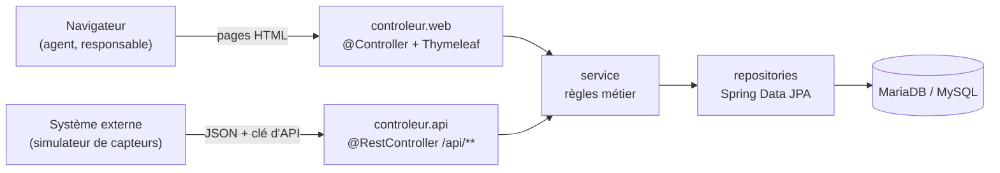
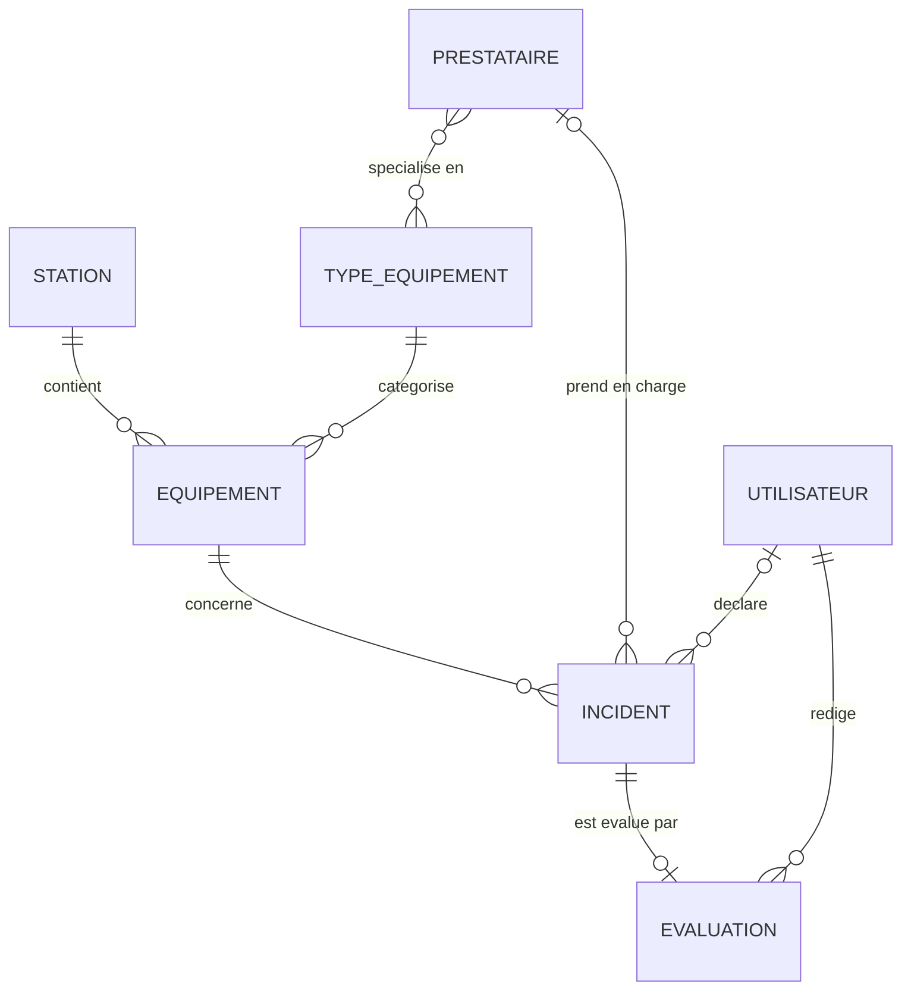

# Journal Downlyzer (ALTN72, 2026-27)

> Supervision d'équipements et suivi d'incidents sur un réseau de transport.

**Groupe :** Ibrahim GHELLAB (seul)

---

## README

### Application déployée
- **URL : https://downlyzer.onrender.com** (API : https://downlyzer.onrender.com/swagger-ui.html)
- Hébergement gratuit : le site se met en veille après 15 minutes sans visite, **le premier chargement peut prendre une minute**.

### Comptes de test

| Profil | Login | Mot de passe |
|---|---|---|
| Responsable d'exploitation | `claire.martin` | `Supervision2026!` |
| Agent de station | `karim.dupont` | `Terrain2026!` |

Les mêmes comptes marchent en local et en ligne. Les mots de passe sont hachés en BCrypt dans la base.

### Prérequis
Java 21, Maven 3.9+ (ou `./mvnw`), MariaDB 10.6+ (développé avec MariaDB 10.4 de XAMPP, voir Limites connues).

### Initialiser la base
1. Créer la base et les données de démonstration, en quelques secondes (aussi importable dans phpMyAdmin) :
   ```bash
   mariadb -u root -p < db/create.sql
   ```
2. Créer le compte de l'application, sans droit sur la structure des tables :
   ```sql
   CREATE USER 'downlyzer_app'@'localhost' IDENTIFIED BY 'un_mot_de_passe';
   GRANT SELECT, INSERT, UPDATE, DELETE ON downlyzer.* TO 'downlyzer_app'@'localhost';
   ```

Le script remet la base à zéro. Les dates sont relatives à son lancement : **le relancer juste avant une démonstration** pour que les cas 47 h, 48 h et 72 h tombent juste.

### Configuration
Aucun secret n'est dans le dépôt. Variables d'environnement (dans IntelliJ : *Run → Edit Configurations → Environment variables*, sans « Store as project file ») :

| Variable | Rôle | Obligatoire |
|---|---|---|
| `DB_USERNAME` | utilisateur de la base (`downlyzer_app`) | oui |
| `DB_PASSWORD` | son mot de passe | oui |
| `DB_URL` | URL JDBC, par défaut `jdbc:mariadb://localhost:3306/downlyzer` | non |
| `DOWNLYZER_API_KEY` | clé de l'API (`X-API-KEY`), par exemple `openssl rand -hex 24` | pour l'API |

Sans `DB_USERNAME` ou `DB_PASSWORD`, l'application ne démarre pas. Sans clé, elle démarre mais l'API répond 401.

### Lancer
```bash
mvn spring-boot:run
```
Puis ouvrir http://localhost:8080. API : http://localhost:8080/swagger-ui.html (bouton « Authorize » pour la clé).

- `requetes.http` : toutes les requêtes de l'API, à lancer dans IntelliJ (clé dans `http-client.private.env.json`, non versionné).
- Simulateur de capteurs (piste 8), avec `DOWNLYZER_API_KEY` dans le terminal. On ajoute l'adresse du site pour viser la version en ligne :
  ```bash
  java simulateur/SimulateurCapteurs.java 5
  ```

### Lancer les tests
```bash
mvn verify
```
Pas besoin de base : 128 tests tournent. Si `DB_USERNAME` est définie et la base lancée, 9 tests de plus tournent sur la vraie base. GitHub Actions lance les 137 sur MariaDB et sur MySQL à chaque push (`.github/workflows/tests.yml`).

### Données de démonstration
- 6 stations, 5 types d'équipement, 16 équipements, 5 prestataires, 22 incidents. Tout est fictif (e-mails en `.example`, coordonnées dans Paris).
- Non affectés, tous les cas de RG3 : 2 h, 47 h, 47 h 59 (vert) ; 48 h, 60 h, 71 h 59 (orange) ; 72 h, 5 jours (rouge).
- 3 incidents affectés, dont un ouvert depuis 80 h (jamais rouge, RG4).
- 11 incidents résolus, dont deux pas encore évalués (pour F10) et trois sans prestataire (non évaluables). Certains viennent d'un capteur.
- `ESC-003` est fragile et a un incident en cours. `DIS-001` a 2 incidents récents et un vieux de 45 jours : il ne l'est pas.

### Recharger la base en ligne
Le client `mysql` de XAMPP ne sait pas se connecter à MySQL 8, d'où ce petit programme (PowerShell, à la racine) :
```powershell
$env:DB_ADMIN_URL = "jdbc:mariadb://<hôte>:<port>/?sslMode=verify-full&serverSslCert=db/aiven-ca.pem"
$env:DB_ADMIN_USERNAME = "avnadmin"
$env:DB_ADMIN_PASSWORD = "<mot de passe avnadmin>"
$env:DB_PASSWORD = "<même mot de passe que sur Render>"
java -cp "$HOME\.m2\repository\org\mariadb\jdbc\mariadb-java-client\3.5.10\mariadb-java-client-3.5.10.jar" db/ChargementBase.java
```

### Limites connues
- `NOW()` dans le script et l'heure de l'application doivent être dans le même fuseau, sinon les seuils sont décalés. En ligne, tout est réglé sur Paris (heure d'hiver codée dans `ChargementBase`).
- Hibernate 7 affiche un avertissement au démarrage (`HHH000511`, version non prise en charge) avec MariaDB 10.4 et avec MySQL 8.4. L'application marche quand même (voir Déploiement).
- Bootstrap, Leaflet et OpenStreetMap viennent d'Internet : sans connexion, pas de mise en forme ni de carte.
- L'état « Dégradé » n'est jamais mis automatiquement, il n'existe que dans les données de démo.
- Les équipements d'une station (F2) ne sont pas triés.

---

## ARCHITECTURE

- Dépôt : https://github.com/ibrahimghellab/Downlyzer



Les deux types de contrôleurs appellent les mêmes services : la logique métier n'est écrite qu'une fois.

| Package (`fr.efrei.downlyzer`) | Contenu |
|---|---|
| `modele`, `modele.<entité>` | énumérations, et chaque entité JPA à côté de son repository |
| `service` | règles de gestion, `PolitiqueUrgence`, `PolitiqueFragilite`, objets renvoyés aux pages |
| `exception` | `ExceptionMetier` et ses sous-classes |
| `securite`, `configuration` | Spring Security, utilisateur connecté, horloge, documentation de l'API |
| `controleur.web`, `.formulaire` | pages Thymeleaf, formulaires, erreurs des pages |
| `controleur.api`, `.dto` | API REST, DTO, erreurs JSON |

### API REST

| Endpoint | Usage | Codes |
|---|---|---|
| `GET /api/incidents` | liste, `?statut=RESOLU` pour filtrer | 200, 400, 401 |
| `GET /api/incidents/{id}` | un incident | 200, 400, 401, 404 |
| `POST /api/incidents` | un capteur déclare une panne avec la référence de l'équipement | 201 + `Location`, 400, 401, 404, 409 |
| `PATCH /api/incidents/{id}/resolution` | retour en service | 204, 401, 404, 409 |

Toutes les erreurs sont en JSON au format `ProblemDetail` (RFC 9457).

### Pages

| URL | Fonctionnalité | Profil |
|---|---|---|
| `/connexion`, `POST /deconnexion` | F1 | tous |
| `/` | envoie le responsable au tableau de bord, l'agent aux stations | connecté |
| `/tableau-de-bord` | F11 | responsable |
| `/stations`, `/stations?vue=carte` | liste des stations, carte (piste 4, responsable) | connecté |
| `/stations/{id}`, `/equipements/{id}` | F2, F3 | connecté |
| `/equipements/{id}/incidents/nouveau` | F4 | connecté |
| `/incidents/{id}`, `/incidents/{id}/description` | F5, F6 | connecté, selon l'état pour F6 |
| `POST /incidents/{id}/affectation`, `/resolution`, `/evaluation` | F7, F8, F10 | responsable |
| `/historique` | F9 | connecté |

### Modèle de données



Le détail des colonnes est dans `db/create.sql`. Ce qu'on a ajouté au modèle du §4, et pourquoi :
- **Le niveau d'attention, la durée et la note moyenne ne sont pas stockés** : ils sont calculés. **Le statut est stocké** pour des requêtes lisibles, protégé par les méthodes d'`Incident` et un `CHECK` (RG2).
- **`source` et `declarant_id` nullable** : un capteur n'est pas un utilisateur. Un `CHECK` impose un déclarant pour une saisie à la main.
- **`date_affectation`, `commentaire_resolution`** : pour savoir depuis quand c'est pris en charge et garder une trace de la réparation.
- **`version`** : verrouillage optimiste contre deux modifications en même temps.
- **`type_equipement` et `prestataire_specialite`** : des types écrits une seule fois, et seuls les prestataires spécialisés sont proposés (F7).
- **Trois états d'équipement** : « dégradé » distingue une panne partielle d'un arrêt.
- **Station** : un `code` court pour les listes, des coordonnées pour la carte. **Prestataire** : e-mail et téléphone, `actif` pour ne plus le proposer sans perdre son historique. **Utilisateur** : `nom` et `actif`, pour la même raison. **Évaluation** : un `auteur`.

Choix du script : énumérations en `VARCHAR` + `CHECK` (SQL standard, lisible dans phpMyAdmin) ; `BIGINT AUTO_INCREMENT` ; InnoDB (transactions et clés étrangères) et `utf8mb4` ; contraintes nommées, pour que l'erreur dise la règle violée ; index sur `statut` et `date_resolution`, utilisés par le tableau de bord et l'historique ; `DROP` puis `CREATE`, pour repartir d'un état connu (§7.6). Les contraintes `UNIQUE`, `CHECK` et `NOT NULL` doublent RG1, RG2, RG5, RG8 et RG9 : elles ne remplacent pas le service, elles protègent contre une erreur de programmation.

---

## TESTS

- **Commande** : `mvn verify`. **137 tests** : 128 sans base, 9 sur une vraie base.
- **Services** : tests unitaires sans Spring ni base, en `new`, avec les repositories simulés par Mockito et l'horloge figée (`Clock.fixed`). Les entités sont de vrais objets, donc les règles d'`Incident` sont testées aussi.
- **Pages et API** : `@WebMvcTest` et MockMvc plutôt que `@SpringBootTest`, pour ne démarrer que la couche web, sans base, avec la vraie sécurité. Le service est simulé (`@MockitoBean`), l'utilisateur aussi (`spring-security-test`). On vérifie les codes HTTP, les vues, la validation, les droits et le CSRF.
- **Requêtes** : `RequetesBaseTests` lance les vraies requêtes sur les données de `db/create.sql`, en lecture seule. Un `@DataJpaTest` avec une base en mémoire n'aurait pas testé notre script ni la requête native sur MariaDB et MySQL.
- **Tests sur base sautés s'il n'y en a pas** (`@EnabledIfEnvironmentVariable`) : `mvn verify` passe sur une copie propre, sans rien configurer (annexe B).
- **Noms** : chaque test est une phrase qui dit la règle (fiche *Nommage*), un échec dit ce qui est cassé.

| Classe | Tests | Ce qui est vérifié |
|---|---|---|
| `PolitiqueUrgenceTest` | 5 | les seuils exacts : 47 h 59 min 59 s vert, 48 h pile orange, 72 h pile rouge, affecté distinct (RG3, RG4) |
| `PolitiqueFragiliteTest` | 10 | les 7 cas limites EF, 30 jours pile, incident affecté, début de fenêtre |
| `IncidentServiceTest` | 22 | F4 à F9, capteurs, droits, doublons, état de l'équipement |
| `EvaluationServiceTest` | 8 | RG8, une seule évaluation, note de 1 à 5, droits, moyennes |
| `TableauDeBordServiceTest` | 14 | tris, filtres, colonnes, indicateurs, répartition, fragilité |
| `StationServiceTest` | 4 | niveau d'une station selon son incident le plus urgent |
| `EquipementServiceTest` | 3 | fenêtre de recherche, équipement fragile ou non |
| `IncidentApiControleurTest` | 16 | 200, 201, 204, 400, 401, 403, 404, 409, JSON sans champ interne |
| `IncidentControleurTest` | 27 | pages d'incident, F5 à F10, droits, CSRF, pages d'erreur (404, 403, 409, 500 sans trace) |
| `TableauDeBordControleurTest` | 12 | les deux vues, filtres, 403 pour l'agent, badge fragile |
| `StationControleurTest` | 5 | ce que voit chaque profil, carte réservée |
| `EquipementControleurTest` | 2 | badge fragile si et seulement si l'équipement l'est |
| `RequetesBaseTests` | 8 | incident résolu absent des incidents en cours (RG6), historique et incidents triés (RG7), filtre JPQL, requête native, `AVG`, prestataires proposés, fragilité |
| `DownlyzerApplicationTests` | 1 | toute l'application démarre et les entités correspondent au schéma (`ddl-auto=validate`) |

**Intégration continue** (GitHub Actions, outil de la piste 7, sans en faire une de nos deux pistes) : à chaque push, une machine neuve crée une vraie base avec le même `db/create.sql` et le même compte `downlyzer_app`, puis lance `./mvnw -B verify`. Deux jobs, MariaDB 11.4 comme en local et MySQL 8.4 comme en ligne, avec `fail-fast: false` pour savoir si le problème vient d'une base ou des deux. Les mots de passe du workflow sont en clair car la base est jetable et injoignable : ce ne sont pas des secrets. `cache: maven` évite de tout retélécharger. `mvnw` a reçu le droit d'exécution dans Git (`--chmod=+x`), car il avait été ajouté depuis Windows.

**Pas couvert** :
- le JavaScript de la carte et la connexion réelle (BCrypt) : vérifiés à la main dans le navigateur ;
- l'annulation réelle en base d'une transaction (RG10) : les tests utilisent des simulations ;
- F2 et le reste de F3 : de simples lectures, sans règle.

---

## CHOIX TECHNIQUES

### Droits par profil

| N° | Fonctionnalité | Responsable d'exploitation | Agent de station |
|---|---|---|---|
| Accueil | Liste des stations | Accès complet, avec les niveaux | Lecture seule, nombre d'incidents sans niveau |
| F2-F3 | Consulter équipements et fiches | Accès complet | Accès complet |
| F4 | Déclarer un incident | Accès complet | Accès complet |
| F5-F6 | Consulter / modifier un incident | Accès complet | Consultation ; description modifiable tant que l'incident n'est pas affecté |
| F7 | Affecter ou réaffecter | Accès complet | Interdit |
| F8 | Déclarer résolu | Accès complet | Interdit |
| F9 | Historique | Accès complet | Lecture seule |
| F10 | Évaluer un prestataire | Accès complet | Interdit |
| F11 | Tableau de bord | Accès complet | Interdit |
| Alpha 4 | Carte des stations | Accès complet | Interdit |

- **Résolution réservée au responsable** : elle ouvre l'évaluation du prestataire, qu'il gère.
- **Niveaux d'attention réservés au responsable** : c'est un outil de pilotage. Les montrer à l'agent lui aurait redonné le tableau de bord par une autre porte. Il voit quand même le nombre d'incidents d'une station, ce qui évite les déclarations en double. Au début, carte et niveaux étaient ouverts aux deux, on est revenus dessus.
- **F6 : seule la description est modifiable.** Le statut, le prestataire et les dates de résolution passent par F7 et F8, qui garantissent RG2 et RG5. La date d'ouverture fausserait les indicateurs. La source et le déclarant sont des faits. Changer d'équipement changerait la nature d'un incident déjà affecté : mieux vaut en déclarer un autre. Pas de champ titre : le sujet ne demande qu'une description. Un incident résolu ne bouge plus, il fait partie de l'historique.
- **L'agent modifie tant que personne n'a pris l'incident** : ensuite, le prestataire travaille sur un texte stable.
- **Pas de profil administrateur** : le sujet impose deux profils, les comptes viennent du script. Les capteurs ne sont pas un profil, ils n'ont accès qu'à `/api/**`.
- **Restrictions côté serveur (RG11)** : Spring Security pour les routes (403 avant le contrôleur), le service pour ce qui dépend de l'état de l'incident. Le droit est vérifié dès l'affichage du formulaire ; masquer un lien n'est que du confort.

### Exceptions
- **`@ControllerAdvice` plutôt que `ResponseStatusException`** (§7.4) : avec `ResponseStatusException`, chaque contrôleur choisit le code et répète les mêmes `orElseThrow`, et le service n'a pas à connaître HTTP. Ici le service lève une exception métier, et un seul gestionnaire la traduit.
- **Deux gestionnaires** : `GestionnaireExceptionsWeb` (page `erreur.html`) et `GestionnaireExceptionsApi` (`ProblemDetail` en JSON). 404 ressource introuvable, 403 action non autorisée, 409 transition interdite ou modification concurrente, 400 donnée invalide.
- **Exceptions personnalisées non vérifiées**, avec une mère abstraite `ExceptionMetier` et des messages en français qui disent l'objet et la raison (fiche *Gestion des exceptions*). Gérer `RessourceIntrouvableException` évite un gestionnaire par entité.
- **`ErreurControleur`** remplace la page Whitelabel pour ce qui n'atteint pas nos contrôleurs : message général, aucune trace technique, et du JSON pour un client JSON.
- **`/incidents/abc`** : 404 côté pages, car pour l'utilisateur la page n'existe pas ; 400 dans l'API, car c'est la requête du programme qui est fausse.
- **`ResponseEntity` seulement dans l'API**, où il donne le 201 avec `Location` et le 204, comme dans le TP. Une page renvoie une vue, son code est fixé par `@ResponseStatus`.
- **Aucun `try/catch` dans le code de l'application** : les exceptions remontent jusqu'aux gestionnaires.

### SOLID
- **S, responsabilité unique (appliqué)** :
  - le contrôleur traduit HTTP, le service organise, `Incident` protège son état, le repository stocke ;
  - `EvaluationService` et `TableauDeBordService` sont séparés d'`IncidentService` : ils changeraient pour d'autres raisons, et chaque test ne prépare que ce dont son service a besoin ;
  - `PolitiqueUrgence` et `PolitiqueFragilite` ne font qu'une chose : changer un seuil ne touche qu'une classe, et l'évolution finale s'est ajoutée sans toucher aux règles existantes ;
  - les contrôleurs sont découpés par écran.
- **O, ouvert / fermé (appliqué là où ça sert)** : une nouvelle exception « introuvable » est gérée sans toucher aux gestionnaires, et un nouveau tri est une entrée de plus dans la `Map` `ORDRES`. Écarté pour `PolitiqueUrgence` : une stratégie par niveau ferait beaucoup de code pour des seuils qui ne changent presque jamais.
- **L, substitution de Liskov (respecté)** : il y a très peu d'héritage. Chaque fille de `ExceptionMetier` remplace sa mère sans surprise, et `UtilisateurConnecte` respecte le contrat de `UserDetails`.
- **I, ségrégation des interfaces (écarté)** : on n'a écrit aucune grosse interface. Les repositories héritent de `JpaRepository`, qui expose plus que nécessaire, mais c'est le fonctionnement de Spring Data vu en cours.
- **D, inversion des dépendances (en partie)** : les services dépendent des interfaces des repositories et de `Clock`, injectés par le constructeur, ce qui rend les tests possibles. Écarté pour les services : ils n'ont qu'une implémentation, Mockito simule une classe, et une interface par service doublerait les fichiers pour rien.

### Requête SQL native
- **Où** : `IncidentRepository.calculerDelaiMoyenDeResolutionEnMinutes`, pour le délai moyen du tableau de bord.
  ```sql
  SELECT AVG(TIMESTAMPDIFF(MINUTE, date_ouverture, date_resolution))
  FROM incident WHERE statut = 'RESOLU' AND date_resolution >= :depuis
  ```
- **Pourquoi** : la base fait le calcul sur toutes les lignes. JPQL n'a pas de différence de dates portable, il aurait fallu tout charger et calculer en Java.
- **Analyse critique** :
  - pas portable : `TIMESTAMPDIFF` existe sur MariaDB et MySQL, pas sur PostgreSQL, alors qu'Hibernate traduirait du JPQL ;
  - liée au schéma : les noms de colonnes et `'RESOLU'` sont du texte, un renommage ne casse pas la compilation ;
  - pas vérifiée au démarrage, contrairement au JPQL : seul un test ou un appel la contrôle ;
  - résultat peu typé : un `Double`, ou `NULL` si rien n'a été résolu, que le service doit gérer.
- **Risques limités** : courte, isolée derrière une méthode claire, avec un paramètre `:depuis` (pas d'injection), testée sur les deux bases par `RequetesBaseTests`.
- **Conclusion** : utile pour ce calcul, à réserver à ce genre de cas. Le reste du projet passe par des requêtes dérivées ou JPQL.

### @Transactional
Annotation de Spring, seulement quand plusieurs écritures ou une vérification suivie d'une écriture doivent aller ensemble (RG10) :
- **`declarerIncident`, `declarerParCapteur`** : l'incident et l'état de l'équipement réussissent ensemble ou pas du tout.
- **`resoudreIncident`** : l'incident et l'équipement, deux tables.
- **`modifierDescription`, `affecterPrestataire`** : vérification et modification dans la même transaction, enregistrées sans `save()`, avec `@Version` pour ne pas écraser le travail d'un autre (409). Limite : le formulaire ne transporte pas la version.
- **`evaluerIntervention` n'est pas annoté** : une seule ligne écrite. Deux évaluations en même temps sont bloquées par `UNIQUE (incident_id)`, traduit en 409.
- **Les lectures ne sont pas annotées** : il n'y a rien à rendre atomique.

### Modèle et requêtes
- **`Incident` n'a pas de setter pour son état** : c'est la seule entité avec des règles. Il se crée par `declarerManuellement` ou `declarerParCapteur` (noms clairs, constructeur privé) et change par `affecter`, `resoudre`, `modifierDescription`, quelle que soit la porte d'entrée. Un setter avec une règle aurait menti sur ce qu'il fait.
- **Les autres entités sont des JavaBeans, comme dans le TP**, avec des `@Column` recopiés du script, et sans `setId()` : c'est la base qui donne l'identifiant.
- **Constructeur `protected`** : JPA en a besoin, mais on ne peut pas créer d'incident vide. `Objects.requireNonNull` refuse un incident sans équipement ou sans date.
- **L'heure est passée en paramètre** par le service, depuis un `Clock` injecté : c'est ce qui rend les seuils testables (§7.8).
- **Les règles liées au profil restent dans le service**, qui connaît l'utilisateur.
- **Énumérations en texte** (`EnumType.STRING`) : ajouter une valeur ne décale rien.
- **Relations à sens unique** : pas de liste d'équipements dans `Station`, moins de chargements inutiles et pas de boucle JSON.
- **`@ManyToOne` en `EAGER`** (par défaut) : pas de `LazyInitializationException` dans les templates, code simple. Avec beaucoup de données, il faudrait `LAZY` et `JOIN FETCH`. `open-in-view` reste actif pour la même raison.
- **Requêtes dérivées quand c'est simple, JPQL dès qu'il y a une jointure ou un nom illisible.** Une méthode n'existe que si un service s'en sert.

### Sécurité et configuration
- **Secrets en variables d'environnement** (§7.7), `.idea/` ignoré. Seule l'URL de la base a une valeur par défaut, car elle n'est pas secrète.
- **Compte `downlyzer_app` avec le minimum de droits** : une faille ne permettrait ni de supprimer des tables ni de lire d'autres bases.
- **`ddl-auto=validate`** : le schéma vient du script, et une erreur de mapping bloque le démarrage.
- **BCrypt** (coût 10, OWASP) et message de connexion vague, pour ne pas révéler quels comptes existent.
- **Spring Security avec notre page `/connexion`** en français, plutôt que `HttpSession` à la main.
- **`UtilisateurConnecte` copie les valeurs** au lieu de garder l'entité en session, et un compte inactif ne se connecte pas.
- **Déconnexion en `POST`** avec jeton CSRF : un lien piégé ne peut pas déconnecter.
- **`/error` et `/favicon.ico` en accès libre** : sinon, une ressource bloquée devenait la « page demandée » après la connexion.
- **`include-message` enlevé** (réglage du TP) : pas de message technique à l'écran.
- **`.properties` en UTF-8** : l'ISO-8859-1 cassait les accents et la compilation.
- **Libellés dans `messages.properties`** : tous les textes au même endroit, l'énumération reste une donnée.

### Formulaires (F4, F6, F7, F8)
- **Un objet formulaire par saisie, pas l'entité** : sinon on pourrait ajouter `statut=RESOLU` à la requête. `DescriptionIncidentFormulaire` sert à F4 et F6, même règle.
- **Description de 10 à 1 000 caractères** : 1 000 est la taille de la colonne, 10 évite « panne ».
- **Validation dans le navigateur et sur le serveur** (`@Valid`), la seule vraie protection. Le formulaire revient avec le texte et le message sous le champ.
- **Déclarant, auteur et dates ne sont jamais saisis** : ils viennent de la session et de l'horloge.
- **Message de confirmation** par `addFlashAttribute` : il survit à la redirection et ne s'affiche qu'une fois.
- **Post/Redirect/Get** côté pages, et des URL d'action en POST plutôt que des PUT simulés : chaque action a son adresse, le `HiddenHttpMethodFilter` du TP n'est plus utile.

### Affectation, résolution, évaluation (F7 à F10)
- **Seuls les prestataires actifs et spécialisés sont proposés**, par ordre alphabétique. Le service revérifie la même liste, donc une requête forgée est refusée (400).
- **La réaffectation passe par le même formulaire**. Pas de table d'historique : aucune fonctionnalité du socle ne s'en sert.
- **Commentaires facultatifs**, enregistrés `NULL` s'ils sont vides.
- **Un incident peut être résolu sans prestataire** (fausse alerte) : il n'est alors pas évaluable (RG8).
- **L'état de l'équipement suit ses incidents** : hors service à la déclaration, en service quand il n'a plus d'incident en cours.
- **Formulaires sur la page de détail** : on voit l'incident et on agit sans changer de page.
- **Historique à part**, trié par la base, sans pagination (le sujet ne la demande pas). Un badge « À évaluer » montre ce qui reste à faire. Les évaluations sont chargées en une requête, pas une par ligne.
- **Note en étoiles** : de vrais boutons radio dessinés en CSS, utilisables au clavier, sans JavaScript.
- **Note vérifiée trois fois** : formulaire, service (RG8 vaut aussi hors des pages), `CHECK` en dernier recours.
- **Une évaluation n'est plus modifiable** : elle changerait après coup une moyenne déjà utilisée.
- **La note moyenne est dans la liste de choix du prestataire**, là où elle sert à décider. Elle est calculée par la base (`AVG`), jamais stockée.

### Tableau de bord (F11)
- **Une page à part**, accueil du responsable, qui n'affiche que les incidents en cours (RG6).
- **Niveau calculé par `PolitiqueUrgence`**, seul endroit des seuils, en comparant des `Duration`, pas des heures arrondies. Un incident résolu lève une `IllegalArgumentException` : c'est une erreur de programmation, pas un cas utilisateur.
- **Quatre colonnes, une par niveau** : on voit tout de suite où sont les urgences, et un incident pris en charge est séparé des autres (RG4). Choisi après trois maquettes : une console dense, ces colonnes et un plan de ligne, écarté car il ne tient pas avec un vrai réseau.
- **Une phrase résume la situation avant les chiffres** : elle dit ce qui demande une action.
- **6 fiches maximum par colonne** (`FICHES_PAR_COLONNE`), puis un lien vers la liste filtrée, pour éviter une page interminable.
- **Vue « Liste »** pour trier finement, avec une barre de répartition.
- **Trois filtres et trois tris** (deux demandés), dans l'URL : une vue filtrée a une adresse et le bouton « précédent » marche. Station et type sont filtrés par la base, le niveau en Java car il n'est pas stocké. Une valeur invalide est ignorée.
- **Tri par défaut** : du plus urgent au moins urgent, et le plus ancien d'abord, car il changera de couleur en premier.
- **Indicateurs sur tout le réseau, sans les filtres** : ils résument la situation générale. Délai moyen sur 30 jours : assez long pour avoir des résolutions, assez court pour rester actuel.
- **Barre empilée plutôt qu'un camembert** : on compare mieux des longueurs que des angles. En HTML et CSS : une barre ne vaut pas une bibliothèque.
- **Couleurs vérifiées avec un outil** (daltonisme, contraste). L'orange sur blanc était trop faible : le texte y est foncé. La couleur n'est jamais seule, il y a toujours un libellé.
- **`record` pour ce qui est calculé** (`LigneTableauDeBord`, `IndicateursTableauDeBord`, `PartNiveau`, `SituationStation`) : rien n'est stocké, pas de relation JPA.

### Interface
- **Une identité à nous** plutôt que le look Bootstrap par défaut, reprise sur toute l'application : console sobre, symbole en SVG (double flèche vers le bas, pour *down*), police Inter, bleu `#1f4fd1`, bordures fines plutôt que des ombres.
- **Bootstrap 5.3.3 par CDN, comme dans le TP**, avec ses variables CSS redéfinies. `style.css` ne contient que ce qui est propre à Downlyzer.
- **Badges teintés avec un point de couleur**, dont la classe reprend la valeur en base : pas de condition dans les templates.
- **Fragments Thymeleaf** pour l'en-tête et les badges, écrits une fois. Le texte de F1 est gardé mot pour mot. L'utilisateur est donné à toutes les pages par un `@ControllerAdvice`.
- **Pas de tiret seul dans une case** : un mot dit ce qui manque (« Aucun », « En cours », « Non évaluable »).
- **Pas de mode sombre** : il faudrait choisir et vérifier une deuxième série de couleurs.

### Organisation
- **Nom Downlyzer**, de *down* et *analyzer* : court, et il dit ce que fait l'application (§12).
- **Fork du dépôt du TP** : même pile (Java 21, Spring Boot 4.1.1, Maven). `artifactId` gardé tel quel pour ne pas casser la configuration IntelliJ, package renommé en `fr.efrei.downlyzer`.
- **Identifiants en français**, tirés du domaine, dans une seule langue (§7.3).
- **Commentaires courts** qui disent pourquoi, pas quoi.
- **Commits préfixés par la fonctionnalité** (`F4 : ...`) : l'historique se lit par fonctionnalité (§7.10).
- **Outils à part, lancés avec `java`** (`simulateur/`, `db/`) : un seul fichier, hors de l'application, avec un `Logger` de Java plutôt que `System.out` (annexe B).

### Déploiement (§7.9)
- **Render pour l'application, Aiven pour la base**, gratuits. Écartés : Railway (essai terminé), Vercel (ne lance ni Java ni Docker), Supabase et la base de Render (PostgreSQL : pilote, script et requête native à réécrire), GitHub Pages (fichiers statiques seulement).
- **MySQL 8 en ligne, MariaDB en local** : pas d'offre gratuite MariaDB, et le même SQL marche sur les deux, vérifié par la CI. On garde le pilote MariaDB.
- **Dialecte MariaDB gardé sur MySQL** : Hibernate le déduit du pilote, d'où l'avertissement `HHH000511`. On a essayé de forcer `MySQLDialect` : la validation ne trouvait plus les tables (`missing table [equipement]`). La CI l'a montré, Render a refusé de déployer et a gardé la version d'avant. On a enlevé ce réglage.
- **`sslMode=verify-full` avec le certificat d'Aiven** : connexion chiffrée et serveur vérifié. Le certificat est public, il peut être dans le dépôt.
- **`Dockerfile` en deux étapes** : Maven construit, seul le JRE lance. `-DskipTests` car la CI s'en charge avec une base. `.dockerignore` enlève le reste.
- **`-XX:MaxRAMPercentage=75`** : Render donne 512 Mo, et le quart par défaut est trop juste pour Spring Boot.
- **`server.port=${PORT:8080}`** : l'hébergeur choisit le port. **`forward-headers-strategy=framework`** : les redirections restent en `https`.
- **`TZ=Europe/Paris`** dans l'image, et le même fuseau au chargement du script : les serveurs sont en UTC.
- **Mot de passe retiré des logs** (`logging.level.org.hibernate.orm.connections.pooling=WARN`) : Hibernate écrivait l'URL de connexion, où le pilote met le mot de passe. Il a été masqué et le mot de passe changé.
- **Compte `downlyzer_app` aussi en ligne**, pour `'%'` car la base est sur une autre machine, plutôt que le compte `avnadmin`. La clé d'API en ligne n'est pas celle du local.
- **`db/ChargementBase.java`** : mots de passe en variables, jamais en argument. Celui de `downlyzer_app` est limité aux lettres et chiffres, car `CREATE USER` n'accepte pas de paramètre `?`.

---

## LOT ALPHA

Pistes retenues : **8** (source de données externe) et **4** (cartographie), qui se renforcent : les pannes des capteurs apparaissent sur la carte. La piste 2 était prévue au départ ; la carte a pris sa place, et il en reste la barre de répartition et les indicateurs. La piste 6 a été écartée : nos pages auraient appelé une API réservée aux systèmes externes.

### Fonctionnalité transverse 1 : source de données externe (piste 8)
- **Besoin** : des capteurs déclarent les pannes tout seuls.
- **Périmètre** : `POST /api/incidents` protégé par une clé, équipement désigné par sa référence, simulateur de plusieurs capteurs.
- **Choix et essais** :
  - la même API sert à F12 et aux capteurs ;
  - une clé d'API plutôt qu'un compte en HTTP Basic : rien dans la table des utilisateurs. Elle est comparée en temps constant (`MessageDigest.isEqual`) ;
  - une référence, unique (RG9), car un capteur ne connaît pas l'identifiant en base ;
  - un seul incident en cours par équipement : un capteur qui répète son signal reçoit un 409 avec `incidentExistant`. Un doublon fausserait le tableau de bord, et un 200 cacherait que rien n'a été créé ;
  - `PATCH` pour le retour en service, car seule une partie de l'incident change ;
  - des DTO, jamais les entités : pas de boucle ni de champ interne ;
  - Swagger sans annotation, pour rester proche du TP. Ses pages sont publiques, mais les appels demandent la clé. Limite : il affiche 200 pour le `POST` et le `PATCH`, les vrais codes sont dans ARCHITECTURE et les tests ;
  - un simulateur en Java plutôt qu'un script `curl` : il marche partout et montre ce que ferait un vrai système.
- **Ce qui marche** : tous les codes de l'API, Swagger avec la clé, le simulateur qui remplit le tableau de bord, couverts par `IncidentApiControleurTest` et `IncidentServiceTest`.
- **Difficultés** : la sécurité des pages redirigeait l'API vers la connexion. Il a fallu une deuxième chaîne Spring Security pour `/api/**`, sans session ni CSRF, avec des 401 et 403 en JSON (un test montrait un 403 vide).
- **Reste à faire** : une clé par capteur, et garder quel capteur a signalé la panne.

### Fonctionnalité transverse 2 : cartographie du réseau (piste 4)
- **Besoin** : voir d'un coup d'œil où sont les problèmes.
- **Périmètre** : carte des stations colorée selon leurs incidents, avec un accès aux équipements.
- **Choix et essais** :
  - d'abord prévue comme une page à part, elle est devenue un onglet de la page Stations. Ouverte aux deux profils au début, puis réservée au responsable ;
  - onglet choisi par l'URL : une adresse par onglet, et la carte n'est créée que si elle est visible ;
  - Leaflet et OpenStreetMap : libres, sans clé, attribution affichée ;
  - une station prend le niveau de son incident le plus urgent, calculé en Java : le JavaScript ne fait que placer les points ;
  - stations lues dans la liste HTML (`data-*`), qui sert de légende, plutôt qu'avec `th:inline="javascript"`, qui dépend de la conversion JSON ;
  - bulles construites avec `textContent` : un nom n'est jamais interprété comme du HTML ;
  - couleurs en variables CSS, lues par le JavaScript avec `getComputedStyle`.
- **Ce qui marche** : stations placées et colorées, bulle avec la situation et un lien vers les équipements, cadrage automatique, onglet Liste équivalent.
- **Difficultés** : Leaflet calcule mal sa taille dans un onglet caché, d'où la carte créée seulement à l'affichage.
- **Reste à faire** : mise à jour sans recharger la page, filtre par niveau.

---

## Évolution séance finale

### Ce qui a été fait
Évolution « Équipement fragile » : au moins 3 incidents ouverts sur 30 jours, quel que soit leur statut, recalculé à chaque consultation.
- `service/PolitiqueFragilite.java` : le seuil, la fenêtre et la règle.
- `service/EquipementService.java` : `listerEquipementsFragiles()` et `estFragile(id)`.
- `modele/incident/IncidentRepository.java` : `findByDateOuvertureGreaterThanEqual`.
- `service/TableauDeBordService.java`, `service/LigneTableauDeBord.java` : chaque ligne dit si son équipement est fragile.
- `controleur/web/EquipementControleur.java`, `controleur/web/IncidentControleur.java` : le badge de la fiche et le message de confirmation.
- `templates/fragments/affichage.html` (fragment `badgeFragile`), `equipements/fiche.html`, `tableau-de-bord.html`, `static/css/style.css`.
- `db/create.sql` : incidents 21 et 22, pour montrer `ESC-003` fragile et `DIS-001` non fragile.

### Choix de conception
- **`PolitiqueFragilite` sur le modèle de `PolitiqueUrgence`** : valeurs à un seul endroit (EF5), règle dans la couche service (EF6), heure en paramètre, donc bornes testables sans base.
- **La règle renvoie les identifiants des équipements fragiles** : une requête pour tout le tableau de bord, pas une par ligne. Compter par identifiant évite de contaminer un voisin.
- **Borne incluse** (EF1) : 30 jours pile compte. Elle est dans la requête et revérifiée en Java.
- **Seuil absent du badge et des messages** : ce serait une deuxième copie des valeurs.
- **Badge plein et foncé, avec un triangle en CSS** : il se voit tout de suite, sans reprendre une couleur de niveau, et le texte reste exact. La colonne Incident passe à 20 rem pour lui laisser la place.
- **`estFragile` est appelé après `declarerIncident`**, pour que le nouvel incident compte.

Raccourcis : `estFragile(id)` charge les incidents de la fenêtre au lieu d'un `COUNT`, ce qui garde un seul chemin à tester. Le tableau de bord refait aussi cette requête pour ses indicateurs, qui n'en ont pas besoin.

### Tests et limites
- `PolitiqueFragiliteTest` (10) : les 7 cas limites, 30 jours pile, incident affecté, début de fenêtre.
- `EquipementServiceTest` (3), `RequetesBaseTests` (1, sur une vraie base).
- `TableauDeBordServiceTest` (1), `TableauDeBordControleurTest` (3), `EquipementControleurTest` (2), `IncidentControleurTest` (2).

Limites : une déclaration par l'API compte, mais sa réponse ne parle pas de fragilité ; pas de badge ailleurs que sur la fiche et le tableau de bord, comme demandé ; un équipement fragile sans incident en cours n'apparaît pas au tableau de bord ; la fenêtre étant glissante, il faut relancer le script avant une démonstration.

---

## BILAN

- **Contribution de chacun** : projet fait seul, sans binôme. La conception, le code, les tests, le déploiement et le journal sont sous ma responsabilité.
- **Plus grande difficulté et comment je l'ai surmontée** : l'application ne démarrait plus, avec l'erreur 1044 (`Access denied ... to database 'downlyzer'`), alors que le code n'était pas en cause. Ça m'a pris une longue séance de débogage. Le mot de passe était bon : les droits avaient disparu, car la table système `mysql.db` de XAMPP était corrompue, sans doute après un arrêt brutal de MySQL. J'ai réparé la table (`REPAIR TABLE`) et redonné les droits avec le `GRANT` du README. La panne est revenue le 5 novembre, et ça a pris quelques minutes parce que j'avais noté la cause. Je retiens de lire le code d'erreur exact (1044 n'est pas 1045) et d'arrêter MySQL proprement.
- **Fonctionnalités pas réalisées et pourquoi** : F1 à F12, les pistes 8 et 4 et l'évolution finale sont faites. Il manque les graphiques de la piste 2, car la carte a pris sa place et j'ai gardé le temps restant pour le socle, l'interface et le déploiement. Il manque aussi une clé d'API par capteur et la mise à jour automatique de la carte, qui ne sont pas nécessaires au fonctionnement des pistes.
- **Trois points à retenir du cours et du projet** :
  1. **Une règle à un seul endroit.** Avoir mis les seuils dans `PolitiqueUrgence` et les changements d'état dans `Incident` a tout simplifié : l'évolution finale s'est ajoutée sur le même modèle, sans toucher à l'existant.
  2. **Ce qui dépend du temps doit pouvoir être testé.** Avec une horloge injectée, 47 h 59 ou 30 jours et 1 minute se testent à la minute près, sans dépendre du jour où on lance les tests.
  3. **Il faut vérifier dans les vraies conditions.** Les tests locaux passaient, mais la CI et le déploiement ont montré les vrais problèmes : le dialecte qui cassait sur MySQL, le mot de passe dans les logs, le fuseau des serveurs. Déployer plus tôt m'aurait laissé plus de temps.
