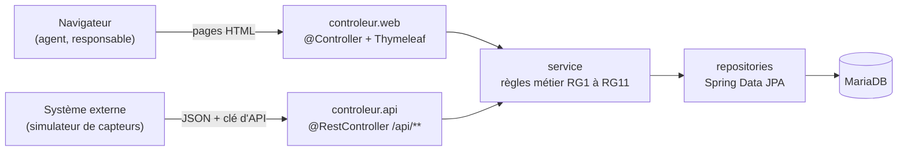
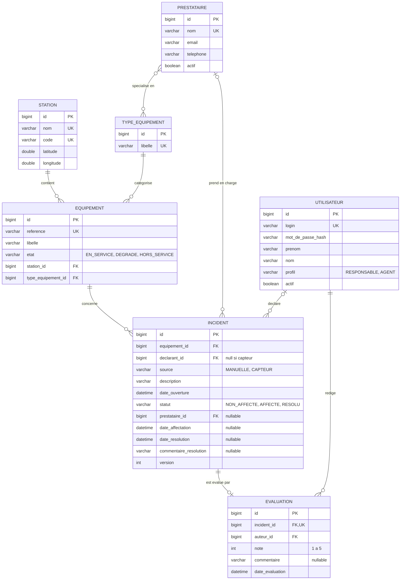

# Journal — Downlyzer (ALTN72, 2026-27)

> Supervision d'équipements et suivi d'incidents sur un réseau de transport.

**Groupe :** Ibrahim GHELLAB, Prénom NOM

---

## README

### Prérequis
- Java 21
- Maven 3.9+ (ou le wrapper `./mvnw` fourni)
- MariaDB : développé et testé avec MariaDB 10.4 (XAMPP) ; version 10.6 ou plus recommandée (voir Limites connues)
- Spring Boot 4.1.1 (même pile que le TP fil rouge)

### Initialiser la base de données
1. Créer la base, son schéma et les données de démonstration (en `root`) :
   ```bash
   mariadb -u root -p < db/create.sql
   ```
   Le script supprime puis recrée toutes les tables : il peut être relancé autant de fois que nécessaire et remet la base dans son état de démonstration. Il peut aussi être importé depuis phpMyAdmin (onglet Importer).

2. Créer un compte dédié à l'application, limité aux données de cette base :
   ```sql
   CREATE USER 'downlyzer_app'@'localhost' IDENTIFIED BY 'un_mot_de_passe';
   GRANT SELECT, INSERT, UPDATE, DELETE ON downlyzer.* TO 'downlyzer_app'@'localhost';
   ```
   L'application n'a ni droit global, ni droit de modifier la structure des tables : seul le script, lancé en `root`, les crée.

Les dates des incidents sont calculées par rapport à l'instant d'exécution du script (`NOW() - INTERVAL 47 HOUR`, etc.) : **relancer le script juste avant une démonstration** pour que les cas limites (47 h, 48 h, 72 h) restent exacts.

### Configuration
Aucun secret n'est versionné. Variables d'environnement à définir avant le lancement (dans IntelliJ : *Run → Edit Configurations → Modify options → Environment variables*, sans cocher « Store as project file ») :

| Variable | Rôle | Obligatoire |
|---|---|---|
| `DB_USERNAME` | utilisateur MariaDB (ex. `downlyzer_app`) | oui |
| `DB_PASSWORD` | mot de passe de cet utilisateur | oui |
| `DB_URL` | URL JDBC ; par défaut `jdbc:mariadb://localhost:3306/downlyzer` | non |
| `DOWNLYZER_API_KEY` | clé d'accès à l'API REST pour les systèmes externes (piste 8) | à venir |

Sans `DB_USERNAME` ou `DB_PASSWORD`, l'application refuse de démarrer (`Could not resolve placeholder`).

### Lancer l'application
```bash
mvn spring-boot:run
```
Puis ouvrir http://localhost:8080. Documentation de l'API : http://localhost:8080/swagger-ui.html

### Lancer les tests
```bash
mvn verify
```
Les tests unitaires et les tests des pages n'ont besoin ni de base ni de variables d'environnement. Seul `DownlyzerApplicationTests` (vérification que toute l'application démarre) se connecte à la base : il faut que MariaDB soit démarrée et que `DB_USERNAME` et `DB_PASSWORD` soient définies, comme pour lancer l'application.

### Comptes de test

| Profil | Login | Mot de passe |
|---|---|---|
| Responsable d'exploitation | `claire.martin` | `Supervision2026!` |
| Agent de station | `karim.dupont` | `Terrain2026!` |

Les mots de passe sont stockés hachés en BCrypt dans la base.

### Données de démonstration
- 6 stations, 5 types d'équipement, 16 équipements, 5 prestataires.
- Incidents non affectés couvrant tous les cas limites de RG3 : 2 h, 47 h, 47 h 59 (vert) ; 48 h pile, 60 h, 71 h 59 (orange) ; 72 h pile, 5 jours (rouge).
- 3 incidents affectés, dont un ouvert depuis 80 h (il ne doit pas apparaître en rouge, RG4).
- 9 incidents résolus sur les 4 dernières semaines, dont un résolu sans prestataire (non évaluable) et deux résolus pas encore évalués (pour démontrer F10).
- Plusieurs incidents déclarés par un capteur (`source = CAPTEUR`, sans déclarant).
- L'état des équipements est cohérent avec leurs incidents : un équipement qui a un incident en cours est hors service ou dégradé.
- Toutes les données sont fictives : noms de stations et de prestataires inventés, adresses e-mail en `.example` (domaine réservé à la documentation, qui ne peut appartenir à personne), coordonnées choisies dans Paris pour la carte (piste 4).

### Application déployée
- URL : *à compléter*

### Limites connues
- Le script de données utilise `NOW()` de MariaDB et l'application l'heure de la JVM : les deux doivent être dans le **même fuseau horaire**, sinon les seuils sont décalés (un incident de 47 h pourrait apparaître orange).
- MariaDB 10.4 (fournie par XAMPP) n'est plus officiellement prise en charge par Hibernate 7, qui affiche un avertissement au démarrage (minimum 10.6). L'application fonctionne, mais le serveur de déploiement doit utiliser une version récente.
- Bootstrap est chargé depuis un CDN : sans accès à Internet, les pages fonctionnent mais s'affichent sans mise en forme.
- L'état « Dégradé » d'un équipement n'est jamais attribué automatiquement (voir CHOIX TECHNIQUES, F7-F8) : il n'existe que dans les données de démonstration.
- Les équipements d'une station (F2) ne sont pas triés : la base les renvoie dans l'ordre de son choix.
- *À compléter au fil du projet.*

---

## ARCHITECTURE

- Dépôt : https://github.com/ibrahimghellab/Downlyzer

### Architecture applicative



Le même service est appelé par les deux types de contrôleurs : la logique métier n'est écrite qu'une fois.

Organisation des packages (`fr.efrei.downlyzer`) :

| Package | Contenu |
|---|---|
| `modele` | énumérations communes (`StatutIncident`, `EtatEquipement`, `Profil`, `SourceIncident`, `NiveauAttention`) |
| `modele.<entité>` (`station`, `equipement`, `incident`…) | une entité JPA et son repository Spring Data |
| `exception` | exceptions métier (`ExceptionMetier` et ses sous-classes) |
| `service` | règles de gestion (`IncidentService`, `StationService`, `EquipementService`) |
| `securite` | configuration Spring Security et chargement de l'utilisateur connecté |
| `configuration` | beans techniques (l'horloge `Clock`) |
| `controleur.web` | pages Thymeleaf, gestionnaire d'erreurs des pages, contrôleur d'erreur |
| `controleur.web.formulaire` | objets qui reçoivent les saisies des formulaires |
| `controleur.api` | API REST et son gestionnaire d'erreurs *(à venir)* |

- **`controleur.web`** : les pages de l'application, utilisées par les deux profils. Après une modification, redirection (Post/Redirect/Get) ; en cas d'erreur, une page lisible avec le bon code HTTP.
- **`controleur.api`** : l'API REST destinée au monde extérieur (F12 et piste 8). Elle expose une partie seulement de la logique métier, renvoie du JSON (DTO, jamais les entités) et des codes HTTP adaptés (200, 201, 204, 400, 404, 409).
- **Chaque repository est rangé à côté de son entité** (`modele.incident.Incident` et `modele.incident.IncidentRepository`) plutôt que dans un package `repository` commun : on trouve au même endroit une donnée et la façon d'y accéder. La séparation des couches reste la même : les contrôleurs n'utilisent jamais un repository, ils passent toujours par un service.

| Endpoint | Usage | Codes |
|---|---|---|
| `POST /api/incidents` | un capteur déclare une panne (par référence d'équipement) | 201, 400, 404, 409 |
| `GET /api/incidents` | consulter les incidents | 200 |
| `GET /api/incidents/{id}` | consulter un incident | 200, 404 |
| `PATCH /api/incidents/{id}/resolution` | signaler le retour en service | 204, 404, 409 |

### Pages de l'application

| URL | Fonctionnalité | Profil |
|---|---|---|
| `GET /connexion` | F1 : connexion (le `POST` est traité par Spring Security) | tous |
| `GET /` | redirige vers `/stations` | connecté |
| `GET /stations` | liste des stations, triée par nom | connecté |
| `GET /stations/{id}` | F2 : équipements de la station | connecté |
| `GET /equipements/{id}` | F3 : fiche de l'équipement et ses incidents | connecté |
| `GET /equipements/{id}/incidents/nouveau`, `POST /equipements/{id}/incidents` | F4 : déclarer un incident sur cet équipement | connecté |
| `GET /incidents/{id}` | F5 : détail d'un incident | connecté |
| `GET`, `POST /incidents/{id}/description` | F6 : modifier la description | selon l'état de l'incident (voir droits) |
| `POST /incidents/{id}/affectation` | F7 : affecter ou réaffecter un prestataire | responsable |
| `POST /incidents/{id}/resolution` | F8 : déclarer l'incident résolu | responsable |
| `POST /deconnexion` | F1 : déconnexion | connecté |

La déclaration d'un incident est rangée sous l'équipement (`/equipements/{id}/incidents`) parce qu'un incident se déclare toujours depuis un équipement donné (F4) ; une fois créé, l'incident a sa propre adresse (`/incidents/{id}`), indépendante de l'équipement.

### Modèle de données



Choix de modélisation (le sujet laisse le groupe enrichir le modèle minimal du §4) :
- **L'indicateur vert / orange / rouge n'est pas stocké** : il est calculé à partir de l'heure courante, comme la durée d'ouverture et la note moyenne d'un prestataire, elles aussi calculées.
- **Le statut est stocké** (enum) pour la lisibilité des requêtes, et sa cohérence est garantie à deux niveaux : il n'est modifié que par des méthodes métier (`affecter()`, `resoudre()`), et une contrainte `CHECK` en base refuse toute combinaison incohérente (RG2).
- **`source` et `declarant_id` nullable** : un incident peut être déclaré par un capteur via l'API (piste 8), qui n'est pas un utilisateur humain. Une contrainte `CHECK` impose quand même un déclarant à tout incident saisi à la main.
- **`date_affectation`** : permet d'afficher depuis quand un incident est pris en charge et de mesurer les délais.
- **`commentaire_resolution`** (facultatif) : garde une trace de ce qui a été fait, utile dans l'historique (F9) et pour évaluer le prestataire (F10).
- **`version`** : verrouillage optimiste (`@Version`) contre les modifications concurrentes d'un même incident.
- **`prestataire_specialite`** : relie les prestataires aux types d'équipement sur lesquels ils interviennent. Elle sert dès F7 (seuls les prestataires spécialisés sont proposés), puis aux statistiques.
- **`type_equipement` est une table** plutôt qu'un texte libre dans `equipement` : les types sont écrits une seule fois, sans faute de frappe possible, et peuvent être reliés aux spécialités des prestataires et regroupés dans les graphiques (piste 2).
- **L'état d'un équipement a trois valeurs** (`EN_SERVICE`, `DEGRADE`, `HORS_SERVICE`) : « dégradé » distingue un équipement qui fonctionne partiellement (deux portiques sur cinq bloqués) d'un équipement à l'arrêt.
- **Station : un `code` court** (`GCE`, `HDV`…) en plus du nom, unique, pour un affichage compact dans les listes ; **coordonnées** nécessaires à la cartographie (piste 4).
- **Prestataire : e-mail et téléphone séparés** (le sujet demande « de quoi le contacter ») et un booléen **`actif`** : un prestataire avec lequel on ne travaille plus n'est plus proposé à l'affectation, sans supprimer son historique.
- **Utilisateur : un `nom`** en plus du prénom (affiché pour le déclarant d'un incident) et un booléen **`actif`** : un compte désactivé ne peut plus se connecter, sans perdre la trace de ses déclarations.
- **Évaluation : un `auteur`**, pour savoir quel responsable a noté l'intervention.

Choix techniques du script `db/create.sql` :
- **Énumérations en `VARCHAR` + `CHECK`** plutôt qu'en type `ENUM` natif : c'est du SQL standard, utilisable avec d'autres bases relationnelles (§7.1), et les valeurs restent lisibles dans phpMyAdmin. Nous avions ajouté `@JdbcTypeCode(SqlTypes.VARCHAR)` sur les champs enum par précaution ; un essai sans cette annotation a montré qu'Hibernate acceptait déjà ces colonnes, elle a donc été retirée.
- **Identifiants `BIGINT AUTO_INCREMENT`**, mappés en `Long` avec `GenerationType.IDENTITY` : c'est la base qui attribue les identifiants.
- **Moteur InnoDB et encodage `utf8mb4`** : InnoDB est le seul moteur de MariaDB qui gère les transactions et les clés étrangères ; `utf8mb4` accepte tous les caractères (accents, apostrophes typographiques).
- **Contraintes nommées** (`uk_equipement_reference`, `ck_incident_statut`…) : un message d'erreur de la base dit immédiatement quelle règle a été violée.
- **Index sur `incident.statut` et `incident.date_resolution`** : le tableau de bord filtre sur le statut, l'historique trie sur la date de résolution.
- **`DROP TABLE IF EXISTS` puis `CREATE TABLE`** : le script remet la base dans un état connu à chaque exécution (§7.6).

Contraintes en base :

| Contrainte | Règle |
|---|---|
| `UNIQUE (equipement.reference)` | RG9 |
| `UNIQUE (evaluation.incident_id)`, `CHECK (note BETWEEN 1 AND 5)` | RG8 |
| `CHECK (date_resolution >= date_ouverture)` | RG5 |
| `NOT NULL` sur `equipement_id`, `date_ouverture`, `statut` | RG1 |
| `CHECK` de cohérence statut / prestataire / dates | RG2 |
| `UNIQUE (utilisateur.login)` | F1 |

Ces contraintes ne remplacent pas les contrôles de la couche service : elles évitent seulement qu'une erreur de programmation laisse la base dans un état incohérent.

---

## TESTS

- **Stratégie** : les règles métier sont testées par des tests unitaires du service, sans base de données : les repositories sont simulés avec Mockito, et l'horloge est figée (`Clock.fixed`) pour que les durées ne dépendent pas du moment où les tests s'exécutent.
  - Les simulations sont créées avec `mock(...)` dans une méthode `@BeforeEach`, et le service est construit à la main avec `new IncidentService(...)` : le test ne démarre pas Spring, il s'exécute en une fraction de seconde, et on voit dans le test exactement de quoi le service dépend.
  - Les entités utilisées dans les tests sont de vrais objets (`Incident.declarerManuellement(...)`, `affecter(...)`) et non des simulations : les règles d'`Incident` (RG1, RG2, RG5) sont donc testées en même temps que celles du service.
- **Les pages sont testées avec `@WebMvcTest` et MockMvc**, et non avec `@SpringBootTest` :
  - `@WebMvcTest` ne démarre que la couche web (les contrôleurs choisis, les `@ControllerAdvice` et la configuration de sécurité, importée avec `@Import(SecuriteConfiguration.class)`), sans serveur ni base. Un `@SpringBootTest` démarrerait toute l'application et aurait besoin de MariaDB : les tests seraient plus lents et échoueraient sur une machine sans base.
  - Le service est remplacé par une simulation (`@MockitoBean`), car ses règles sont déjà couvertes par ses propres tests. On ne vérifie que ce qui relève du contrôleur : code HTTP, page affichée, redirection, validation du formulaire, droits d'accès et CSRF.
  - L'utilisateur connecté est simulé avec `spring-security-test` (`user(new UtilisateurConnecte(...))`), ce qui évite de passer par le formulaire de connexion dans chaque test ; `csrf()` ajoute le jeton exigé par Spring Security sur les formulaires.
  - Le contenu de la page est vérifié par quelques textes attendus (`containsString`), pour s'assurer que le template s'affiche réellement sans erreur.
- **Noms des tests** : chaque méthode est nommée comme une phrase qui décrit le comportement attendu (`unAgentNePeutPlusModifierLaDescriptionDUnIncidentAffecte`), conformément à la fiche *Nommage* : un test qui échoue dit directement quelle règle est cassée.
- Commande : `mvn verify` (voir README pour `DownlyzerApplicationTests`, qui a besoin de la base).
- Couvert :
  - service (`IncidentServiceTest`, 17 tests) :
    - F4 : un incident déclaré démarre non affecté, à l'heure de l'horloge, et l'équipement passe hors service ;
    - F5-F6 : droits de modification de la description (agent ou responsable, incident non affecté, affecté ou résolu), incident inexistant, durée d'ouverture (incident en cours ou résolu) ;
    - F7 : affectation d'un prestataire spécialisé, réaffectation (l'ancien prestataire n'est plus proposé), refus d'un prestataire non proposé, refus d'affecter un incident résolu (RG5), seul le responsable peut affecter et résoudre ;
    - F8 : date de résolution et commentaire enregistrés, équipement remis en service s'il n'a plus d'incident en cours, ou laissé hors service sinon, commentaire vide enregistré comme absent, refus de résoudre deux fois.
  - pages (`IncidentControleurTest`, 19 tests) :
    - accès refusé sans connexion, détail d'un incident (F5) avec ou sans lien de modification, enregistrement d'une description valide, formulaire réaffiché si la description est trop courte, refus d'un envoi sans jeton CSRF ;
    - F7-F8 : formulaires visibles pour le responsable et absents pour l'agent, affectation et résolution qui ramènent au détail avec un message, affectation sans prestataire réaffichée avec l'erreur, prestataire non proposé (400), agent qui tente d'affecter ou de résoudre (403) ;
    - pages d'erreur : 404 (incident inexistant, identifiant non numérique, URL inconnue), 403, 409, et erreur imprévue affichée sans détail technique.
- Non couvert :
  - les pages et services des stations et des équipements (F2-F3) : ils ne contiennent pas de règle, seulement des lectures ;
  - la connexion réelle (`UtilisateurDetailsService` et le contrôle du mot de passe BCrypt) : vérifiée à la main avec les deux comptes de test ;
  - les repositories et les requêtes JPQL : aucun test n'utilise une vraie base (`@DataJpaTest` demanderait une base de test) ;
  - l'atomicité réelle des opérations `@Transactional` (RG10) : les tests unitaires utilisent des simulations, ils vérifient les règles mais pas l'annulation en base en cas d'erreur.

---

## CHOIX TECHNIQUES

### Profils et droits

Deux profils :
- **Responsable d'exploitation** : gère le réseau : décide des affectations, valide les résolutions, évalue les prestataires et supervise la situation.
- **Agent de station** : sur le terrain : consulte les équipements et signale les pannes.

| N° | Fonctionnalité | Responsable d'exploitation | Agent de station |
|---|---|---|---|
| F2–F3 | Consulter équipements et fiches | Accès complet | Accès complet |
| F4 | Déclarer un incident | Accès complet | Accès complet |
| F5–F6 | Consulter / modifier un incident | Accès complet | Consultation ; modification de la description tant que l'incident n'est pas affecté |
| F7 | Affecter ou réaffecter un prestataire | Accès complet | Interdit |
| F8 | Déclarer un incident résolu | Accès complet | Interdit |
| F9 | Consulter l'historique | Accès complet | Lecture seule |
| F10 | Évaluer un prestataire | Accès complet | Interdit |
| F11 | Tableau de bord | Accès complet | Interdit |
| Alpha 2 et 4 | Page de supervision (graphiques, carte) | Accès complet | Interdit |

Justification :
- La résolution est réservée au responsable, car c'est elle qui ouvre l'évaluation du prestataire (RG8) : elle revient à celui qui gère les prestataires.
- L'agent peut préciser sa description tant que personne n'a pris l'incident en charge ; ensuite, le prestataire travaille sur une description stable.
- **F6 : seule la description est modifiable** (par le responsable jusqu'à la résolution, par l'agent tant que l'incident n'est pas affecté). Les autres informations ont chacune une raison de ne pas l'être :
  - le statut, le prestataire et les dates d'affectation et de résolution changent uniquement par F7 et F8, qui garantissent RG2 et RG5 : les modifier librement permettrait de contourner ces règles ;
  - la date d'ouverture sert au calcul de l'indicateur vert / orange / rouge (RG3) et des délais : la modifier permettrait de fausser la supervision ;
  - la source et le déclarant sont des faits (qui a signalé la panne, et comment), pas des informations à corriger ;
  - l'équipement n'est pas modifiable : nous avons envisagé de permettre de corriger un mauvais équipement, mais un incident déjà affecté changerait alors de nature sous les yeux du prestataire ; il vaut mieux résoudre l'incident erroné et en déclarer un nouveau ;
  - un incident n'a pas de titre : le sujet ne prévoit qu'une description, et un titre court aurait demandé un champ de plus dans la base, les formulaires et les règles de F6 pour un gain surtout visuel ;
  - un incident résolu n'est plus modifiable : il fait partie de l'historique (F9) et peut avoir été évalué (F10).
- **Le droit de modifier est vérifié dès l'affichage du formulaire**, et pas seulement à l'envoi : une adresse saisie à la main (`/incidents/9/description` pour un incident affecté) affiche directement le refus, au lieu d'un formulaire dont l'envoi serait rejeté. Le lien « Modifier la description » n'est affiché que si la modification est permise, mais ce n'est qu'un confort : la règle est appliquée par le service.
- Les systèmes externes (capteurs) ne sont pas un profil de l'application : ils accèdent uniquement à `/api/**`, avec une clé d'API.
- Nous n'avons pas créé de profil « administrateur » chargé de créer les comptes : le sujet impose deux profils, et aucune fonctionnalité ne demande de gérer les utilisateurs ; les comptes sont créés par le script SQL.
- Toutes les restrictions sont appliquées côté serveur (RG11), à deux niveaux :
  - **par Spring Security pour les routes réservées à un profil** (`POST /incidents/*/affectation` et `/incidents/*/resolution` exigent le rôle `RESPONSABLE`) : un agent qui forge la requête reçoit un 403 avant même d'atteindre le contrôleur ;
  - **dans la couche service pour les règles qui dépendent de l'état de l'incident** (un agent ne modifie plus un incident affecté) : Spring Security ne connaît que l'URL, pas l'incident.

### Deux types de contrôleurs
Les pages de l'application et l'API REST sont séparées en deux packages (`controleur.web` et `controleur.api`) :
- elles ne servent pas les mêmes clients (un humain dans un navigateur / un programme) ;
- elles ne répondent pas de la même manière (vue et redirection / JSON et codes HTTP) ;
- elles ne sont pas sécurisées de la même manière (formulaire de connexion et session / clé d'API sans session, réponse 401 en JSON) ;
- chacune a son propre gestionnaire d'exceptions, ciblé par package.

Une création depuis un formulaire renvoie une redirection (302, Post/Redirect/Get) et non un 201 : un navigateur ne suit pas l'en-tête `Location` d'un 201, et un rafraîchissement de la page renverrait le formulaire. Le 201 est réservé à l'API.

Les transitions d'état passent par des requêtes POST vers des URL d'action (`/incidents/{id}/affectation`, `/incidents/{id}/resolution`) plutôt que par PUT/DELETE simulés avec un champ caché : chaque action métier a sa propre adresse, et le `HiddenHttpMethodFilter` du TP n'est plus nécessaire.

### Configuration et accès à la base
- **Aucun secret dans le dépôt** (§7.7) : les identifiants de connexion sont lus dans des variables d'environnement (`${DB_USERNAME}`, `${DB_PASSWORD}`). Seule l'URL a une valeur par défaut, car elle n'est pas secrète. Les variables sont définies dans la configuration de lancement d'IntelliJ, sans « Store as project file », et `.idea/` est ignoré par Git : elles ne peuvent pas être versionnées par ce chemin non plus.
- **Compte dédié à privilèges minimaux** : l'application se connecte avec `downlyzer_app`, qui n'a que `SELECT`, `INSERT`, `UPDATE` et `DELETE` sur `downlyzer`. Une faille dans l'application ne permettrait ni de supprimer des tables, ni de lire les autres bases du serveur. Le compte n'accepte que les connexions locales (`'downlyzer_app'@'localhost'`), puisque l'application tourne sur la même machine que la base.
- **`spring.jpa.hibernate.ddl-auto=validate`** : le schéma est créé uniquement par `db/create.sql`. Au démarrage, Hibernate vérifie que les entités correspondent aux tables, sans jamais modifier la base ; une erreur de mapping bloque le démarrage au lieu de passer inaperçue.
- **`spring.web.error.include-message` retiré** : utile pendant le TP, ce réglage pourrait afficher à l'écran le message d'une exception technique. Les messages destinés à l'utilisateur passent par le gestionnaire d'erreurs.
- **`spring.jpa.open-in-view` laissé à sa valeur par défaut (actif)** : la connexion à la base reste disponible pendant l'affichage de la page, ce qui permet aux templates de lire une relation non encore chargée (les spécialités d'un prestataire, par exemple). Spring affiche un avertissement au démarrage à ce sujet. Le désactiver obligerait chaque service à charger explicitement tout ce dont la vue a besoin ; avec nos relations en `EAGER` (voir plus bas), le gain serait faible.
- **Fichiers `.properties` en UTF-8** : ils étaient enregistrés en ISO-8859-1, ce qui cassait les accents et faisait échouer la compilation Maven (`MalformedInputException`).
- **Libellés des énumérations dans `messages.properties`** (`etat.HORS_SERVICE=Hors service`) plutôt que dans les énumérations elles-mêmes : le texte affiché est une affaire de présentation, l'énumération reste une simple donnée, et tous les textes de l'interface sont au même endroit. Les templates les lisent avec `#{etat.__${equipement.etat}__}`.
- **Horloge injectée** : `HorlogeConfiguration` déclare un bean `Clock` (`Clock.systemDefaultZone()`), injecté dans les services. Personne n'appelle `LocalDateTime.now()` sans horloge : les tests peuvent figer l'heure (§7.8). Le fuseau par défaut de la machine est utilisé, comme celui de `NOW()` dans le script SQL (voir Limites connues).

### Modèle de données en Java
- **Les entités simples** (`Station`, `TypeEquipement`, `Equipement`, `Prestataire`, `Utilisateur`, `Evaluation`) suivent le modèle JavaBean du TP : annotations JPA explicites (`@Table`, `@Column` avec `nullable`, `length` et `unique` recopiés du script SQL, pour lire la structure de la table dans la classe), getters et setters. Exception : **aucun `setId()`**, car l'identifiant est attribué par la base ; le modifier pourrait faire écraser une autre ligne.
- **`Incident` n'expose pas de setters pour son état.** C'est la seule entité dont l'état obéit à des règles de gestion. Il est créé par `declarerManuellement(...)` ou `declarerParCapteur(...)`, qui garantissent RG1 (équipement et date d'ouverture obligatoires, statut `NON_AFFECTE`, aucun prestataire). Il évolue uniquement par `affecter()`, `resoudre()` et `modifierDescription()`, qui vérifient RG2 et RG5 et lèvent une `TransitionInterditeException` en cas de transition interdite. Ces règles sont donc écrites une seule fois, quelle que soit la porte d'entrée (pages, API, capteurs), et le statut, le prestataire et les dates changent toujours ensemble.
  - **Deux méthodes de création nommées plutôt qu'un constructeur public** : chaque cas a ses règles (une saisie manuelle exige un déclarant, un capteur n'en a pas), et le nom dit l'intention (`declarerParCapteur(...)` se lit mieux que `new Incident(equipement, null, CAPTEUR, ...)`). Le constructeur complet est privé.
  - **Constructeur sans argument `protected`** : JPA l'exige pour recréer un incident lu en base, mais le reste de l'application ne peut pas créer un incident vide. Il ne peut pas être `private`, car Hibernate crée des sous-classes des entités.
  - `Objects.requireNonNull` refuse un incident sans équipement ou sans date d'ouverture dès sa création, avec un message explicite.
  - **La durée d'ouverture est calculée par `Incident.dureeOuverture(maintenant)`**, jamais stockée : jusqu'à maintenant pour un incident en cours, jusqu'à la résolution sinon. Les petites questions sur l'état (`estResolu()`, `estAffecte()`, `estEvaluable()`) sont aussi posées à l'incident, à côté des données qu'elles utilisent.
- **Les règles qui dépendent du profil connecté restent dans le service** : `Incident` interdit toute modification de la description une fois résolu, mais la règle « l'agent ne la modifie que tant que l'incident n'est pas affecté » est vérifiée par le service, qui connaît l'utilisateur.
- **Un setter qui contiendrait une règle a été écarté** : son nom annoncerait un simple rangement de valeur alors qu'il refuserait ou modifierait d'autres champs, et l'ordre d'appel des setters deviendrait une règle cachée.
- **L'heure courante est passée en paramètre** des méthodes d'`Incident` : elle est fournie par le service à partir de l'horloge injectée, ce qui rend les règles testables.
- **Les énumérations sont stockées en texte** (`@Enumerated(EnumType.STRING)`) : ajouter une valeur à une énumération ne décale pas les données déjà enregistrées.
- **Relations à sens unique** : `Equipement` connaît sa `Station`, mais `Station` n'a pas de liste d'équipements ; les listes sont obtenues par des requêtes du repository. On évite ainsi les chargements inutiles et les boucles lors de la conversion en JSON.
- **Relations « vers un » en chargement immédiat (`EAGER`, valeur par défaut de `@ManyToOne`)** : charger un incident charge aussi son équipement, sa station, son prestataire et son déclarant. Les templates peuvent donc lire `incident.equipement.station.nom` sans risque de `LazyInitializationException`, et le code reste simple. La contrepartie est que des requêtes supplémentaires sont lancées pour chaque relation, même quand la page n'en a pas besoin ; avec le volume de données de l'application (quelques dizaines d'incidents), l'effet n'est pas mesurable. Le chargement paresseux (`LAZY`) avec des requêtes `JOIN FETCH` serait le choix à faire avec beaucoup plus de données.
- **Les spécialités d'un prestataire (`@ManyToMany`) restent en chargement paresseux** (valeur par défaut) : elles ne servent qu'à F7, et elles sont lues en base par une requête JPQL plutôt qu'en parcourant la collection.
- **Requêtes des repositories** : une requête dérivée du nom de la méthode quand la recherche est simple (un ou deux critères et un tri : `findByLogin`, `findByEquipementIdOrderByDateOuvertureDesc`, `existsByEquipementIdAndIdNotAndStatutNot`), du JPQL dès qu'il faut une jointure ou que le nom deviendrait illisible (`PrestataireRepository.trouverActifsSpecialisesEn`, qui parcourt la table des spécialités). Une méthode n'est ajoutée que lorsqu'un service en a besoin, pour ne pas laisser de requête inutilisée.

### Authentification (F1)
- **Spring Security avec un formulaire de connexion** : la vérification du mot de passe, la session, la protection de chaque page et la déconnexion sont confiées à une bibliothèque éprouvée, plutôt que réécrites avec `HttpSession`.
- **Page de connexion personnalisée** (`/connexion`, `connexion.html`) plutôt que la page générée par Spring Security : elle est en français, avec la mise en forme de l'application. Les champs gardent les noms attendus par défaut (`username`, `password`), ce qui évite une configuration de plus.
- **Message d'erreur volontairement générique** (« Identifiant ou mot de passe incorrect ») : préciser que le login n'existe pas permettrait de deviner les comptes existants.
- **Mots de passe hachés en BCrypt** (coût 10, valeur par défaut de `BCryptPasswordEncoder`) : un sel différent par compte et un calcul volontairement lent, comme le recommande l'OWASP (annexe C du sujet).
- **`UtilisateurConnecte`** est l'objet gardé en session : il implémente `UserDetails` et contient le login, l'empreinte, le profil, le prénom (pour l'en-tête) et l'état actif. Il copie ces valeurs au lieu de garder l'entité `Utilisateur`, qui serait détachée de la base pendant toute la session. Le profil devient un rôle préfixé `ROLE_` (convention de Spring Security, qui permet d'écrire `hasRole("RESPONSABLE")`), et un compte inactif ne peut pas se connecter (`isEnabled()`).
- **Après la connexion**, l'utilisateur revient sur la page qu'il avait demandée, ou arrive sur la liste des stations ; l'adresse `/` redirige aussi vers `/stations`, pour que l'adresse de base mène quelque part.
- **La déconnexion est un `POST` vers `/deconnexion`** (un bouton dans un formulaire) et non un simple lien : Spring Security exige le jeton CSRF, pour qu'un lien piégé sur un autre site ne puisse pas déconnecter l'utilisateur. Elle ramène sur `/connexion?logout`, qui affiche « Vous êtes déconnecté ».
- **`/error` et `/favicon.ico` sont en accès libre** : sinon, une ressource introuvable demandée par la page de connexion (l'icône de l'onglet) était bloquée, mémorisée par Spring Security comme « page demandée », et l'utilisateur y était renvoyé juste après s'être connecté (`/error?continue`).
- **L'en-tête « Bonjour [Prénom] ([profil]) | Déconnectez-vous » est un fragment Thymeleaf** (`fragments/entete.html`) inclus par chaque page : le texte n'est écrit qu'une fois. L'utilisateur connecté est fourni à toutes les pages par `UtilisateurConnecteModele`, un `@ControllerAdvice` avec une méthode `@ModelAttribute`, plutôt qu'en l'ajoutant dans chaque méthode de chaque contrôleur.

### Formulaires et saisie (F4, F6, F7, F8)
- **Un objet formulaire par saisie** (`DescriptionIncidentFormulaire`, `AffectationFormulaire`, `ResolutionFormulaire`) plutôt que l'entité, comme le `@ModelAttribute Programmeur` du TP : Spring remplit tous les champs dont le nom apparaît dans la requête, et un utilisateur pourrait ajouter `statut=RESOLU` ou `dateOuverture=...` avec les outils du navigateur. Le formulaire ne contient que ce que l'utilisateur a le droit de saisir ; le reste (équipement, date, statut, déclarant) est fixé par le serveur. `Incident` n'a d'ailleurs pas de setters que Spring pourrait appeler.
- **`DescriptionIncidentFormulaire` sert à F4 et à F6** : la déclaration et la modification portent sur la même donnée, avec la même règle de validation, écrite une seule fois.
- **Description : obligatoire, de 10 à 1 000 caractères.** 1 000 correspond à la taille de la colonne en base (une description plus longue serait refusée par MariaDB avec une erreur incompréhensible) ; 10 évite les déclarations inexploitables (« panne », « ok »), comme dans l'exemple de la fiche *Gestion des exceptions*.
- **Validation à deux niveaux** : dans le navigateur (`required`, `minlength`, `maxlength`) pour un retour immédiat, et sur le serveur (`@Valid` et `BindingResult`), qui est la vraie protection puisque la validation du navigateur se contourne facilement. En cas d'erreur, le formulaire est réaffiché avec le texte saisi et le message sous le champ.
- **Le déclarant est l'utilisateur connecté** (`@AuthenticationPrincipal`), jamais une donnée du formulaire : on ne peut pas déclarer un incident au nom de quelqu'un d'autre.
- **Message de confirmation après chaque action** (« L'incident a bien été déclaré. »), transmis par `RedirectAttributes.addFlashAttribute` : il survit à la redirection et ne s'affiche qu'une fois.
- **Les dates sont affichées au format `dd/MM/yyyy HH:mm`** (`#temporals.format`) et les durées en jours, heures et minutes.

### Affectation et résolution (F7, F8)
- **F7 : seuls les prestataires actifs et spécialisés dans le type de l'équipement sont proposés** (requête JPQL sur `prestataire_specialite`). Proposer un prestataire d'écrans pour un ascenseur n'aurait pas de sens, et la table des spécialités existait déjà. L'ordre alphabétique rend la liste facile à parcourir.
- **La réaffectation passe par le même formulaire** que l'affectation (le bouton devient « Réaffecter ») ; le prestataire déjà chargé de l'incident n'est plus proposé, et réaffecter au même prestataire est refusé. La date d'affectation devient celle de la dernière affectation.
- **Un prestataire qui ne figure pas dans la liste proposée est refusé par le service** (`DonneeInvalideException`, 400), même si la requête est forgée : la vérification réutilise exactement la liste proposée, la règle n'est donc écrite qu'une fois.
- **F8 : la date et l'heure de résolution sont celles de l'horloge**, au moment du clic, et ne sont pas saisies : elles ne peuvent donc pas précéder l'ouverture (RG5) ni être antidatées.
- **Le commentaire de résolution est facultatif** (au plus 1 000 caractères) : le sujet n'exige que la date. Un commentaire laissé vide est enregistré comme absent (`NULL`) plutôt que comme une chaîne vide.
- **Un incident peut être résolu sans avoir été affecté** (fausse alerte, redémarrage sur place) : il n'est alors pas évaluable (RG8), ce que la page de détail indique.
- **Les formulaires d'affectation et de résolution sont sur la page de détail de l'incident** plutôt que sur des pages séparées : le responsable voit l'incident et agit sans changer de page. Ils ne sont affichés qu'au responsable et tant que l'incident n'est pas résolu (`IncidentService.peutAffecterEtResoudre`).
- **L'état de l'équipement suit ses incidents** :
  - déclarer un incident fait passer l'équipement **hors service** ;
  - résoudre un incident le remet **en service**, seulement s'il n'a plus d'autre incident en cours (`existsByEquipementIdAndIdNotAndStatutNot`).
  - Sans cela, la fiche d'un équipement pouvait afficher « En service » avec une panne ouverte. Limite : l'application ne sait pas qu'une panne est seulement partielle ; l'état « dégradé » n'est jamais attribué automatiquement.
- **Pas de table d'historique des affectations** : la réaffectation remplace le prestataire de l'incident. Une table `affectation` (prestataire, date de début, date de fin) garderait la trace des réaffectations, mais aucune fonctionnalité du socle ne l'utilise.

### Exceptions
- Exceptions métier personnalisées, non vérifiées (`RuntimeException`, qui n'obligent pas chaque méthode à les déclarer), héritant d'une classe mère abstraite `ExceptionMetier` (fiche *Gestion des exceptions*), avec des messages en français qui indiquent l'objet concerné et la raison :
  - `RessourceIntrouvableException` (abstraite) et ses filles `StationIntrouvableException`, `EquipementIntrouvableException`, `IncidentIntrouvableException`, `PrestataireIntrouvableException`, `UtilisateurIntrouvableException` ;
  - `TransitionInterditeException` : l'état de l'incident interdit l'opération (par exemple, modifier un incident résolu) ;
  - `ActionNonAutoriseeException` : l'opération est possible, mais pas pour le profil connecté, dans l'état actuel de l'incident (par exemple, un agent qui modifie un incident affecté) ;
  - `DonneeInvalideException` : une donnée envoyée est refusée par une règle métier que la validation du formulaire ne peut pas vérifier seule (par exemple, un prestataire qui n'intervient pas sur ce type d'équipement).
- **Traduction en réponses HTTP : `@ControllerAdvice` plutôt que `ResponseStatusException`** (§7.4). Avec `ResponseStatusException`, comme dans le TP, chaque contrôleur choisit lui-même le code HTTP et répète le même `orElseThrow(...)` ; le service, lui, ne doit rien savoir de HTTP. Ici, le service lève une exception métier, et un seul gestionnaire par package de contrôleurs la traduit. Pour les pages, `GestionnaireExceptionsWeb` (limité à `controleur.web`) affiche la page `erreur.html` avec le message métier : **404** pour une ressource introuvable, **403** pour une action non autorisée, **409** pour une transition interdite ou une modification concurrente, **400** pour une donnée invalide.
  - Les contrôleurs ne contiennent ni `try/catch` ni test d'existence : ils appellent le service, et chaque exception est traduite à un seul endroit.
  - Gérer les classes mères (`RessourceIntrouvableException`) évite d'écrire un gestionnaire par entité : une nouvelle exception « introuvable » est prise en charge sans rien ajouter.
  - Un identifiant non numérique dans l'URL (`/incidents/abc`) est traité comme une ressource introuvable (**404**) plutôt que comme une requête invalide (400) : pour l'utilisateur, cette page n'existe pas.
  - Une modification concurrente (`ObjectOptimisticLockingFailureException`, levée par `@Version`) donne un **409** avec un message qui invite à recharger la page, plutôt qu'une erreur technique.
  - `ResponseEntity` n'est pas utilisé côté pages : une page renvoie le nom d'une vue, et le code HTTP est fixé par `@ResponseStatus` sur le gestionnaire. Il sera utilisé dans l'API, uniquement pour le 201 qui doit porter l'en-tête `Location`.
- Les erreurs qui n'atteignent jamais un de nos contrôleurs (URL inconnue, accès refusé par Spring Security, exception imprévue) sont reprises par `ErreurControleur`, qui remplace la page « Whitelabel » de Spring Boot et affiche la même page `erreur.html`, avec un message générique en français : le détail technique d'une exception n'est jamais montré à l'utilisateur. Il est placé dans `controleur.web` pour que l'en-tête affiche toujours l'utilisateur connecté.
  - Limite : ce contrôleur répond toujours en HTML. Une URL inconnue sous `/api` recevra donc une page HTML ; à revoir avec l'API.
  - L'API aura son propre gestionnaire, qui répondra en JSON : les deux clients n'attendent pas le même format.

### Interface
- **Bootstrap 5.3.3**, chargé depuis un CDN comme dans le TP : mise en page cohérente sur toutes les pages (barre d'en-tête, cartes, tableaux, formulaires, alertes) sans écrire de CSS. Inconvénient : il faut un accès à Internet pour que les pages soient mises en forme. Une WebJar (Bootstrap en dépendance Maven) supprimerait cette limite au prix d'une dépendance de plus.
- Les deux feuilles de style sont déclarées une seule fois, dans le fragment `styles` de `fragments/entete.html`, inclus par chaque page.
- `static/css/style.css` ne contient que ce qui est propre à Downlyzer, notamment la couleur des badges d'état et de statut. La classe d'un badge reprend le nom de la constante stockée en base (`etat-HORS_SERVICE`, `statut-NON_AFFECTE`…) : la couleur est donc choisie par la feuille de style, sans condition dans les templates.
- Les erreurs de saisie sont affichées sous le champ concerné, qui est entouré en rouge (`th:errorclass="is-invalid"`).
- **Templates rangés par dossier** (`stations/`, `equipements/`, `incidents/`, `fragments/`) : le nom renvoyé par un contrôleur (`"incidents/detail"`) dit où chercher la vue, et plusieurs pages de détail peuvent coexister sans conflit de nom.
- **Navigation par liens** : stations → équipements d'une station → fiche équipement → détail d'un incident, avec un lien de retour en haut de chaque page.
- La liste des stations affiche le code et le nom, triée par nom (`findAllByOrderByNomAsc`).

### Organisation du projet
- **Nom du projet : Downlyzer**, contraction de *down* (en panne) et *analyzer* : court, facile à retenir, et il dit ce que fait l'application (§12).
- **Le dépôt est un fork du dépôt du TP fil rouge** : la pile technique (Java 21, Spring Boot 4.1.1, Maven) est identique à celle du TP, comme l'exige le §7.1. Le remote `upstream` pointe vers le dépôt de l'enseignant ; le code du TP (`Programmeur`) a été supprimé au fil de la mise en place du projet.
- **Package `fr.efrei.downlyzer`** et classe `DownlyzerApplication` à la place de `altn72.tpfilrouge` : nom de domaine inversé de l'école suivi du nom du projet, conformément aux conventions Java et à la fiche *Nommage*.
- **Identifiants en français**, issus du vocabulaire du domaine (`Incident`, `Prestataire`, `declarerIncident`, `peutModifierDescription`), dans une seule langue (§7.3). Les termes imposés par Java ou Spring (`Repository`, `get`/`set`) restent en anglais.
- **Messages de commit préfixés par la fonctionnalité** (`F4 : déclaration d'un incident`) : l'historique se lit fonctionnalité par fonctionnalité (§7.10).
- `target/` et `.idea/` sont ignorés par Git : ils sont produits par Maven et par l'IDE, et `.idea/` peut contenir les variables d'environnement (donc le mot de passe de la base).

### SOLID
*À compléter* (principe(s) appliqué(s) : où, pourquoi ; principes écartés : pourquoi).

### Requête SQL native
*À compléter* (où, analyse critique).

### @Transactional
- **`IncidentService.declarerIncident` (F4)** : l'incident est enregistré et l'équipement passe hors service. Ce sont deux écritures sur deux tables : la transaction garantit qu'elles réussissent ensemble ou pas du tout (RG10). Sans elle, une erreur entre les deux laisserait un incident ouvert sur un équipement affiché « En service ».
- **`IncidentService.modifierDescription` (F6)** : l'incident est chargé, vérifié puis modifié dans une seule transaction. Hibernate enregistre la modification de lui-même à la fin de la transaction, sans appel à `save()`. Le verrouillage optimiste (`@Version`) est vérifié au même moment : si quelqu'un a modifié l'incident entre son chargement et l'enregistrement, l'enregistrement est refusé (409) au lieu d'écraser son travail. Le formulaire ne transporte pas la version : une modification faite pendant que l'utilisateur remplit le formulaire n'est donc pas détectée.
- **`IncidentService.affecterPrestataire` (F7)** : la vérification (le prestataire fait partie de la liste proposée, l'incident n'est pas résolu) et la modification se font dans la même transaction, avec le même verrouillage optimiste : deux responsables qui affectent le même incident en même temps ne peuvent pas s'écraser sans le savoir.
- **`IncidentService.resoudreIncident` (F8)** : l'incident passe résolu et, s'il n'a plus d'autre incident en cours, l'équipement repasse en service. Deux tables modifiées, donc une seule transaction (RG10).
- Les méthodes de lecture (`trouverIncident`, `listerStations`…) ne sont pas annotées : chaque appel au repository s'exécute déjà dans sa propre transaction en lecture, et il n'y a rien à rendre atomique.
- L'annotation utilisée est celle de Spring (`org.springframework.transaction.annotation.Transactional`), gérée nativement par Spring, et non celle de Jakarta.

### Points métier à trancher
- Un capteur qui signale une panne sur un équipement ayant déjà un incident actif : 409 Conflict, ou renvoi de l'incident existant ?

---

## LOT ALPHA

Fonctionnalités retenues : pistes **8** et **2**. La piste **4** est une réalisation supplémentaire.

Ces pistes ont été choisies parce qu'elles se renforcent : les incidents envoyés par les capteurs (8) alimentent les graphiques (2) et la carte (4). Les pistes 5 (journal métier) et 7 (qualité) étaient aussi envisagées ; la piste 6 a été écartée, car elle ferait appeler par nos propres pages l'API réservée aux systèmes externes, avec un second mode d'authentification à gérer.

### Fonctionnalité transverse 1 : source de données externe (piste 8)
- **Besoin** : des capteurs installés sur les équipements déclarent automatiquement les pannes, sans intervention humaine.
- **Périmètre envisagé** : endpoint `POST /api/incidents` sécurisé par clé d'API ; l'équipement est désigné par sa référence (le capteur ne connaît pas l'identifiant technique) ; un client de test simule plusieurs capteurs qui envoient des pannes.
- Choix et essais : *à compléter*
- Ce qui fonctionne : *à compléter*
- Difficultés : *à compléter*
- Reste à faire : *à compléter*

### Fonctionnalité transverse 2 : visualisation des données (piste 2)
- **Besoin** : donner au responsable d'exploitation une vue d'ensemble de l'activité.
- **Périmètre envisagé** : répartition des incidents par station et par type d'équipement, évolution des délais de résolution, note moyenne des prestataires. Les agrégations sont faites côté serveur (repository et service) ; le front ne fait qu'afficher.
- Choix et essais : *à compléter*
- Ce qui fonctionne : *à compléter*
- Difficultés : *à compléter*
- Reste à faire : *à compléter*

### Réalisation supplémentaire : cartographie du réseau (piste 4)
- **Besoin** : voir d'un coup d'œil où se trouvent les problèmes sur le réseau.
- **Périmètre envisagé** : carte des stations (Leaflet + OpenStreetMap) ; la couleur de chaque station est calculée par le service à partir de ses incidents actifs, avec la même logique que RG3 ; un clic sur une station mène à ses équipements (F2).
- Choix et essais : *à compléter*
- Ce qui fonctionne : *à compléter*
- Difficultés : *à compléter*
- Reste à faire : *à compléter*

---

## BILAN

- Contribution de chacun : *à compléter*
- Plus grande difficulté et comment elle a été surmontée : *à compléter*
- Fonctionnalités non réalisées et pourquoi : *à compléter*
- Trois points à retenir du cours et du projet : *à compléter*
