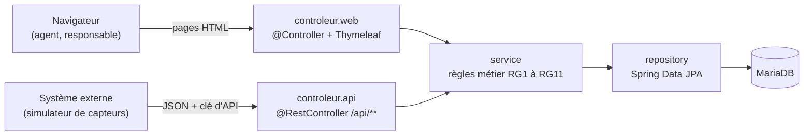
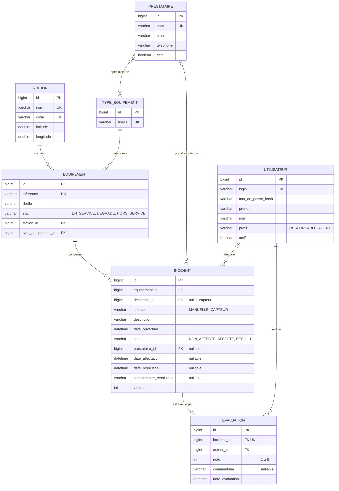

# Journal — Downlyzer (ALTN72, 2026-27)

> Supervision d'équipements et suivi d'incidents sur un réseau de transport.

**Groupe :** Ibrahim GHELLAB, Prénom NOM

---

## README

### Prérequis
- Java 21
- Maven 3.9+ (ou le wrapper `./mvnw` fourni)
- MariaDB : développé et testé avec MariaDB 10.4 (XAMPP) ; version 10.6 ou plus recommandée (voir Limites connues)
- Spring Boot 4.1.1 (même pile que le TP fil rouge)

### Initialiser la base de données
1. Créer la base, son schéma et les données de démonstration (en `root`) :
   ```bash
   mariadb -u root -p < db/create.sql
   ```
   Le script recrée la base `downlyzer` en quelques secondes. Il peut aussi être importé depuis phpMyAdmin (onglet Importer).

2. Créer un compte dédié à l'application, limité aux données de cette base :
   ```sql
   CREATE USER 'downlyzer_app'@'localhost' IDENTIFIED BY 'un_mot_de_passe';
   GRANT SELECT, INSERT, UPDATE, DELETE ON downlyzer.* TO 'downlyzer_app'@'localhost';
   ```
   L'application n'a ni droit global, ni droit de modifier la structure des tables : seul le script, lancé en `root`, les crée.

Les dates des incidents sont calculées par rapport à l'instant d'exécution du script (`NOW() - INTERVAL 47 HOUR`, etc.) : **relancer le script juste avant une démonstration** pour que les cas limites (47 h, 48 h, 72 h) restent exacts.

### Configuration
Aucun secret n'est versionné. Variables d'environnement à définir avant le lancement (dans IntelliJ : *Run → Edit Configurations → Modify options → Environment variables*, sans cocher « Store as project file ») :

| Variable | Rôle | Obligatoire |
|---|---|---|
| `DB_USERNAME` | utilisateur MariaDB (ex. `downlyzer_app`) | oui |
| `DB_PASSWORD` | mot de passe de cet utilisateur | oui |
| `DB_URL` | URL JDBC ; par défaut `jdbc:mariadb://localhost:3306/downlyzer` | non |
| `DOWNLYZER_API_KEY` | clé d'accès à l'API REST pour les systèmes externes (piste 8) | à venir |

Sans `DB_USERNAME` ou `DB_PASSWORD`, l'application refuse de démarrer (`Could not resolve placeholder`).

### Lancer l'application
```bash
mvn spring-boot:run
```
Puis ouvrir http://localhost:8080. Documentation de l'API : http://localhost:8080/swagger-ui.html

### Comptes de test

| Profil | Login | Mot de passe |
|---|---|---|
| Responsable d'exploitation | `claire.martin` | `Supervision2026!` |
| Agent de station | `karim.dupont` | `Terrain2026!` |

Les mots de passe sont stockés hachés en BCrypt dans la base.

### Données de démonstration
- 6 stations, 5 types d'équipement, 16 équipements, 5 prestataires.
- Incidents non affectés couvrant tous les cas limites de RG3 : 2 h, 47 h, 47 h 59 (vert) ; 48 h pile, 60 h, 71 h 59 (orange) ; 72 h pile, 5 jours (rouge).
- 3 incidents affectés, dont un ouvert depuis 80 h (il ne doit pas apparaître en rouge, RG4).
- 9 incidents résolus sur les 4 dernières semaines, dont un résolu sans prestataire (non évaluable) et deux résolus pas encore évalués (pour démontrer F10).
- Plusieurs incidents déclarés par un capteur (`source = CAPTEUR`, sans déclarant).

### Application déployée
- URL : *à compléter*

### Limites connues
- Le script de données utilise `NOW()` de MariaDB et l'application l'heure de la JVM : les deux doivent être dans le **même fuseau horaire**, sinon les seuils sont décalés (un incident de 47 h pourrait apparaître orange).
- MariaDB 10.4 (fournie par XAMPP) n'est plus officiellement prise en charge par Hibernate 7, qui affiche un avertissement au démarrage (minimum 10.6). L'application fonctionne, mais le serveur de déploiement doit utiliser une version récente.
- *À compléter au fil du projet.*

---

## ARCHITECTURE

- Dépôt : https://github.com/ibrahimghellab/Downlyzer

### Architecture applicative



Le même service est appelé par les deux types de contrôleurs : la logique métier n'est écrite qu'une fois.

Organisation des packages (`fr.efrei.downlyzer`) :

| Package | Contenu |
|---|---|
| `modele` | entités JPA et énumérations |
| `repository` | interfaces Spring Data JPA |
| `exception` | exceptions métier (`ExceptionMetier` et ses sous-classes) |
| `service` | règles de gestion RG1 à RG11 *(à venir)* |
| `controleur.web` | pages Thymeleaf et leur gestionnaire d'erreurs *(à venir)* |
| `controleur.api` | API REST et son gestionnaire d'erreurs *(à venir)* |

- **`controleur.web`** : les pages de l'application, utilisées par les deux profils. Après une modification, redirection (Post/Redirect/Get) ; en cas d'erreur, une page lisible avec le bon code HTTP.
- **`controleur.api`** : l'API REST destinée au monde extérieur (F12 et piste 8). Elle expose une partie seulement de la logique métier, renvoie du JSON (DTO, jamais les entités) et des codes HTTP adaptés (200, 201, 204, 400, 404, 409).

| Endpoint | Usage | Codes |
|---|---|---|
| `POST /api/incidents` | un capteur déclare une panne (par référence d'équipement) | 201, 400, 404, 409 |
| `GET /api/incidents` | consulter les incidents | 200 |
| `GET /api/incidents/{id}` | consulter un incident | 200, 404 |
| `PATCH /api/incidents/{id}/resolution` | signaler le retour en service | 204, 404, 409 |

### Modèle de données



Choix de modélisation :
- **L'indicateur vert / orange / rouge n'est pas stocké** : il est calculé à partir de l'heure courante (RG3). La durée d'ouverture et la note moyenne d'un prestataire sont elles aussi calculées.
- **Le statut est stocké** (enum) pour la lisibilité des requêtes, et sa cohérence est garantie à deux niveaux : il n'est modifié que par des méthodes métier (`affecter()`, `resoudre()`), et une contrainte `CHECK` en base refuse toute combinaison incohérente (filet de sécurité de RG10).
- **`source` et `declarant_id` nullable** : un incident peut être déclaré par un capteur via l'API (piste 8), qui n'est pas un utilisateur humain.
- **`date_affectation`** : permet d'afficher depuis quand un incident est pris en charge et de mesurer les délais.
- **`version`** : verrouillage optimiste (`@Version`) contre les modifications concurrentes d'un même incident.
- **`prestataire_specialite`** : relie les prestataires aux types d'équipement sur lesquels ils interviennent (statistiques, et aide à l'affectation si le temps le permet).
- **Coordonnées des stations** : nécessaires à la cartographie (piste 4).

Contraintes en base :

| Contrainte | Règle |
|---|---|
| `UNIQUE (equipement.reference)` | RG9 |
| `UNIQUE (evaluation.incident_id)`, `CHECK (note BETWEEN 1 AND 5)` | RG8 |
| `CHECK (date_resolution >= date_ouverture)` | RG5 |
| `NOT NULL` sur `equipement_id`, `date_ouverture`, `statut` | RG1 |
| `CHECK` de cohérence statut / prestataire / dates | RG2 |
| `UNIQUE (utilisateur.login)` | F1 |

Ces contraintes ne remplacent pas les contrôles de la couche service : elles évitent seulement qu'une erreur de programmation laisse la base dans un état incohérent.

---

## TESTS

- Stratégie : *à compléter*
- Commande : `mvn verify`
- Couvert : *à compléter* | Non couvert : *à compléter*

---

## CHOIX TECHNIQUES

### Profils et droits

Deux profils :
- **Responsable d'exploitation** : pilote le réseau, décide des affectations, valide les résolutions, évalue les prestataires et supervise la situation.
- **Agent de station** : présent sur le terrain, consulte les équipements et signale les pannes.

| N° | Fonctionnalité | Responsable d'exploitation | Agent de station |
|---|---|---|---|
| F2–F3 | Consulter équipements et fiches | Accès complet | Accès complet |
| F4 | Déclarer un incident | Accès complet | Accès complet |
| F5–F6 | Consulter / modifier un incident | Accès complet | Consultation ; modification de la description tant que l'incident n'est pas affecté |
| F7 | Affecter ou réaffecter un prestataire | Accès complet | Interdit |
| F8 | Déclarer un incident résolu | Accès complet | Interdit |
| F9 | Consulter l'historique | Accès complet | Lecture seule |
| F10 | Évaluer un prestataire | Accès complet | Interdit |
| F11 | Tableau de bord | Accès complet | Interdit |
| Alpha 2 et 4 | Page de supervision (graphiques, carte) | Accès complet | Interdit |

Justification :
- La résolution est réservée au responsable, car c'est elle qui ouvre l'évaluation du prestataire (RG8) : elle revient à celui qui gère les prestataires.
- L'agent peut préciser sa description tant que personne n'a pris l'incident en charge ; ensuite, le prestataire travaille sur une description stable.
- Les systèmes externes (capteurs) ne sont pas un profil de l'application : ils accèdent uniquement à `/api/**`, avec une clé d'API.
- Toutes les restrictions sont appliquées côté serveur (RG11) : par Spring Security pour l'accès aux routes, et dans la couche service pour les règles dépendant de l'état de l'incident.

### Deux types de contrôleurs
Les pages de l'application et l'API REST sont séparées en deux packages (`controleur.web` et `controleur.api`) :
- elles ne servent pas les mêmes clients (un humain dans un navigateur / un programme) ;
- elles ne répondent pas de la même manière (vue et redirection / JSON et codes HTTP) ;
- elles ne sont pas sécurisées de la même manière (formulaire de connexion et session / clé d'API sans session, réponse 401 en JSON) ;
- chacune a son propre gestionnaire d'exceptions, ciblé par package.

Une création depuis un formulaire renvoie une redirection (302, Post/Redirect/Get) et non un 201 : un navigateur ne suit pas l'en-tête `Location` d'un 201, et un rafraîchissement de la page renverrait le formulaire. Le 201 est réservé à l'API.

Les transitions d'état passent par des requêtes POST vers des URL d'action (`/incidents/{id}/affectation`, `/incidents/{id}/resolution`) plutôt que par PUT/DELETE simulés avec un champ caché : chaque action métier a sa propre adresse, et le `HiddenHttpMethodFilter` du TP n'est plus nécessaire.

### Configuration et accès à la base
- **Aucun secret dans le dépôt** (§7.7) : les identifiants de connexion sont lus dans des variables d'environnement (`${DB_USERNAME}`, `${DB_PASSWORD}`). Seule l'URL a une valeur par défaut, car elle n'est pas secrète.
- **Compte dédié à privilèges minimaux** : l'application se connecte avec `downlyzer_app`, qui n'a que `SELECT`, `INSERT`, `UPDATE` et `DELETE` sur `downlyzer`. Une faille dans l'application ne permettrait ni de supprimer des tables, ni de lire les autres bases du serveur.
- **`spring.jpa.hibernate.ddl-auto=validate`** : le schéma est créé uniquement par `db/create.sql`. Au démarrage, Hibernate vérifie que les entités correspondent aux tables, sans jamais modifier la base ; une erreur de mapping bloque le démarrage au lieu de passer inaperçue.
- **`spring.web.error.include-message` retiré** : utile pendant le TP, ce réglage pourrait afficher à l'écran le message d'une exception technique. Les messages destinés à l'utilisateur passent par le gestionnaire d'erreurs.

### Modèle de données en Java
- **Les entités simples** (`Station`, `TypeEquipement`, `Equipement`, `Prestataire`, `Utilisateur`, `Evaluation`) suivent le modèle JavaBean du TP : annotations JPA explicites, getters et setters. Exception : **aucun `setId()`**, car l'identifiant est attribué par la base ; le modifier pourrait faire écraser une autre ligne.
- **`Incident` n'expose pas de setters pour son état.** C'est la seule entité dont l'état obéit à des règles de gestion. Il est créé par `declarerManuellement(...)` ou `declarerParCapteur(...)`, qui garantissent RG1 (équipement et date d'ouverture obligatoires, statut `NON_AFFECTE`, aucun prestataire). Il évolue uniquement par `affecter()`, `resoudre()` et `modifierDescription()`, qui vérifient RG2 et RG5 et lèvent une `TransitionInterditeException` en cas de transition interdite. Ces règles sont donc écrites une seule fois, quelle que soit la porte d'entrée (pages, API, capteurs), et le statut, le prestataire et les dates changent toujours ensemble.
- **Les règles qui dépendent du profil connecté restent dans le service** : `Incident` interdit toute modification de la description une fois résolu, mais la règle « l'agent ne la modifie que tant que l'incident n'est pas affecté » sera vérifiée par le service, qui connaît l'utilisateur.
- **Un setter qui contiendrait une règle a été écarté** : son nom annoncerait un simple rangement de valeur alors qu'il refuserait ou modifierait d'autres champs, et l'ordre d'appel des setters deviendrait une règle cachée.
- **L'heure courante est passée en paramètre** des méthodes d'`Incident` : elle est fournie par le service à partir d'une horloge injectée (`Clock`), ce qui rend les règles testables.
- **Les énumérations sont stockées en texte** (`@Enumerated(EnumType.STRING)`) : ajouter une valeur à une énumération ne décale pas les données déjà enregistrées.
- **Relations à sens unique et chargement paresseux** (`FetchType.LAZY`) : `Equipement` connaît sa `Station`, mais `Station` n'a pas de liste d'équipements ; les listes sont obtenues par des requêtes du repository. On évite ainsi les chargements inutiles et les boucles lors de la conversion en JSON.

### Exceptions
- Exceptions métier personnalisées, non vérifiées, héritant d'une classe mère abstraite `ExceptionMetier` (fiche *Gestion des exceptions*), avec des messages en français qui indiquent l'objet concerné et la raison : `TransitionInterditeException` pour l'instant.
- Traduction en réponses HTTP : choix de `@ControllerAdvice`, un gestionnaire par package de contrôleurs (pages / API). *Justification détaillée à compléter lors de la mise en place.*

### SOLID
*À compléter* (principe(s) appliqué(s) : où, pourquoi ; principes écartés : pourquoi).

### Requête SQL native
*À compléter* (où, analyse critique).

### @Transactional
*À compléter* (où, pourquoi).

### Points métier à trancher
- Déclarer un incident fait-il passer l'équipement hors service, et la résolution le remet-elle en service ? (si oui : opération sur deux tables, donc transactionnelle).
- Un capteur qui signale une panne sur un équipement ayant déjà un incident actif : 409 Conflict, ou renvoi de l'incident existant ?
- `spring.jpa.open-in-view` : le laisser actif (les relations paresseuses se chargent pendant l'affichage des pages) ou le désactiver (chaque service charge explicitement ce dont la vue a besoin, par exemple avec `JOIN FETCH`) ?
---

## LOT ALPHA

Fonctionnalités retenues : pistes **8** et **2**. La piste **4** est une réalisation supplémentaire.

### Fonctionnalité transverse 1 : source de données externe (piste 8)
- **Besoin** : des capteurs installés sur les équipements déclarent automatiquement les pannes, sans intervention humaine.
- **Périmètre envisagé** : endpoint `POST /api/incidents` sécurisé par clé d'API ; l'équipement est désigné par sa référence (le capteur ne connaît pas l'identifiant technique) ; un client de test simule plusieurs capteurs qui envoient des pannes.
- Choix et essais : *à compléter*
- Ce qui fonctionne : *à compléter*
- Difficultés : *à compléter*
- Reste à faire : *à compléter*

### Fonctionnalité transverse 2 : visualisation des données (piste 2)
- **Besoin** : donner au responsable d'exploitation une vue d'ensemble de l'activité.
- **Périmètre envisagé** : répartition des incidents par station et par type d'équipement, évolution des délais de résolution, note moyenne des prestataires. Les agrégations sont faites côté serveur (repository et service) ; le front ne fait qu'afficher.
- Choix et essais : *à compléter*
- Ce qui fonctionne : *à compléter*
- Difficultés : *à compléter*
- Reste à faire : *à compléter*

### Réalisation supplémentaire : cartographie du réseau (piste 4)
- **Besoin** : voir d'un coup d'œil où se trouvent les problèmes sur le réseau.
- **Périmètre envisagé** : carte des stations (Leaflet + OpenStreetMap) ; la couleur de chaque station est calculée par le service à partir de ses incidents actifs, avec la même logique que RG3 ; un clic sur une station mène à ses équipements (F2).
- Choix et essais : *à compléter*
- Ce qui fonctionne : *à compléter*
- Difficultés : *à compléter*
- Reste à faire : *à compléter*

---

## BILAN

- Contribution de chacun : *à compléter*
- Plus grande difficulté et comment elle a été surmontée : *à compléter*
- Fonctionnalités non réalisées et pourquoi : *à compléter*
- Trois points à retenir du cours et du projet : *à compléter*